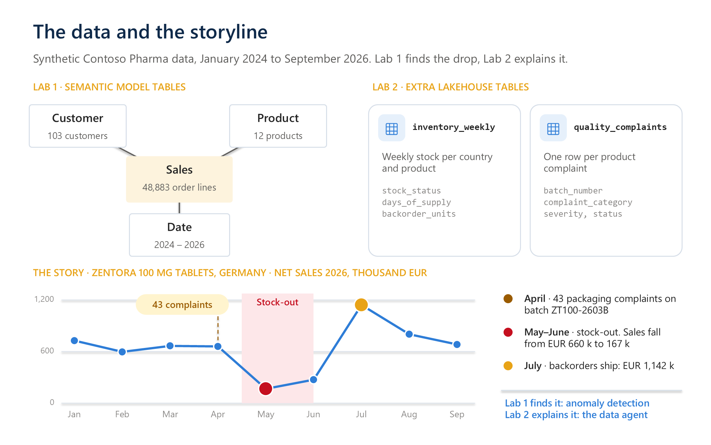

# Contoso Pharma lab data

Synthetic data for both labs. All company, product, customer and batch names are invented. Customer names are generic labels made of a city and a customer type; they don't refer to real organizations. Any resemblance to real products or organizations is coincidental.

Regenerate the files with `python scripts/generate_data.py`. The seed is fixed, so the output is always identical. To refresh the expected answers, run `python scripts/build_answer_key.py`.

The same tables also come as **Parquet** files in [`parquet`](parquet). Parquet keeps the column types (dates, decimal amounts, whole numbers), so the instructor uploads these to the lakehouse and uses **Load to tables** ([setup, step 4](../setup/README.md#4-create-the-lakehouse-and-upload-the-data)). To recreate them from the CSV files, run `python scripts/export_parquet.py` (needs `pip install pyarrow`).

## Tables

| Table | Rows | Used in | Grain |
| --- | ---: | --- | --- |
| `fact_sales` | 48,883 | Lab 1 semantic model | One order line (January 2024 to September 2026) |
| `dim_customer` | 103 | Lab 1 semantic model | One hospital, clinic, pharmacy or wholesaler |
| `dim_product` | 12 | Lab 1 semantic model | One product (pack) |
| `dim_date` | 1,096 | Lab 1 semantic model | One calendar day (2024-01-01 to 2026-12-31) |
| `inventory_weekly` | 23,730 | Lab 2 data agent (lakehouse) | One country + product + week |
| `quality_complaints` | 1,273 | Lab 2 data agent (lakehouse) | One product quality complaint |

The two lab 2 tables are not in the semantic model. They repeat product and country names so that the data agent can query them without joins.

## Columns

### fact_sales

| Column | Type | Description |
| --- | --- | --- |
| `sales_line_id` | integer | Unique order line ID |
| `order_date` | date | Order date. Relates to `dim_date[date]` |
| `customer_key` | integer | Relates to `dim_customer[customer_key]` |
| `product_key` | integer | Relates to `dim_product[product_key]` |
| `channel` | text | `Direct`, `Wholesale` or `Tender` |
| `units` | integer | Packs sold |
| `unit_price_eur` | decimal | Country list price per pack, EUR |
| `gross_sales_eur` | decimal | `units` × `unit_price_eur` |
| `discount_eur` | decimal | Discount and rebates, EUR |
| `net_sales_eur` | decimal | `gross_sales_eur` − `discount_eur` |

### dim_customer

| Column | Description |
| --- | --- |
| `customer_key` | Unique customer ID |
| `customer_name` | Customer name, for example *Berlin Teaching Hospital* |
| `customer_type` | `Hospital`, `Specialty Clinic`, `Retail Pharmacy` or `Wholesaler` |
| `city`, `country`, `country_code` | Location. 14 European countries |
| `sales_region` | `DACH`, `Western Europe`, `Southern Europe`, `Nordics` or `UK & Ireland` |
| `key_account` | `Yes` or `No` |

### dim_product

| Column | Description |
| --- | --- |
| `product_key` | Unique product ID |
| `product_name` | Product and strength, for example *Zentora 100 mg tablets* |
| `brand` | Zentora, Onkivex, Immunara, Neurovanta, Cardiqa, Ocularis or Viraquel |
| `therapeutic_area` | Oncology, Immunology, Neuroscience, Cardiovascular, Ophthalmology or Infectious Diseases |
| `formulation` | Tablet, Capsule, Infusion, Pre-filled pen or Intravitreal injection |
| `launch_date` | Launch date |
| `list_price_eur` | Reference list price per pack, EUR |

### dim_date

`date`, `year`, `quarter` (Q1–Q4), `year_quarter` (2026-Q2), `month_number` (1–12), `month_name` (January), `year_month` (2026-05), `month_start_date`, and `week_ending_date` (the Sunday of that week).

### inventory_weekly

| Column | Description |
| --- | --- |
| `week_ending_date` | Sunday of the snapshot week |
| `country`, `country_code` | Country of the distribution centre |
| `product_name`, `brand`, `therapeutic_area` | Product |
| `stock_units` | Packs on hand at week end |
| `avg_weekly_demand_units` | Expected weekly demand, packs |
| `days_of_supply` | Stock divided by daily demand |
| `backorder_units` | Packs ordered but not delivered |
| `stock_status` | `OK` (21+ days), `Low` (under 21 days) or `Stock-out` (no stock) |

### quality_complaints

| Column | Description |
| --- | --- |
| `complaint_id` | Unique ID, for example `QC-2026-01015` |
| `received_date` | Date the complaint was received |
| `country`, `country_code` | Country where the complaint was raised |
| `product_name`, `brand`, `therapeutic_area` | Product |
| `batch_number` | Manufacturing batch, for example `ZT100-2603B` |
| `complaint_category` | Packaging, Product appearance, Labeling, Shipping damage, Device malfunction or Missing leaflet |
| `description` | Short free text |
| `severity` | `Minor`, `Major` or `Critical` |
| `status`, `closed_date`, `days_to_close` | Handling status |

## Storyline built into the data

| When | What happens | Where you see it |
| --- | --- | --- |
| February 2025 | One-off hospital tender for *Onkivex 400 mg infusion* in France (about 9 times a normal month) | Lab 1: anomaly detection, positive spike |
| From July 2025 | *Cardiqa* faces price pressure. Units decline and discounts rise | Lab 1: key influencers, decomposition tree |
| Every winter | *Viraquel* (antiviral) demand peaks December to February | Lab 1: forecast seasonality |
| 30 March – 28 April 2026 | 46 packaging complaints ("blister seal not intact") on batch `ZT100-2603B` of *Zentora 100 mg tablets* in Germany | Lab 2: lakehouse table `quality_complaints` |
| Weeks ending 3 May – 14 June 2026 | Germany is out of stock of *Zentora 100 mg tablets* (batch quarantined) | Lab 2: lakehouse table `inventory_weekly` |
| May–July 2026 | Net sales of *Zentora 100 mg tablets* in Germany drop from EUR 660 k (April) to EUR 167 k (May), then spike to EUR 1,142 k in July as backorders ship | Lab 1: anomaly detection. Lab 2: the data agent explains the drop |

Expected answers are in [`../lab-02-data-agent/testing/answer-key.csv`](../lab-02-data-agent/testing/answer-key.csv). Expected measure values are in [`../lab-01-semantic-model/expected-values.csv`](../lab-01-semantic-model/expected-values.csv).
