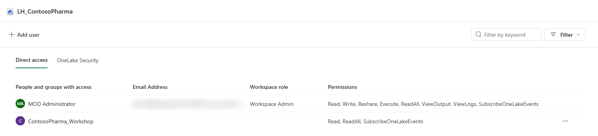
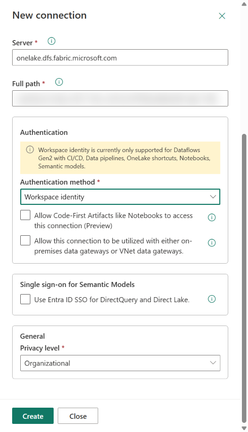
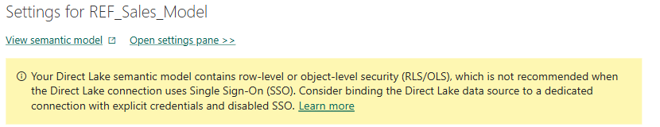
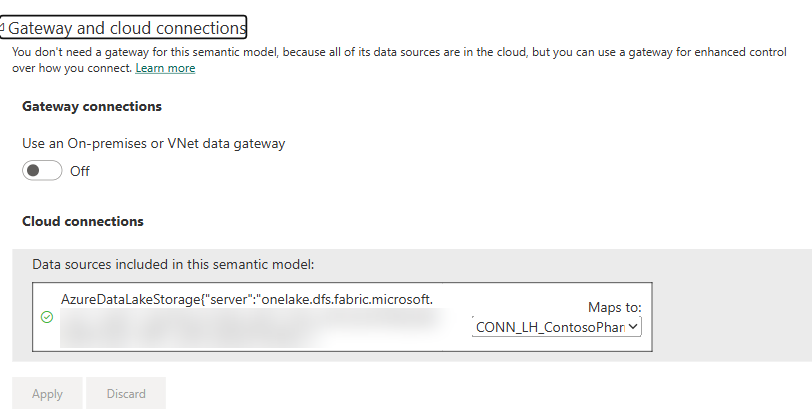
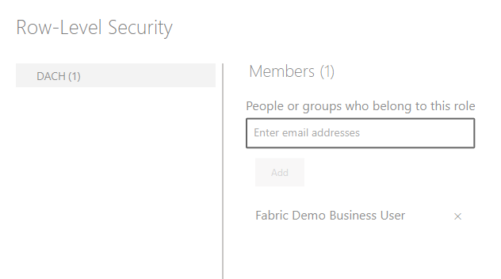

# Security and governance for both labs

What protects the semantic model, the report and the data agent, and how to show it in 10 minutes.

## 1. Access model

| Layer | In this workshop | Key fact | Source |
| --- | --- | --- | --- |
| Workspace roles | One workspace. Participants are **Contributors** | Contributors can create, change and delete any item in the workspace, including the shared lakehouse. Viewers can only read | [Roles in workspaces](https://learn.microsoft.com/fabric/fundamentals/roles-workspaces) |
| Semantic model through an agent | Read on the model | **Read** is enough to query a model through a data agent. Build or Write is needed only to change the model or use Prep for AI | [Publish and share data agents](https://learn.microsoft.com/fabric/data-science/data-agent-sharing) |
| Lakehouse behind the Direct Lake model | Contributor role in the workspace; `REF_Sales_Model` and `P01_Sales_Model` use a fixed identity | With the default SSO, a Direct Lake model reads the lakehouse as the signed-in user, so everyone who queries it needs **Read** and **ReadAll** on the lakehouse. With a fixed-identity connection, readers need no lakehouse access ([section 2](#rls-that-holds-fixed-identity)) | [Direct Lake security](https://learn.microsoft.com/fabric/fundamentals/direct-lake-security-integration#permission-requirements), [Lakehouse sharing](https://learn.microsoft.com/fabric/data-engineering/lakehouse-sharing) |
| Lakehouse through an agent | Contributor role in the workspace | **Read** on the lakehouse item (and table access, if it's enforced) | [Publish and share data agents](https://learn.microsoft.com/fabric/data-science/data-agent-sharing) |
| Data agent sharing | Share with **View details** | Default: query the published version only. **View details**: see the configuration. **Edit and view details**: change it. These options apply to people without a workspace role; Admins, Members and Contributors can already edit every item | [Publish and share data agents](https://learn.microsoft.com/fabric/data-science/data-agent-sharing), [Roles in workspaces](https://learn.microsoft.com/fabric/fundamentals/roles-workspaces) |
| Copilot on a model | Default setting | **Allow any person with only read permissions to use AI (for example, Copilot, Microsoft's MCP tools) on this model and its related reports** is on by default. It covers Copilot, data agents and the remote MCP tools | [Use Copilot with semantic models](https://learn.microsoft.com/power-bi/create-reports/copilot-semantic-models) |

## 2. Row-level security

- Lab 1 creates the role `DACH` (Customer > Sales Region = DACH).
- **RLS restricts only readers.** It doesn't apply to workspace Admins, Members or Contributors ([Row-level security](https://learn.microsoft.com/fabric/security/service-admin-row-level-security)).
- A data agent runs every query as the signed-in user and honors RLS and CLS ([Publish and share data agents](https://learn.microsoft.com/fabric/data-science/data-agent-sharing)).
- Lakehouse tables can be secured with OneLake security roles, including row and column rules ([OneLake security](https://learn.microsoft.com/fabric/onelake/security/data-access-control-model)). This lab doesn't configure them.

### RLS that holds (fixed identity)

A new Direct Lake model uses single sign-on (SSO): it reads OneLake as the user who runs the query. That has two effects, both verified in the workshop tenant:

- Every reader needs **Read** and **ReadAll** on the lakehouse, so they could read all rows directly in OneLake and bypass the model's RLS. The model settings page warns: *Your Direct Lake semantic model contains row-level or object-level security (RLS/OLS), which is not recommended when the Direct Lake connection uses Single Sign-On (SSO)*.
- **Test as role** returns *Not supported – Test as role does not work with Single Sign-On (SSO)*.

Microsoft's guidance: use semantic model RLS when readers have no permission on the lakehouse and the model uses a cloud connection with a fixed identity ([Integrate Direct Lake security – data-access rule options](https://learn.microsoft.com/fabric/fundamentals/direct-lake-security-integration#data-access-rule-options)). `REF_Sales_Model` and `P01_Sales_Model` are set up that way:

1. **Workspace identity:** **Workspace settings** > **Workspace identity** > **+ Workspace identity** (workspace admin) ([Workspace identity](https://learn.microsoft.com/fabric/security/workspace-identity)).
2. **Give it the lakehouse, nothing else:** `00_Shared` > **…** next to `LH_ContosoPharma` > **Share**. Enter `ContosoPharma_Workshop` (the workspace identity has the workspace name), select **Read all Apache Spark and subscribe to events**, clear **Notify recipients by email**, then **Grant**. The identity needs no workspace role.

   

3. **Create the connection:** **…** next to the model > **Settings** > **<< Open settings page** > **Gateway and cloud connections** > **Maps to** > **Create a connection**. The server and path are filled in. Enter a **Connection name**, set **Authentication method** = **Workspace identity**, keep **Use Entra ID SSO for DirectQuery and Direct Lake** cleared, then select **Create** ([Shareable cloud connection with workspace identity](https://learn.microsoft.com/power-bi/connect-data/service-connect-cloud-data-sources#create-a-shareable-cloud-connection-using-workspace-identity)).

   

4. **Bind the model:** back in **Gateway and cloud connections**, select the new connection in **Maps to**, then **Apply**. The SSO warning disappears.

   

   

5. **Share with readers:** add the readers to the role (**…** > **Security** > `DACH` > add people > **Save**) and share the report with them (**…** > **Manage permissions** > **Direct access** > **Add user**). Don't give them a workspace role or lakehouse access.

   

**Result in the tenant:** **Test as role** on `REF_Sales_Model` opens *Now viewing as: DACH*. A DAX query that impersonates a DACH reader without any lakehouse access returns only Austria, Switzerland and Germany (2025 net sales EUR 80.4 M), while the admin sees all five regions. The Lab 1 expected values still match.

**Why not for participants:** each participant model would need the binding. Participants are Contributors and always see all data, so in the lab they create the role and the trainer shows the effect on `REF_Sales_Model`. To use the connection, a model owner needs the **User** permission on it (**Manage connections and gateways** > **…** > **Manage users**) ([Shareable cloud connections](https://learn.microsoft.com/power-bi/connect-data/service-connect-cloud-data-sources#advantages-of-shareable-cloud-connections)).

## 3. Sensitivity labels

- Apply a label to a model or report: **…** > **Settings** > **Sensitivity label** ([Apply sensitivity labels](https://learn.microsoft.com/fabric/enterprise/powerbi/service-security-apply-data-sensitivity-labels)).
- Manual labelling works for all Fabric items. **Downstream inheritance** is on by default: a report created from a labelled model gets the model's label. Inheritance from data sources currently works for Power BI semantic models only ([Information protection](https://learn.microsoft.com/fabric/governance/information-protection)).
- Sensitivity labels aren't applied to the AI interactions themselves (prompts and responses) in Copilot in Fabric ([Purview for Copilot in Fabric](https://learn.microsoft.com/purview/ai-copilot-fabric)).

## 4. Data loss prevention (DLP)

- Purview DLP policies for Fabric evaluate **semantic models** and **lakehouses** (and other items). Conditions are sensitivity labels and sensitive information types. Actions are a policy tip, alerts, and **Restrict access** (preview) ([DLP for Fabric](https://learn.microsoft.com/purview/dlp-powerbi-get-started)).
- DLP isn't supported for semantic models that use DirectQuery or a live connection. DLP evaluates a lakehouse whenever its data changes ([DLP for Fabric – limitations](https://learn.microsoft.com/purview/dlp-powerbi-get-started)).
- The workshop demo uses a separate lakehouse with synthetic customer bank accounts (IBAN), so the policy tip appears without touching the lab data. Setup, script and screenshots: [purview-demo.md](purview-demo.md).
- Data agents respect Purview DLP and access-restriction policies on their sources ([Data agent concepts](https://learn.microsoft.com/fabric/data-science/concept-data-agent)). DLP for the AI interactions themselves isn't supported for Copilot in Fabric ([Purview for Copilot in Fabric](https://learn.microsoft.com/purview/ai-copilot-fabric)).

## 5. Audit

| Action in the labs | Audit operation | Source |
| --- | --- | --- |
| Edit the model in the web | `ApplyChangeToPowerBIModel`, `GetPowerBIDataModel`, `ApplyQueriesExecution` | [Edit semantic models – audit](https://learn.microsoft.com/power-bi/transform-model/service-edit-data-models#viewing-audit-logs-and-activity-events) |
| Apply or change a label | `SensitivityLabelApplied`, `SensitivityLabelChanged` | [Operation list](https://learn.microsoft.com/fabric/admin/operation-list) |
| Use Copilot or a data agent | `CopilotInteraction` (prompt and response) | [Operation list](https://learn.microsoft.com/fabric/admin/operation-list), [Data agent audit](https://learn.microsoft.com/fabric/data-science/data-agent-purview-governance) |

Search them in the Microsoft Purview portal under **Audit**, or in DSPM **Activity explorer**.

## 6. DSPM for AI (Data Security Posture Management)

- **Scope:** Copilot for Power BI is supported (all prompts and text responses). Other Copilot experiences in Fabric, and **Fabric data agents**, are in **preview** ([Purview for Copilot in Fabric](https://learn.microsoft.com/purview/ai-copilot-fabric)).
- **Setup:**
  - DSPM setup task **Activate Microsoft Purview Audit**
  - setup task **Secure interactions in Microsoft Copilot experiences**
  - Fabric tenant setting **Allow Microsoft Purview to secure AI interactions**
  - **pay-as-you-go billing** for Purview, which managing these AI interactions requires ([Purview for Copilot in Fabric](https://learn.microsoft.com/purview/ai-copilot-fabric))

  Source: [Data agent audit](https://learn.microsoft.com/fabric/data-science/data-agent-purview-governance).
- **What's captured:** the user prompt and the agent response, as `CopilotInteraction` records in the unified audit log. Internal steps and backend queries aren't captured ([Data agent audit](https://learn.microsoft.com/fabric/data-science/data-agent-purview-governance)).
- **Also supported** for AI interactions: Insider Risk Management, Communication Compliance, eDiscovery and retention policies ([Purview for Copilot in Fabric](https://learn.microsoft.com/purview/ai-copilot-fabric)).
- **Data risk assessments for Fabric:** DSPM scans Fabric workspaces for sensitive items and oversharing after a one-time connection (app registration with a federated credential, a security group, and two Fabric admin API settings). Step by step: [purview-demo.md](purview-demo.md#connect-dspm-to-fabric-for-data-risk-assessments).

## 7. Tenant, residency and capacity settings

- **Users can use Copilot and other features powered by Azure OpenAI** is required for Copilot and data agents ([Data agent tenant settings](https://learn.microsoft.com/fabric/data-science/data-agent-tenant-settings)).
- With a capacity in the EU Data Boundary, Copilot data is processed in the EU, and the cross-geo settings aren't needed ([Copilot in Fabric – regions](https://learn.microsoft.com/fabric/fundamentals/copilot-fabric-overview#available-regions)).
- Data agent conversation history is kept for up to 28 days unless the user clears the chat ([Data agent tenant settings](https://learn.microsoft.com/fabric/data-science/data-agent-tenant-settings)).
- If a data agent is used from outside Fabric (Microsoft 365 Copilot, Copilot Studio, Foundry, MCP), its responses may leave Fabric's compliance boundary ([Data agent tenant settings](https://learn.microsoft.com/fabric/data-science/data-agent-tenant-settings)).
- A data agent can't query a source whose capacity is in a different region from the agent's capacity ([Data agent concepts](https://learn.microsoft.com/fabric/data-science/concept-data-agent)).
- A **Fabric Copilot capacity** bills the Copilot and data agent usage of chosen users to one capacity ([Fabric Copilot capacity](https://learn.microsoft.com/fabric/enterprise/fabric-copilot-capacity)).

## 8. Instructor demo script (10 minutes)

Prepare this the day before ([setup, step 6](../setup/README.md#6-prepare-the-security-demos)). For the full Purview part, with screenshots of every screen, use [purview-demo.md](purview-demo.md).

1. **RLS through the agent (3 min):** in an InPrivate window, sign in as the test user (member of role `DACH`, not a workspace member). Open `REF_Sales_Agent` and ask *"What were net sales in France in 2025?"*, then *"Show net sales by country for 2025."* Only Germany, Austria and Switzerland appear.
2. **Labels (1 min):** show the **Sensitivity** column in the workspace. Show that `REF_Sales_Report` inherited the model's label.
3. **DLP (2 min):** open `GOV` > `LH_Customer_Finance` and show the policy tip, then the policy in Purview ([purview-demo.md, part 1](purview-demo.md#1-dlp-finds-bank-data-in-a-lakehouse)).
4. **DSPM for AI (2 min):** in **Activity explorer** > **AI activities**, open one data agent interaction and show the prompt and the response ([purview-demo.md, part 2](purview-demo.md#2-dspm-shows-what-people-ask-the-ai)).
5. **Audit (2 min):** in Purview **Audit**, search the last 24 hours for `CopilotInteraction` and `ApplyChangeToPowerBIModel`. Use records from the dry run, because audit data isn't instant.
