# Purview demo: DLP and DSPM for Fabric, click by click

A 15-minute instructor demo that shows how Microsoft Purview protects the data behind the labs and watches the AI on top of it. Every screenshot comes from the workshop tenant.

| Part | What the audience sees | Minutes |
| --- | --- | ---: |
| [1. DLP finds bank data in a lakehouse](#1-dlp-finds-bank-data-in-a-lakehouse) | A policy tip on a Fabric lakehouse, the policy behind it, the alert | 5 |
| [2. DSPM shows what people ask the AI](#2-dspm-shows-what-people-ask-the-ai) | Data agent conversations on their own, then Copilot answers flagged for medical terms | 5 |
| [3. DSPM data risk assessment for Fabric](#3-dspm-data-risk-assessment-for-fabric) | Oversharing of sensitive Fabric items | 3 |
| [4. Audit](#4-audit) | The same interactions as audit records | 2 |

## What you need

| Item | Where it comes from | Ready how long before the demo |
| --- | --- | --- |
| Folder `GOV` with lakehouse `LH_Customer_Finance` and table `customer_bank_accounts` | [Seed the demo data](#seed-the-demo-data) | 1 hour (DLP evaluation) |
| DLP policy *Workshop - Fabric customer bank data* | [scripts/create-dlp-policy.ps1](scripts/create-dlp-policy.ps1) | 1 hour |
| DSPM setup tasks done, pay-as-you-go billing on | [Prerequisites for DSPM](#prerequisites-for-dspm) | Once per tenant |
| A few Copilot and data agent conversations | Run Lab 1 and Lab 2 once (dry run). Ask the data agent at least once in Fabric and once through MCP | The day before (audit pipeline) |
| Your account can read prompts and responses | Purview role group **Data Security AI Content Viewers** | 1 hour |
| Fabric connection for data risk assessments | [Connect DSPM to Fabric](#connect-dspm-to-fabric-for-data-risk-assessments) | 4 days for the first default assessment, up to 48 hours for a custom one |

All data is synthetic. The IBANs in `customer_bank_accounts` have valid check digits, so Purview recognizes them, but they don't belong to real accounts ([generate_governance_demo_data.py](../scripts/generate_governance_demo_data.py)).

## Seed the demo data

1. Generate the table: `python scripts/generate_governance_demo_data.py`. It writes `data/governance/customer_bank_accounts.parquet` (103 rows, one per customer).
2. In the workshop workspace, create the folder `GOV`. In it, create the lakehouse `LH_Customer_Finance`. Clear **Lakehouse schemas**.
3. Upload `customer_bank_accounts.parquet` to **Files**, then **…** > **Load to tables** > **New table** ([Load to tables](https://learn.microsoft.com/fabric/data-engineering/load-to-tables)).

The lakehouse is in its own folder and isn't used by the labs. Participants never need to open it.

## Create the DLP policy

Run the script once, as a Compliance Administrator. It needs PowerShell 7 and the ExchangeOnlineManagement module.

```powershell
Install-Module ExchangeOnlineManagement -Scope CurrentUser
./governance/scripts/create-dlp-policy.ps1 -WorkspaceId <workspace-guid> -UserPrincipalName admin@contoso.onmicrosoft.com
```

The policy covers only the workshop workspace. Its rule matches the sensitive information type **International Banking Account Number (IBAN)**, shows a policy tip to the item owner, and sends a high-severity alert ([New-DlpCompliancePolicy](https://learn.microsoft.com/powershell/module/exchangepowershell/new-dlpcompliancepolicy), [New-DlpComplianceRule](https://learn.microsoft.com/powershell/module/exchangepowershell/new-dlpcompliancerule)).

**The same in the portal:** **Data loss prevention** > **Policies** > **Create policy** > **Enterprise applications & devices** > **Custom** > **Custom policy**. Choose only the location **Fabric and Power BI workspaces** and include the workshop workspace. Create a rule with **Content contains** > **Sensitive info types** > *International Banking Account Number (IBAN)*. Turn on **User notifications** and **Incident reports**. DLP policy templates aren't supported for Fabric, so always start from **Custom** ([Create a DLP policy for Fabric](https://learn.microsoft.com/purview/dlp-create-policy-powerbi-cc-numbers), [DLP for Fabric](https://learn.microsoft.com/purview/dlp-powerbi-get-started)).

**When DLP evaluates:** a lakehouse is evaluated when its data changes, for example when you load or overwrite a table. A semantic model is evaluated when it's published or refreshed. DLP doesn't evaluate DirectQuery or live-connection models ([DLP for Fabric](https://learn.microsoft.com/purview/dlp-powerbi-get-started)). After you create the policy, reload the table once so that DLP evaluates it.

## Prerequisites for DSPM

All of these are tenant-wide and are done once ([Data agent audit](https://learn.microsoft.com/fabric/data-science/data-agent-purview-governance), [Purview for Copilot in Fabric](https://learn.microsoft.com/purview/ai-copilot-fabric)):

1. Purview portal > **DSPM** > **Tasks and actions** > **Setup tasks**: complete **Activate Microsoft Purview Audit** and **Secure interactions in Microsoft Copilot experiences**. The second one creates the collection policy *DSPM for AI - Capture interactions for Copilot experiences*, which captures the prompts and responses of Copilot in Fabric and data agents.
2. Pay-as-you-go billing: Purview portal > **Settings** > **Account** shows the linked Azure subscription and *You've successfully consented to the new Purview Business Model*. Managing Copilot in Fabric and data agent interactions requires it ([Enable pay-as-you-go](https://learn.microsoft.com/purview/purview-payg-subscription-based-enablement)).
3. Fabric admin portal > **Tenant settings**: **Allow Microsoft Purview to secure AI interactions** is on (the default).
4. Add the presenter to the role group **Data Security AI Content Viewers** (Purview portal > **Settings** > **Roles and scopes** > **Role groups**), so the prompt and response text is visible.

**Check it in the tenant** (PowerShell, read-only):

```powershell
Connect-IPPSSession -UserPrincipalName admin@contoso.onmicrosoft.com
Get-FeatureConfiguration -FeatureScenario KnowYourData | Format-Table Name, Mode, Enabled
Connect-ExchangeOnline -UserPrincipalName admin@contoso.onmicrosoft.com
Search-UnifiedAuditLog -StartDate (Get-Date).AddDays(-7) -EndDate (Get-Date) -RecordType CopilotInteraction -ResultSize 1000 |
  ForEach-Object { ($_.AuditData | ConvertFrom-Json) } |
  Group-Object AppIdentity, AgentName | Format-Table Count, Name
```

Data agent records have **AppIdentity** `Copilot.Fabric.DataAgent` and **AgentName** `DataAgent`. Copilot in Power BI records have `Copilot.Fabric.CopilotForPowerBI` ([Audit logs for Copilot and AI applications](https://learn.microsoft.com/purview/audit-copilot)).

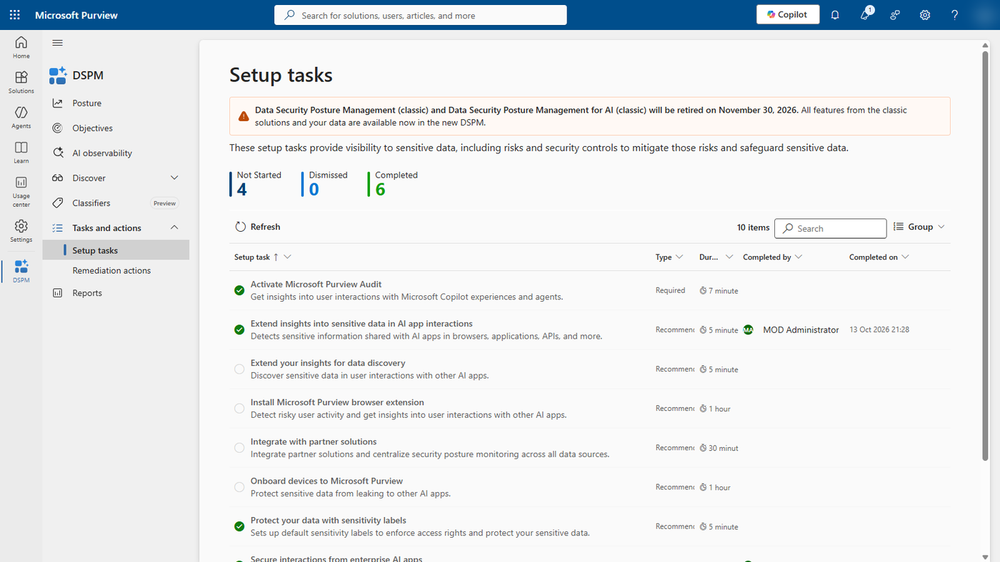

## Connect DSPM to Fabric for data risk assessments

This one-time setup lets DSPM scan Fabric workspaces for oversharing ([Prerequisites for Fabric data risk assessments](https://learn.microsoft.com/purview/dspm-for-ai-considerations#prerequisites-for-fabric-data-risk-assessments), [Enable service principal authentication for admin APIs](https://learn.microsoft.com/fabric/admin/enable-service-principal-admin-apis)):

1. Purview portal > **DSPM** > **Discover** > **Data risk assessments** > **Fabric** tab > **Set config**. Keep **Federated Credentials** selected and copy the **OIDC Issuer URL**, **Namespace** and **Service Account Name**.

   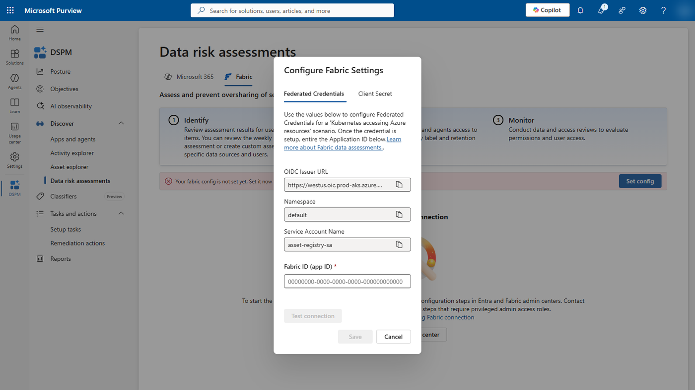

2. In the Microsoft Entra admin center (Application Administrator):
   - create an app registration;
   - under **Certificates & secrets** > **Federated credentials**, add a credential of the scenario *Kubernetes accessing Azure resources*. Use the three values from step 1;
   - create a security group and add the app's service principal to it.
3. In Fabric (Fabric administrator): **Tenant settings** > **Admin API settings**. Turn on **Service principals can access read-only admin APIs** and **Service principals can access admin APIs used for updates**, each for that security group.
4. Back in **Set config**: paste the app's **Application (client) ID** into **Fabric ID (app ID)** > **Test connection** > **Save**.

The page then shows *You have set up connection for Fabric*. The default assessment covers the top 100 workspaces and runs weekly; its first results take up to 4 days.

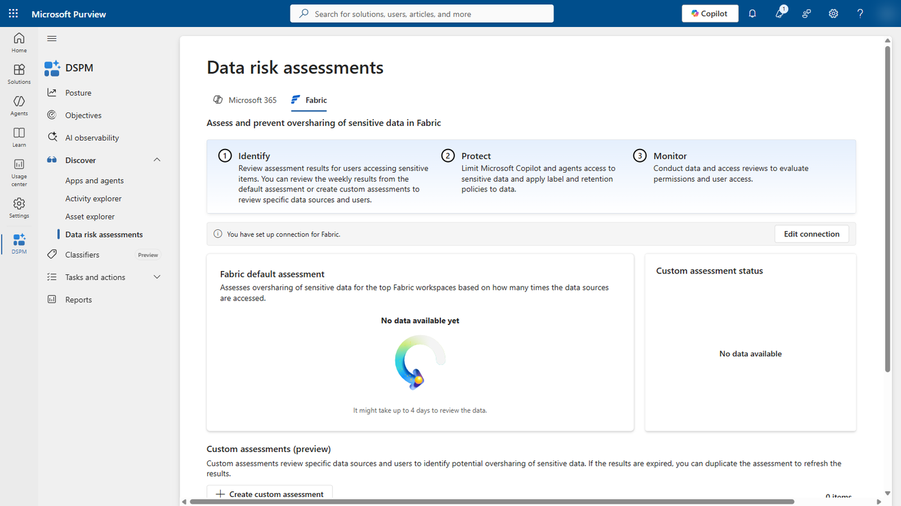

---

## 1. DLP finds bank data in a lakehouse

1. Open the workshop workspace > folder **GOV** > **LH_Customer_Finance**. The header shows **Sensitive info detected**. Select it.

   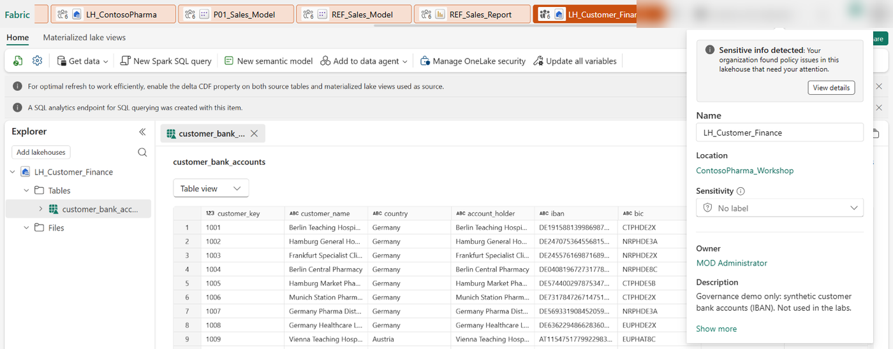

2. Select **View details**. The panel shows the custom policy tip and the detected type, *International Banking Account Number (IBAN)* ([Respond to a DLP policy match](https://learn.microsoft.com/fabric/governance/data-loss-prevention-respond)).

   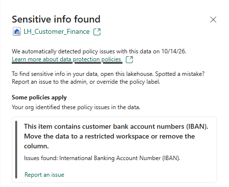

3. Switch to the Purview portal > **Data loss prevention** > **Policies**. Show *Workshop - Fabric customer bank data*: mode **On**, sync **completed**. Select it to show the rule and the location **Fabric and Power BI workspaces**.

   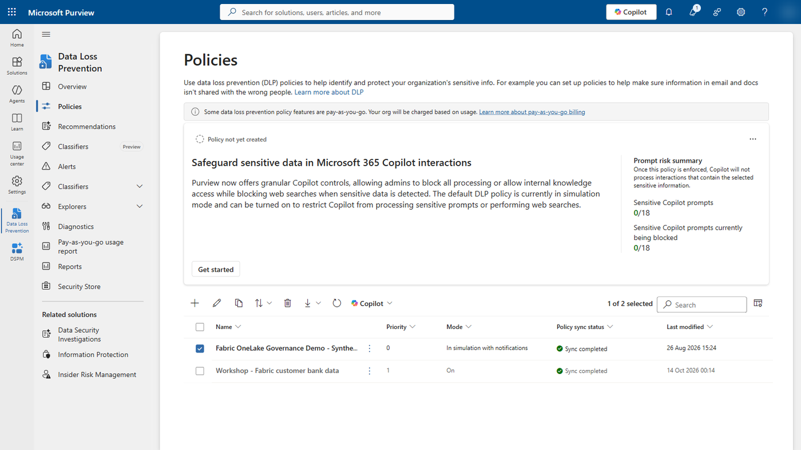

   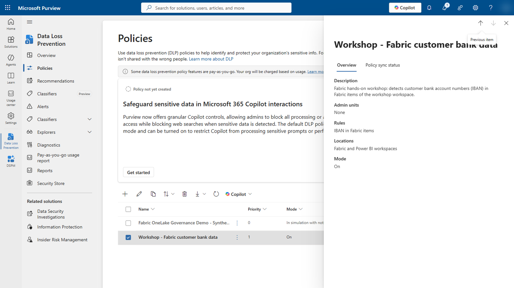

4. **Data loss prevention** > **Alerts**: open the high-severity alert for the lakehouse ([Monitor DLP policy matches in Fabric](https://learn.microsoft.com/fabric/governance/data-loss-prevention-monitor)).

**Say:** the same policy can **restrict access** (preview), so only the owner or people in the organization keep access. A data agent that uses this lakehouse respects the restriction ([DLP for Fabric](https://learn.microsoft.com/purview/dlp-powerbi-get-started), [Data agent concepts](https://learn.microsoft.com/fabric/data-science/concept-data-agent)).

## 2. DSPM shows what people ask the AI

Activity explorer shows Copilot and data agent conversations in one list. Use the **Agents involved** filter to show data agents only.

1. Purview portal > **DSPM** > **Discover** > **Activity explorer** > **AI activities** tab.

   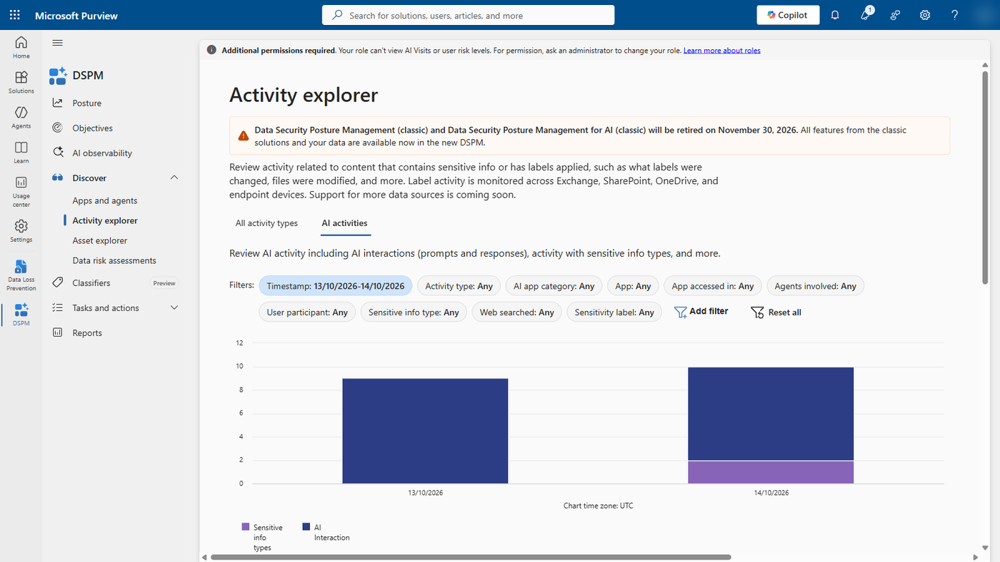

2. **Data agents only:** set **Timestamp** to cover your dry run, then **Agents involved** = **DataAgent** > **Apply**.

   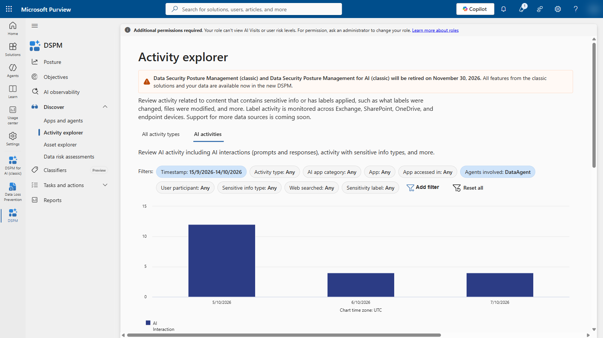

3. Open a row. A data agent record shows **App** = *Copilot in Fabric*, **Agent name** = *DataAgent*, **App accessed in** = where it was used (*MCP* for VS Code and other MCP clients), and under **Resources AI app accessed** the agent, its workspace and its sources.

   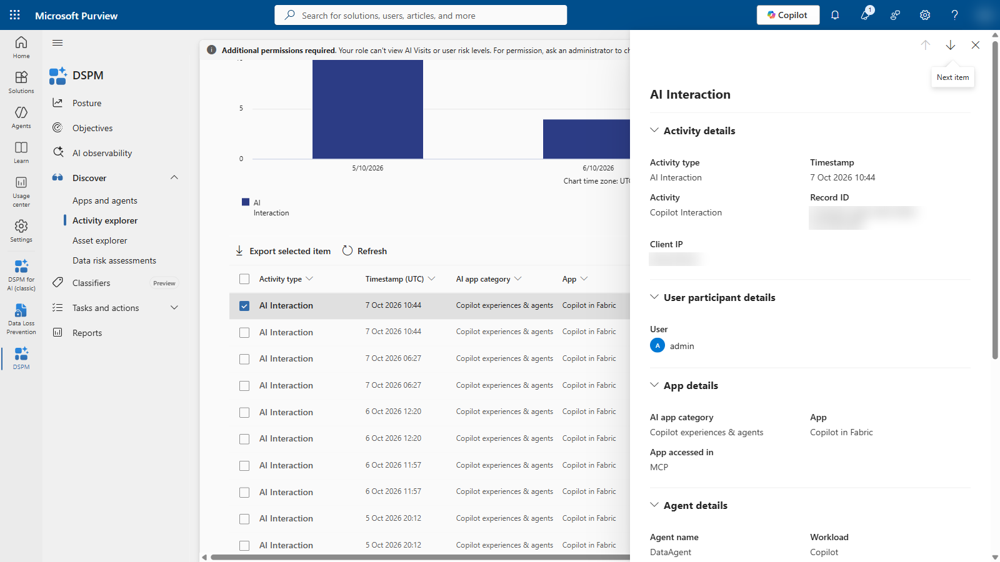

4. **Copilot only, for comparison:** change the filter to **Agents involved** = *PowerBICopilot* (Copilot in Power BI). Open a **Sensitive info types** row. In the workshop tenant it lists **Diseases** and **All Medical Terms And Conditions**: DSPM classified the Copilot answer about therapeutic areas (for example *Infectious Diseases*). Good talking point for a pharma audience: medical terms in AI answers are detected without any configuration.

   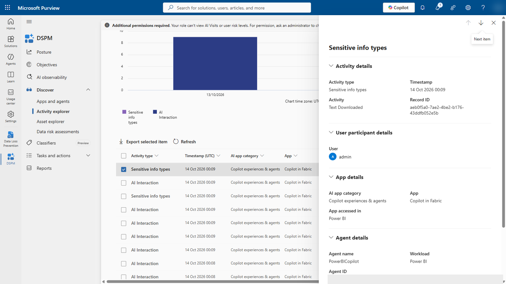

| To show | Filter | Values seen in the workshop tenant |
| --- | --- | --- |
| Data agents only | **Agents involved** | *DataAgent* |
| Copilot in Power BI only | **Agents involved** | *PowerBICopilot* |
| Copilot in Fabric (Fabric AI Hub) | **Agents involved** | *PowerBIMCPServer* |
| Where a data agent was used | **App accessed in** | *MCP* (VS Code, other MCP clients) |
| Microsoft 365 Copilot Chat | **App** | *M365Copilot - Bizchat* |

The Microsoft Learn example shows **App** = *Fabric - DataAgent* and **App accessed in** = *DataScience* or *M365* for data agents ([Data agent audit](https://learn.microsoft.com/fabric/data-science/data-agent-purview-governance)). In the workshop tenant, records showed **App** = *Copilot in Fabric* instead. Filter on **Agents involved** = *DataAgent*: it works in both cases.

**To see the prompt and the response text:** your account needs the Purview role group **Data Security AI Content Viewers** or **Content Explorer Content Viewer**. Without it, a record shows *Permissions needed to view prompts and responses*. Role changes can take up to an hour ([Considerations for DSPM – activity explorer events](https://learn.microsoft.com/purview/data-security-posture-management-considerations#activity-explorer-events-in-data-security-posture-management)).

**Timing and a known gap (preview):** prepare this the day before. In the workshop tenant, data agent records appeared for questions asked through MCP on 5–7 October 2026 (the 20 records in the screenshot). Questions asked to `REF_Sales_Agent` on 13–14 October, through MCP and in the Fabric chat (draft and published), had not produced any record a day later, while Copilot in Power BI records kept arriving. The same tenant settings, capacity and user were used. Check that your own dry-run questions appear before you rely on them; if they don't, show the existing records and say that data agent capture is in preview. The Activity explorer default range is the last day; widen **Timestamp** to include your dry run.

**Say:**
- Prompts and responses of Copilot for Power BI are captured (generally available). Data agents and other Copilot experiences in Fabric are in preview ([Purview for Copilot in Fabric](https://learn.microsoft.com/purview/ai-copilot-fabric)).
- Only what the user sees is captured: the prompt and the response, including generated queries returned to the user. The agent's internal steps and backend queries aren't ([Data agent audit](https://learn.microsoft.com/fabric/data-science/data-agent-purview-governance)).
- DLP doesn't act on the AI conversation itself in Copilot in Fabric. It protects the data sources, as in part 1 ([Purview for Copilot in Fabric](https://learn.microsoft.com/purview/ai-copilot-fabric)).

## 3. DSPM data risk assessment for Fabric

1. **DSPM** > **Discover** > **Data risk assessments** > **Fabric** tab.
2. Show the **Fabric default assessment**: sensitive information types found, items with and without sensitivity labels, and who can access them.
3. Show the custom assessment *Workshop - ContosoPharma_Workshop* and its **Overshared items**. Open the **Protect** tab: the recommended fixes are a DLP policy (part 1) and a default sensitivity label for new items ([Prevent oversharing with data risk assessments](https://learn.microsoft.com/purview/data-security-posture-management-oversharing)).

Scanned item types include lakehouses, warehouses, SQL analytics endpoints, reports and notebooks ([DSPM for AI](https://learn.microsoft.com/purview/dspm-for-ai)).

**If no results are shown yet:** the first default assessment takes up to 4 days, a custom assessment up to 48 hours. Show the connected Fabric tab and explain the scope instead.

## 4. Audit

Purview portal > **Audit** > search the last 7 days. Use these **Activities - operation names** ([Operation list](https://learn.microsoft.com/fabric/admin/operation-list), [Audit logs for Copilot and AI applications](https://learn.microsoft.com/purview/audit-copilot)):

| Operation | Created by |
| --- | --- |
| `CopilotInteraction` | Every Copilot and data agent prompt and response. Tell them apart by the **AppIdentity** in the record: `Copilot.Fabric.DataAgent` or `Copilot.Fabric.CopilotForPowerBI` |
| `QueryAISkillDeploymentEndpoint` | A question to the **published** data agent (Fabric chat, MCP, other channels). Seen in the workshop tenant; not on the Learn operation list |
| `QueryAISkillDevelopmentEndpoint` | Work in the agent's **draft** (test chat, configuration). Seen in the workshop tenant |
| `ApplyChangeToPowerBIModel` | Lab 1 model edits in the browser |
| `SensitivityLabelApplied` | Lab 1 step 9 |

Microsoft documents filtering on **AppIdentity** offline: export the `CopilotInteraction` results and filter the export ([Audit logs for Copilot and AI applications – accessing Copilot audit logs](https://learn.microsoft.com/purview/audit-copilot#accessing-copilot-audit-logs)). Audit records can take hours to appear. Use the records from your dry run.

## Clean up after the workshop

```powershell
Connect-IPPSSession -UserPrincipalName admin@contoso.onmicrosoft.com
Remove-DlpCompliancePolicy -Identity "Workshop - Fabric customer bank data"
```

Then delete the folder `GOV` with the lakehouse. If you created the app registration and security group only for this demo, delete them and remove the group from the two Fabric admin API settings. Remove the presenter from **Data Security AI Content Viewers** if they don't need it after the workshop.
