# Lab 1 – Build a semantic model on the shared lakehouse and an AI-powered report

**Time:** 120 minutes · **Level:** beginner · **Tools:** browser only

## The story

Contoso Pharma (fictional) sells prescription medicines to hospitals, clinics, pharmacies and wholesalers in 14 European countries. Today every analyst calculates "sales" a little differently, in their own Excel file. Your task: build **one semantic model** that the commercial team, and every AI tool, uses to answer these questions.

| Business question | Answered with | Step | Answer |
| --- | --- | --- | --- |
| How much do we sell, and are we growing? | KPIs **Net Sales** and **Net Sales YoY %** | 4, 7 | €293.8 M in 2025, +10.0 % on 2024 |
| Which therapeutic areas and countries drive sales? | Bar charts, decomposition tree | 7, 8 | Oncology (€103.4 M) and Germany (€52.6 M) in 2025 |
| Where do we give the most discount? | KPI **Discount %**, key influencers | 4, 8 | 10.4 % in 2025; hospital tenders 20 % |
| Did anything unusual happen? | Anomaly detection | 8 | Zentora 100 mg tablets in Germany: €660 k in April 2026, €167 k in May |
| What comes next? | Forecast | 8 | Viraquel, next 6 months |

**What you build**

1. `P07_Sales_Model`: a star-schema semantic model on the shared lakehouse, with three business KPIs, business names and descriptions.
2. `P07_Sales_Report`: an overview page, and a page with AI visuals: anomaly detection, forecast, key influencers and decomposition tree.
3. Security and governance on the model: row-level security, a sensitivity label, endorsement.

**Why you also make the model AI-ready (step 6)**

Copilot in Power BI, Microsoft 365 Copilot and Fabric data agents don't read your report. They read the semantic model and write DAX queries against it. They know only what the model tells them: names, descriptions, which fields to use, your business terms and approved answers ([Copilot in Power BI and Fabric](https://learn.microsoft.com/fabric/iq/connectors/copilot-power-bi-fabric), [Prepare your data for AI](https://learn.microsoft.com/power-bi/create-reports/copilot-prepare-data-ai)).

One question stays open at the end of this lab: *why* did Zentora sales drop in May 2026? The cause, a stock-out after quality complaints, is in two lakehouse tables that aren't in the model. In [Lab 2](../lab-02-data-agent/README.md) you build a data agent that combines this model with those tables. When the agent queries the model, it uses the model's Prep data for AI settings, not the agent's own instructions ([Semantic model best practices for data agent](https://learn.microsoft.com/fabric/data-science/semantic-model-best-practices)).

## How you build it

The model uses **Direct Lake**: it reads the lakehouse tables in place, with no copy. Everyone builds their own model on the same data, in the Fabric portal.

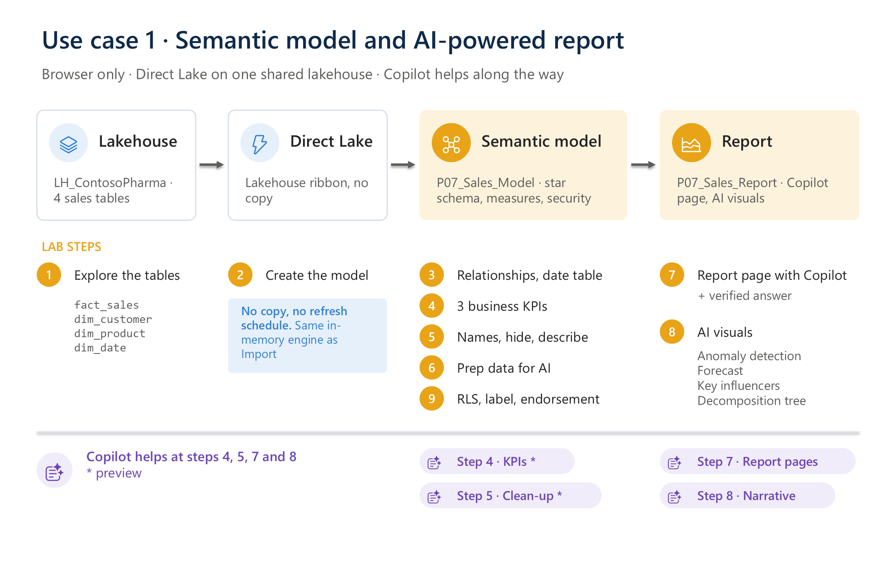

| Step | What you do | Min |
| --- | --- | ---: |
| 0 | Welcome, the story, your ID, naming rules | 10 |
| [1](#step-1--explore-the-data) | Explore the data | 5 |
| [2](#step-2--create-the-semantic-model) | Create the semantic model from the lakehouse | 10 |
| [3](#step-3--tables-relationships-and-date-table) | Tables, relationships and date table | 10 |
| [4](#step-4--add-the-business-kpis-to-the-model) | Add the business KPIs: by hand and with Copilot | 20 |
| [5](#step-5--clean-up-the-model-with-copilot) | Clean up the model with Copilot | 10 |
| [6](#step-6--prep-data-for-ai) | Prep data for AI | 10 |
| [7](#step-7--create-the-report-by-hand-then-with-copilot) | Create the report by hand, then with Copilot; add a verified answer | 15 |
| [8](#step-8--ai-visuals) | AI visuals: anomalies, forecast, key influencers, decomposition tree | 10 |
| [9](#step-9--secure-and-govern) | Secure and govern | 10 |
| – | [Wrap-up](#wrap-up): checklist, Lab 2 preview, questions | 10 |

## Before you start

- You have your participant ID, for example `P07`. Replace `P07` with your ID everywhere in this guide.
- You're a Contributor in the workspace **ContosoPharma_Workshop**. Its folder **00_Shared** holds the shared lakehouse **LH_ContosoPharma** that everyone builds on.
- You have read the [naming rules](../docs/naming-and-etiquette.md).

Files used in this lab: [kpi-definitions.md](kpi-definitions.md) · [measures.dax](measures.dax) and [measures-time-intelligence.dax](measures-time-intelligence.dax) (optional, step 4) · [copilot-prompts.md](copilot-prompts.md) · [ai-instructions.md](ai-instructions.md) · [expected-values.csv](expected-values.csv) · [best-practices-checklist.md](best-practices-checklist.md)

---

## Step 1 – Explore the data

1. Go to <https://app.fabric.microsoft.com> and open the workspace **ContosoPharma_Workshop**.

   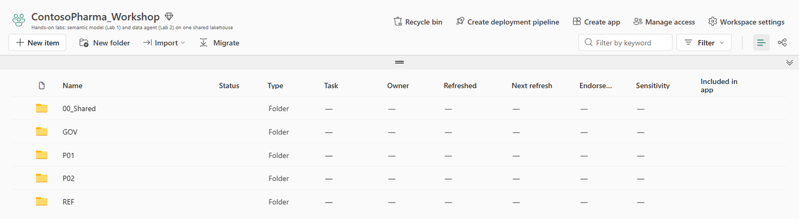

2. Open the folder **00_Shared**, then the lakehouse **LH_ContosoPharma**.
3. In the **Explorer**, expand **Tables**. Select `fact_sales` to preview the rows. Then look at `dim_customer`, `dim_product` and `dim_date`.

   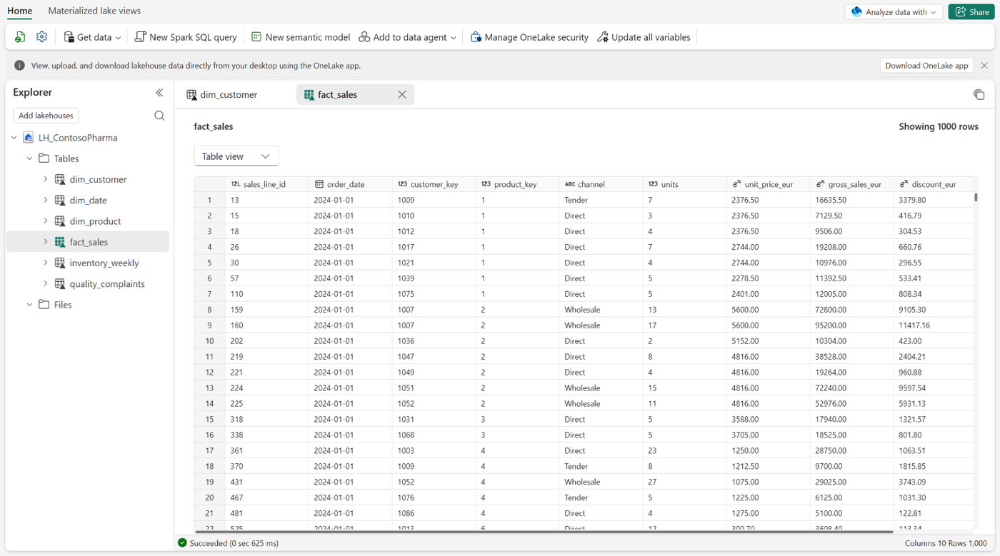

> Look, don't change: everyone builds on this lakehouse. Don't rename, delete or load anything here.

✅ **Check:** you see 6 tables. Lab 1 uses the 4 tables `fact_sales`, `dim_customer`, `dim_product` and `dim_date`. The other two are for Lab 2.

> **Why this design:** `fact_sales` holds the numbers. The `dim_` tables describe them (who, what, when). That is a **star schema**, the recommended shape for Power BI models ([Star schema](https://learn.microsoft.com/power-bi/guidance/star-schema)).

## Step 2 – Create the semantic model

You're still in the lakehouse from step 1.

1. On the lakehouse **Home** ribbon, select **New semantic model**.

   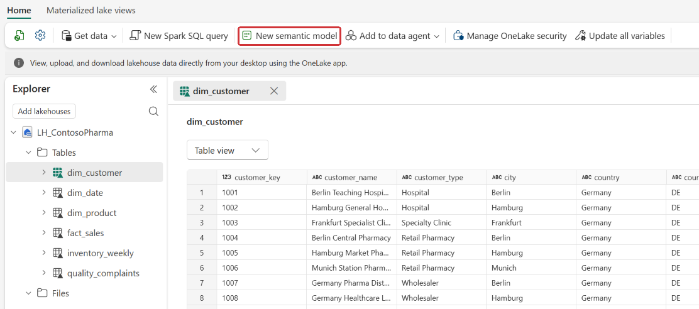

2. In **New semantic model**:
   1. **Direct Lake semantic model name:** enter `P07_Sales_Model`.
   2. **Workspace:** keep **ContosoPharma_Workshop**.
   3. Select the tables `dim_customer`, `dim_date`, `dim_product` and `fact_sales`. Leave `inventory_weekly` and `quality_complaints` unselected: they're for Lab 2.
   4. Select **Confirm**.

   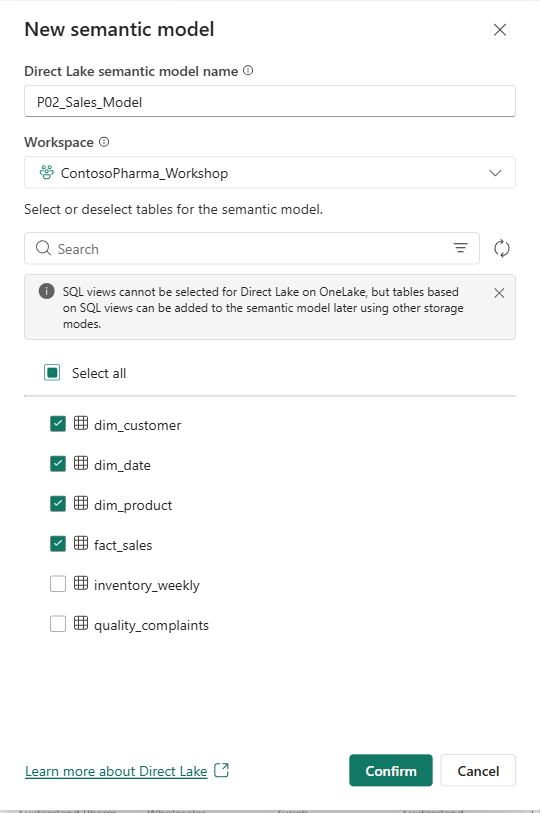

3. After about a minute, the model opens in the web model editor, in the same browser tab.
4. The model is saved in the workspace root, not in your folder. Move it: in the left navigation, select **ContosoPharma_Workshop**. Select **…** next to `P07_Sales_Model` > **Move to** > **P07** > **Move here**.
5. Open the folder **P07** and select **…** next to `P07_Sales_Model` > **Open semantic model**.

✅ **Check:** in the model, select the `fact_sales` table. In **Properties** > **Advanced**, **Storage mode** is **Direct Lake**.

<details>
<summary>Other way in: <b>+ New item</b> in your folder</summary>

1. In your folder **P07**, select **+ New item** > **All items**, type **Semantic model** in the filter and select the tile **Semantic model**.

   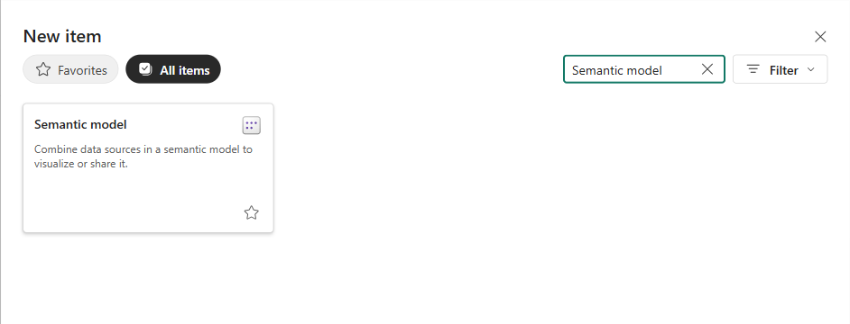

2. On **Add data to start building a report**, select **OneLake catalog**. Search for `ContosoPharma`, select **LH_ContosoPharma**, then select **Connect**. Don't select `LH_Customer_Finance`: it belongs to the trainer's DLP demo.

   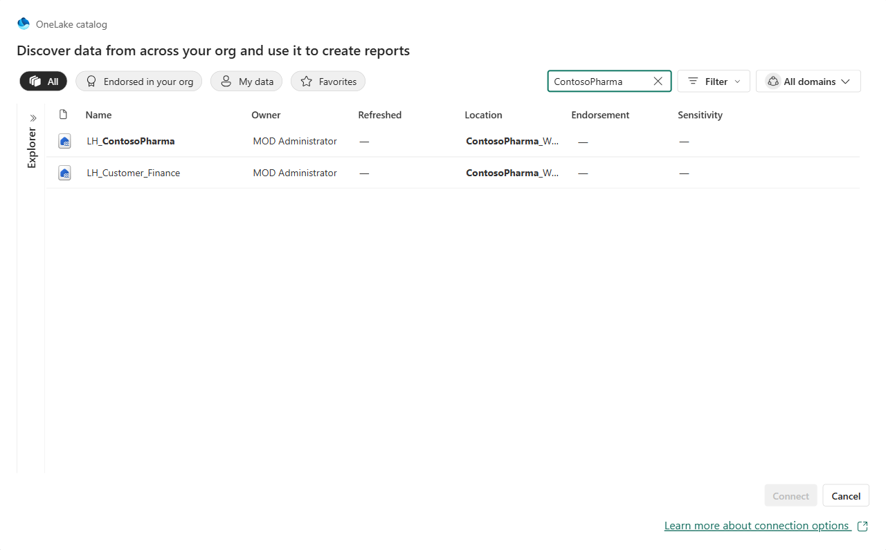

3. In **Choose tables from OneLake**, enter the name, select the same four tables and select **Confirm**. If the model doesn't open after about 30 seconds, allow pop-ups for the Fabric portal.

   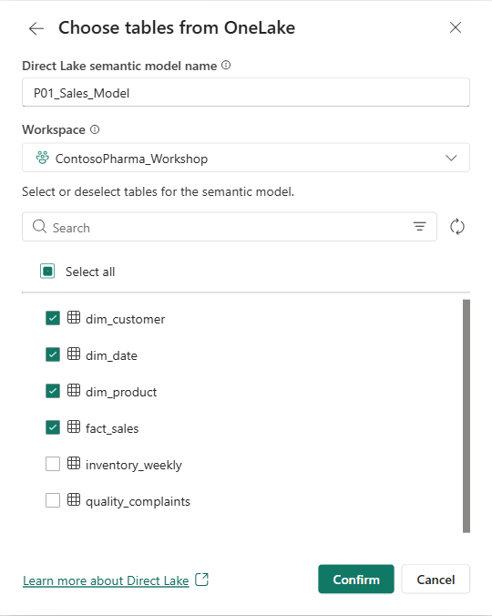

This way also saves the model in the workspace root: move it to your folder as in step 2.4. Both ways create the same Direct Lake model.

</details>

> **Why Direct Lake:** the model reads the Delta tables in OneLake directly. It doesn't copy the data, and it doesn't need a scheduled refresh: changes in the lakehouse appear in the model automatically. Queries run in the same in-memory engine as Import mode, so reports stay fast ([Direct Lake overview](https://learn.microsoft.com/fabric/fundamentals/direct-lake-overview)).

Learn more: [Create a Power BI semantic model in Direct Lake mode](https://learn.microsoft.com/fabric/data-warehouse/create-semantic-model#create-a-new-power-bi-semantic-model-in-direct-lake-mode) · [Direct Lake in web modeling](https://learn.microsoft.com/fabric/fundamentals/direct-lake-web-modeling)

## Step 3 – Tables, relationships and date table

1. Check the top right of the model editor. If it shows **Viewing**, select it, then **Editing** (*Make any changes*). A model created from the lakehouse ribbon opens in **Editing** already.
   > Changes in the web editor save automatically and can't be undone. Version history keeps the last five versions ([Version history](https://learn.microsoft.com/power-bi/transform-model/service-semantic-model-version-history)).
2. Rename the tables: select a table in the **Data** pane, then in **Properties** > **General** > **Name**, type the new name and press **Enter**. Each change takes a few seconds to save: wait until the new name shows in the **Data** pane before you rename the next table. If a name doesn't change, enter it again.

   | Old name | New name |
   | --- | --- |
   | `fact_sales` | `Sales` |
   | `dim_customer` | `Customer` |
   | `dim_product` | `Product` |
   | `dim_date` | `Date` |

3. On the **Home** ribbon, select **Manage relationships** > **New relationship**. For each row of the table below:
   1. **From table**: select `Sales`, then select the column header of the key column in the grid below it.
   2. **To table**: select the dimension table, then select its key column header.
   3. Check **Cardinality** = **Many to one (\*:1)** and **Cross-filter direction** = **Single**.
   4. Select **Assume referential integrity**. It's not selected by default. Wait until **Validating …** disappears, then select **Save**.

   | From table, column | To table, column |
   | --- | --- |
   | `Sales`, `customer_key` | `Customer`, `customer_key` |
   | `Sales`, `product_key` | `Product`, `product_key` |
   | `Sales`, `order_date` | `Date`, `date` |

   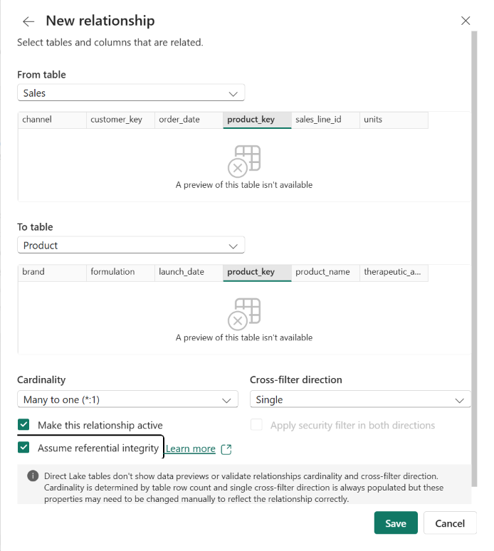

   *A preview of this table isn't available* is normal for Direct Lake. The info note under the options says that Direct Lake doesn't validate cardinality and cross-filter direction, so check both yourself ([Direct Lake overview – limitations](https://learn.microsoft.com/fabric/fundamentals/direct-lake-overview#considerations-and-limitations)). The lakehouse has no relationships, so you create them yourself.

   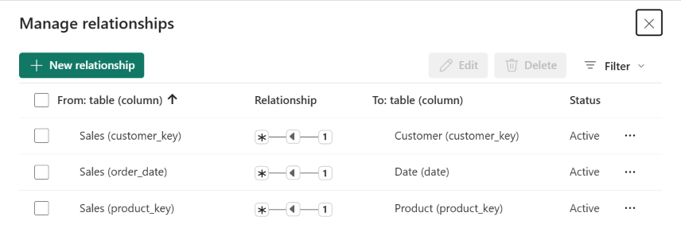

4. In the **Data** pane, right-click **Date** > **Mark as date table**. Turn on **Mark as a date table**, choose the date column `date`, wait for **Validated successfully**, then select **Save** ([Mark as date table](https://learn.microsoft.com/power-bi/transform-model/desktop-date-tables)).

   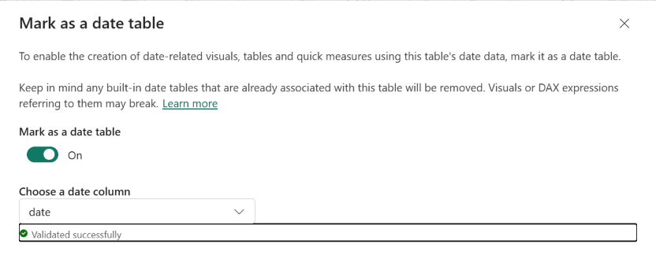

5. Select **File** > **Options**. On **Data Load**, under **Time intelligence**, clear **Auto date/time**, then select **OK**. It's on by default for a new model. Your Date table replaces the hidden automatic date tables ([Auto date/time guidance](https://learn.microsoft.com/power-bi/guidance/auto-date-time), [Date tables](https://learn.microsoft.com/power-bi/guidance/model-date-tables)).

   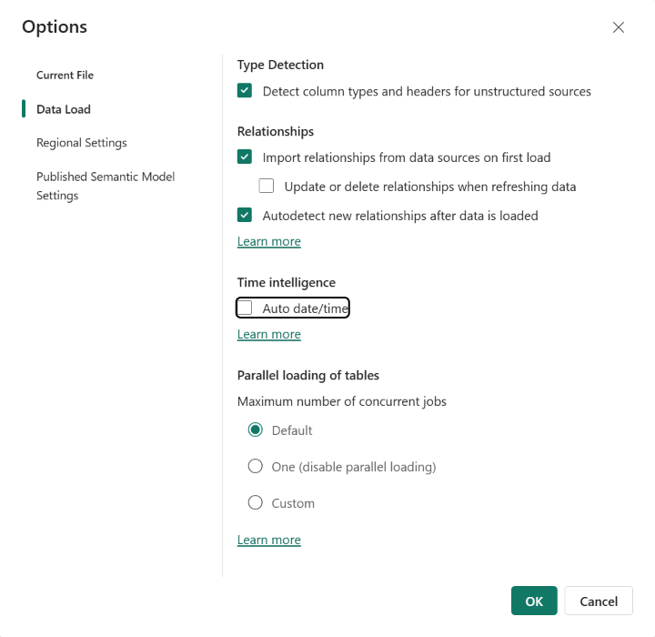

✅ **Check:** the diagram shows **Sales** with three many-to-one lines to **Customer**, **Product** and **Date**. On the **Date** card in the diagram, the `date` column shows a calendar icon.

> **Why these rules**
>
> | Rule | Why |
> | --- | --- |
> | Star schema | Dimensions (Customer, Product, Date) filter and group, the fact table (Sales) is summarized. Simple for people and for AI ([Star schema](https://learn.microsoft.com/power-bi/guidance/star-schema)) |
> | Many-to-one | Each customer, product and date appears once in its dimension. Filters flow from the one side to the many side and totals add up without double counting ([Model relationships](https://learn.microsoft.com/power-bi/transform-model/desktop-relationships-understand)). Direct Lake also requires unique values on the one side ([Direct Lake – limitations](https://learn.microsoft.com/fabric/fundamentals/direct-lake-overview#considerations-and-limitations)) |
> | Single direction | Filters flow from the dimension to the fact only: predictable and fast. Filters in both directions can create ambiguous paths and slower queries ([Bi-directional relationship guidance](https://learn.microsoft.com/power-bi/guidance/relationships-bidirectional-filtering)) |
> | Assume referential integrity | Every key in Sales exists in Customer, Product and Date. The engine then uses inner joins, and slicers don't show an extra **(Blank)** item. In Fabric you can only set this in the browser ([Assume referential integrity](https://learn.microsoft.com/power-bi/connect-data/desktop-assume-referential-integrity), [Lakehouse tutorial – relationships](https://learn.microsoft.com/fabric/data-engineering/tutorial-lakehouse-build-report#define-table-relationships)) |
> | Marked date table | Time intelligence such as prior year and year-to-date needs one row per day without gaps, and every chart uses the same calendar ([Date tables](https://learn.microsoft.com/power-bi/guidance/model-date-tables)) |
> | Auto date/time off | Otherwise Power BI adds a hidden date table for every date column: a bigger model and inconsistent calendars ([Auto date/time guidance](https://learn.microsoft.com/power-bi/guidance/auto-date-time)) |

## Step 4 – Add the business KPIs to the model

The model has columns such as `net_sales_eur`, but no business definitions yet. You now add the three KPIs that answer the questions in [the story](#the-story). Each KPI is a **measure**: a named DAX formula that is stored in the model. Every report, Copilot and the Lab 2 data agent then use the same definition, instead of each person adding up columns their own way ([Measures](https://learn.microsoft.com/power-bi/transform-model/desktop-measures), [Create measures in the service](https://learn.microsoft.com/power-bi/transform-model/service-edit-data-models#create-measures)).

| KPI | Business question | You create it |
| --- | --- | --- |
| **Net Sales** | How much do we sell? | 4a, by hand |
| **Discount %** | How much discount do we give? | 4b, with Copilot |
| **Net Sales YoY %** | Are we growing? | 4b, with Copilot |

All three go in the table **Sales**, in the display folder **KPIs**. The formulas are in [kpi-definitions.md](kpi-definitions.md).

**Why in Sales?** Every measure is listed under one table in the **Data** pane: its *home table*. A measure doesn't store data in that table, and it works with every related table: **Net Sales** by **Country** works, although **Country** is in **Customer**. Sales is the natural home here, because the KPIs summarize its columns. You can move a measure later in **Properties** > **Home table** ([Column and measure references](https://learn.microsoft.com/dax/best-practices/dax-column-measure-references#measures)).

### 4a. Net Sales, by hand

1. In the **Data** pane, select the table **Sales**.
2. On the **Home** ribbon, select **New measure**. The formula bar shows `Measure =`.
3. Replace the text with this formula, then press **Enter**:

   ```dax
   Net Sales = SUM ( Sales[net_sales_eur] )
   ```

   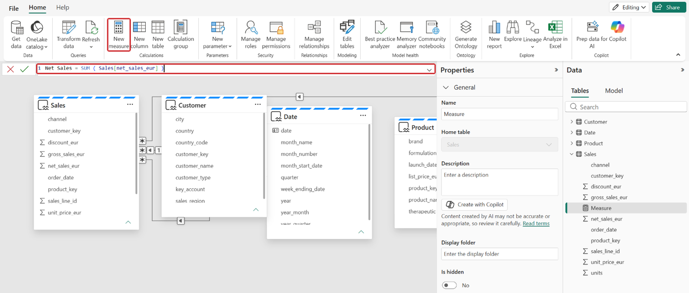

4. With **Net Sales** selected, set its **Properties**:
   1. **Description:** select **Create with Copilot**, read the proposal, then select **Keep it** ([Measure descriptions with Copilot](https://learn.microsoft.com/power-bi/transform-model/desktop-measure-copilot-descriptions)). Without Copilot, type *Net sales in EUR after discounts and rebates.*

      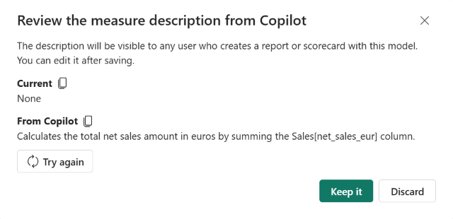

   2. **Display folder:** type `KPIs` and press **Enter**. The **Data** pane now shows **Sales** > **KPIs** > **Net Sales**.
   3. **Formatting:** **Format** is already **Currency**. Set **Currency format** to **€ Euro (€ 123)**, then **Decimal places** to `0`. The amounts are in EUR, but the currency symbol that Power BI picks for a new model isn't always €. In our dry run it was £.

      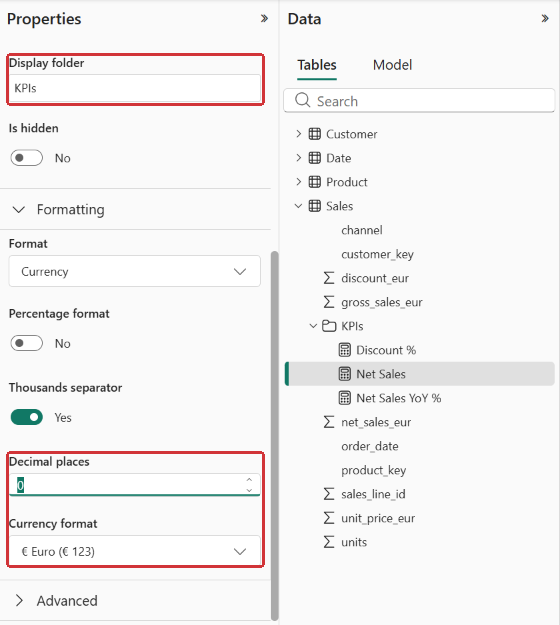

### 4b. Discount % and Net Sales YoY %, with Copilot

*Copilot in web modeling is in preview: it works today, but it can still change before general availability* ([Copilot in web modeling](https://learn.microsoft.com/power-bi/transform-model/copilot-web-modeling)).

1. Select **Copilot** on the **Home** ribbon. The Copilot pane opens on the right. The button is disabled in **Viewing** mode.
2. Paste prompt **4b-1** and send it:

   ```text
   Create a measure Discount % in the Sales table: discounts as a share of gross sales, DIVIDE ( SUM ( Sales[discount_eur] ), SUM ( Sales[gross_sales_eur] ) ). Format it as a percentage with one decimal, put it in the display folder KPIs, and add a short description.
   ```

3. Copilot asks once per session: *Allow Copilot to make changes during this chat session?* Select **Allow**. Copilot then saves a restore checkpoint in version history, so you can roll back everything it does in this session.

   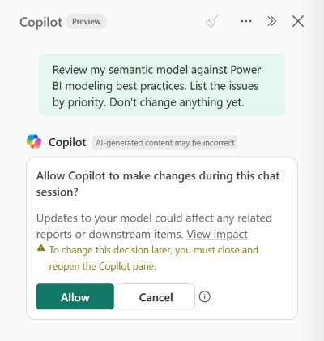

4. When Copilot has finished, paste prompt **4b-2**:

   ```text
   Create a measure Net Sales YoY % in the Sales table that shows how much Net Sales grew compared with the same period last year. Use the Date table. Format it as a percentage with one decimal, put it in the display folder KPIs, and add a short description.
   ```

5. Read Copilot's answer: table, DAX, format, display folder and description.

   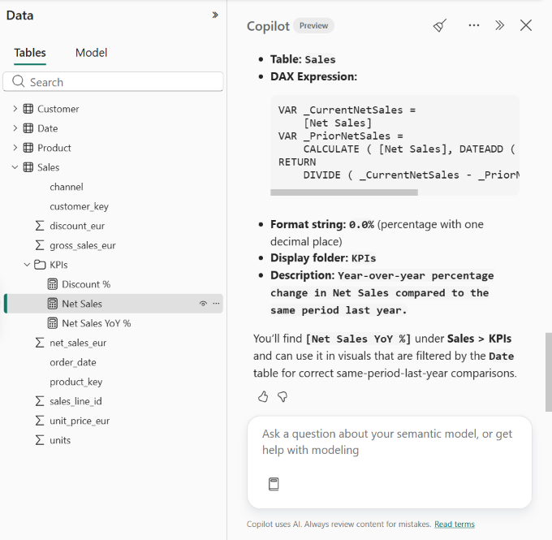

**No Copilot?** Create both measures like **Net Sales** in 4a, with the formulas and formats from [kpi-definitions.md](kpi-definitions.md).

<details>
<summary>Other way, by hand and all at once: DAX query view</summary>

Instead of 4a and 4b, you can paste DAX scripts that define the measures. Do it before step 5: the scripts use the original column names, such as `net_sales_eur`.

1. At the bottom of the model editor, select **DAX query view**.
2. Paste the whole content of [measures.dax](measures.dax) and select **Run**. The results show the measures by year.
3. Select **Update model with changes**. This adds 8 measures to **Sales**, because each definition names its home table: `MEASURE 'Sales'[Net Sales] = …`. The `///` lines above a measure become its description ([DAX query view – update model with changes](https://learn.microsoft.com/power-bi/transform-model/dax-query-view#update-model-with-changes)).
4. Select **+** to open a new query tab. Paste [measures-time-intelligence.dax](measures-time-intelligence.dax), select **Run**, then **Update model with changes**. This adds **Net Sales YoY %** and **Net Sales YTD**.
5. Select **Model view**. Put **Net Sales**, **Discount %** and **Net Sales YoY %** in the display folder `KPIs`, and set their formats from [kpi-definitions.md](kpi-definitions.md).

You get the three KPIs and seven more measures: the same set as `REF_Sales_Model`. If a measure with the same name already exists, **Update model with changes** overwrites its formula. The query tabs are discarded when you close the editor; the measures stay in the model.

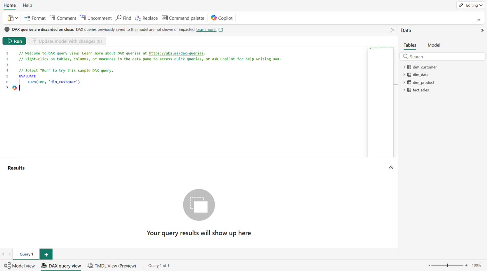

</details>

✅ **Check:** **Sales** > **KPIs** shows **Discount %**, **Net Sales** and **Net Sales YoY %**. You check their values on the report in step 7.

> **Review what Copilot wrote.** Select **Net Sales YoY %** and read the formula bar. In our run, Copilot compared each period with the same dates one year earlier: `DATEADD ( 'Date'[Date], -1, YEAR )`. On the report in step 7, 2025 shows +10.0 % and 2026 shows −26.8 %: the data ends in September 2026, so nine months of 2026 are compared with all twelve months of 2025. The formula is right, but that comparison isn't like for like. Reviewing AI output means checking results like this one. Step 6 tells AI which period to use by default.

> **Why measures in the model**
>
> | Practice | Why |
> | --- | --- |
> | An explicit measure for every KPI | One definition for every report, Copilot and data agent ([Star schema – measures](https://learn.microsoft.com/power-bi/guidance/star-schema#measures)) |
> | **DIVIDE** for ratios | Returns a blank instead of an error when the denominator is 0 ([DIVIDE vs /](https://learn.microsoft.com/dax/best-practices/dax-divide-function-operator)) |
> | Format and description on the measure | Every visual shows € and % the same way. Report authors and Copilot read the description ([Measure descriptions with Copilot](https://learn.microsoft.com/power-bi/transform-model/desktop-measure-copilot-descriptions)) |
> | A display folder for the KPIs | Report authors find all KPIs in one place. Some teams put measures in a separate measure-only table instead; both work ([Organize your measures](https://learn.microsoft.com/power-bi/transform-model/desktop-measures#organize-your-measures)) |

## Step 5 – Clean up the model with Copilot

*Copilot in web modeling is in preview.*

This isn't chatting with your data. Copilot in the model editor changes the model itself: names, hidden fields, sort order, data categories and descriptions ([Copilot in web modeling](https://learn.microsoft.com/power-bi/transform-model/copilot-web-modeling)).

1. Keep the **Copilot** pane from step 4 open. If you closed it, check that the top right shows **Editing**, then select **Copilot** on the ribbon.
2. Paste prompts **5a** to **5d** from [copilot-prompts.md](copilot-prompts.md#step-5--clean-up-with-copilot) one at a time. After each one, read the answer and check the **Data** pane before you send the next:

   | Prompt | What it does | Check |
   | --- | --- | --- |
   | 5a Review | Lists issues by priority, changes nothing | A list, nothing changed |
   | 5b Rename | Business names from an exact mapping | Names like **Therapeutic Area** in the Data pane |
   | 5c Hide and sort | Hides keys and technical columns, sorts months, sets data categories | **Sales** shows only **Channel** and the folder **KPIs** |
   | 5d Describe | Descriptions under 150 characters for tables and columns | Hover a field to see its description |

3. For 5b, Copilot can list the renames first and ask you to confirm. Reply `yes`.

   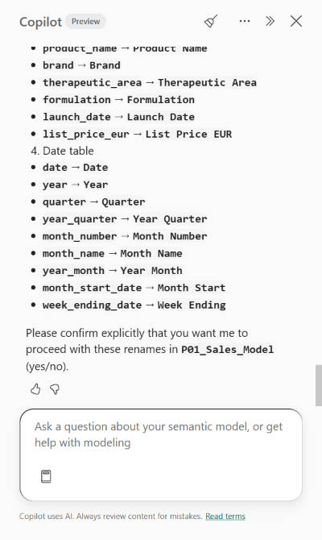

✅ **Check:** column names are readable (for example **Therapeutic Area**). **Sales** shows only **Channel** and the folder **KPIs**. **Month Name** sorts January to December. Select **Net Sales**: the formula now reads `SUM ( Sales[Net Sales EUR] )`. Renaming a column updates the measures that use it. If the formula bar shows a red underline right after the rename, select another field and come back.

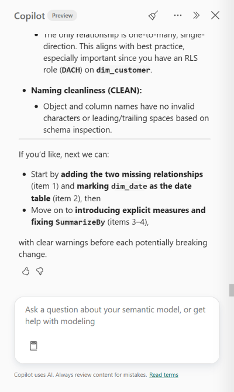

**If Copilot isn't available**, do the same by hand in **Properties** (about 10 minutes). Steps 6–8 need these names:

1. Rename the visible columns with the mapping in [prompt 5b](copilot-prompts.md#step-5--clean-up-with-copilot): every **Customer**, **Product** and **Date** column, plus `channel` → **Channel** in **Sales**.
2. Hide all other **Sales** columns and every key column. Search the **Data** pane for `key`, Ctrl+select the results, and set **Is hidden** to on.
3. Set **Sort by column** of **Month Name** to **Month Number**.

**If something goes wrong:** select **File** > **Version history** and restore the version from before the Copilot session.

## Step 6 – Prep data for AI

*Preview.*

**Why it matters:** as the [story](#the-story) explains, every AI that answers from this model knows only what the model tells it. Names and descriptions (steps 4 and 5) help. Prep data for AI adds what AI can't guess: your terms (GTN, DACH, TA), your default period, which fields to ignore, and approved answers. These settings are used everywhere Copilot in Power BI is available ([Prepare your data for AI](https://learn.microsoft.com/power-bi/create-reports/copilot-prepare-data-ai)), and a data agent's DAX generation uses only these settings, not the agent's own instructions ([Semantic model best practices](https://learn.microsoft.com/fabric/data-science/semantic-model-best-practices)).

> **See the difference:** after step 7, ask the report Copilot pane *What was GTN in DACH last year?* Ask it again after the AI instructions have taken effect. In our dry run, the data agent without these settings answered with a question: which year did "last year" mean?

1. In your folder, select `P07_Sales_Model` to open its details page. On the ribbon, select **Prep data for AI**. If the tabs are disabled, select **Turn on Q&A** first. The dialog opens on **Get started**, with three tasks.

   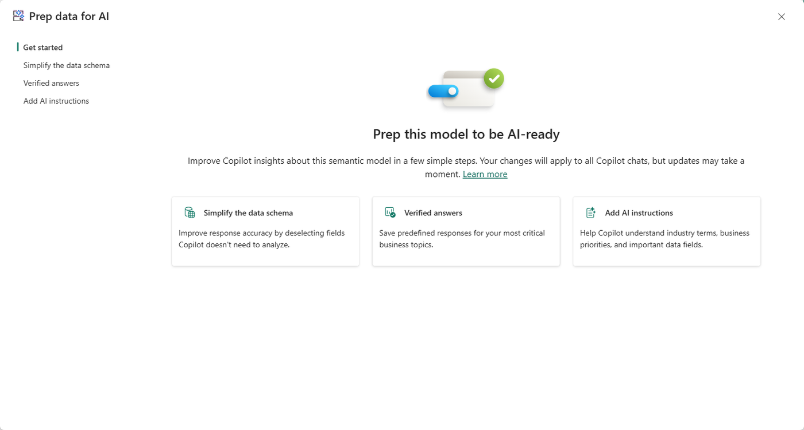

2. On **Simplify the data schema**, keep only the fields that AI should use:
   - **Customer:** Customer Name, Customer Type, City, Country, Sales Region, Key Account
   - **Product:** Product Name, Brand, Therapeutic Area, Formulation, Launch Date
   - **Date:** Date, Year, Quarter, Year Quarter, Month Name, Year Month, Month Start
   - **Sales:** Channel and all measures

   ([AI data schema](https://learn.microsoft.com/power-bi/create-reports/copilot-prepare-data-ai-data-schema))

   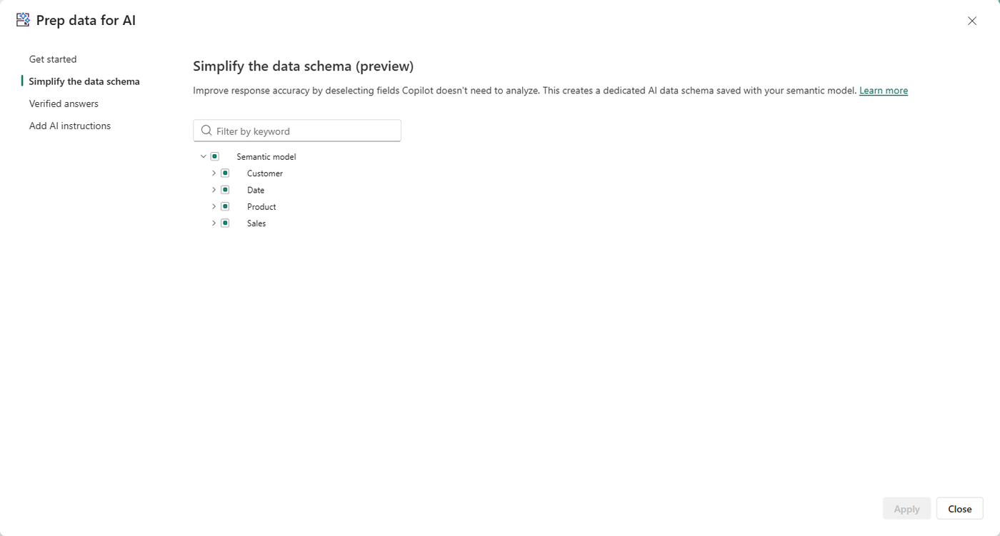

3. On **Add AI instructions**, paste the text from [ai-instructions.md](ai-instructions.md). The counter shows about 1,350 of 10,000 characters ([AI instructions](https://learn.microsoft.com/power-bi/create-reports/copilot-prepare-data-ai-instructions)).

   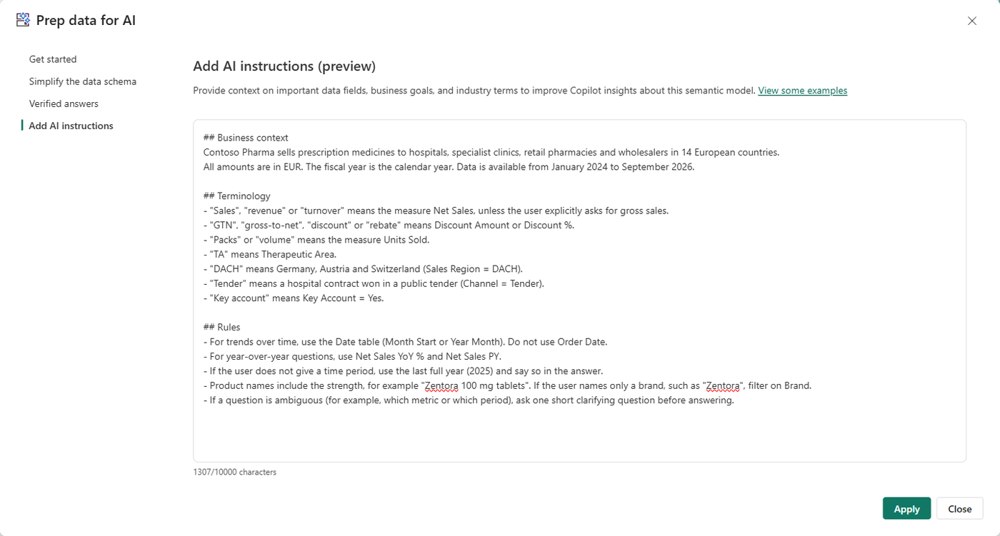

4. Select **Apply**. Changes can take a few minutes to reach Copilot.

## Step 7 – Create the report by hand, then with Copilot

You build the overview page by hand first (7a), then ask Copilot for the same page (7b). That way you know what a good page looks like and can judge what Copilot builds.

### 7a. Build the overview page yourself

1. In the model editor, select **New report** on the ribbon. The report canvas opens in a new tab, in edit mode.
2. **Cards:** in the **Visualizations** pane select **Card**, then select **Net Sales** in the **Data** pane. Add two more cards for **Net Sales YoY %** and **Discount %** ([Card visuals](https://learn.microsoft.com/power-bi/visuals/power-bi-visualization-card)).
3. **Line chart:** **X-axis** = **Month Start**, **Y-axis** = **Net Sales**.
4. **Clustered bar chart:** **Y-axis** = **Therapeutic Area**, **X-axis** = **Net Sales**. Copy it and replace **Therapeutic Area** with **Country**.
5. **Slicer:** **Year** ([Slicers](https://learn.microsoft.com/power-bi/visuals/power-bi-visualization-slicers)).
6. Rename the page **Sales overview**. Select **File** > **Save**. Name the report `P07_Sales_Report`, save it in **ContosoPharma_Workshop**, and move it to your folder **P07**.

✅ **Check:** with **2025** selected in the slicer, the cards show **Net Sales** €294M (exactly €293,801,286), **Net Sales YoY %** 10.0 % and **Discount %** 10.4 %. More checks: [expected-values.csv](expected-values.csv).

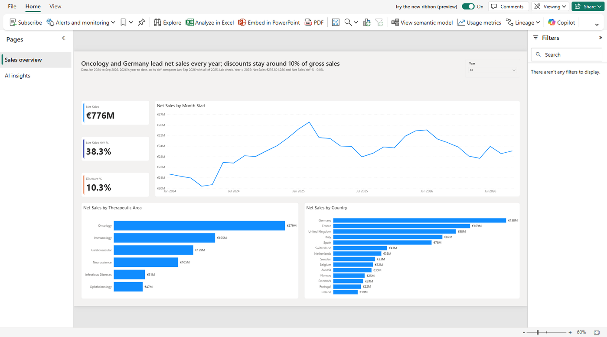

### 7b. Ask Copilot for the same page, then compare

1. Select **Copilot** and paste the report prompt from [copilot-prompts.md – step 7](copilot-prompts.md#step-7--copilot-in-the-report). Copilot builds a new page ([Create reports with Copilot](https://learn.microsoft.com/power-bi/create-reports/copilot-create-reports)).
2. Compare it with your page: same visuals, same numbers, better or worse layout? Keep the better page and delete the other.
3. Refine with a follow-up prompt, for example a different chart type or sort order.
4. **Verified answer:** stay in edit mode and select the **Net Sales by Therapeutic Area** chart. Select **…** > **Set up a verified answer**. Add these trigger phrases:
   - *Which therapeutic area sells the most?*
   - *Net sales by therapeutic area*
   - *Show sales by TA*
   - *Compare therapeutic areas by revenue*
   - *What is our biggest therapeutic area?*

   Select **Apply** ([Verified answers](https://learn.microsoft.com/power-bi/create-reports/copilot-prepare-data-ai-verified-answers)).

> Copilot report creation needs the model's **Q&A** switch on. It doesn't work if implicit measures are disabled. Copilot can't apply styling or formatting changes ([Create reports with Copilot – limitations](https://learn.microsoft.com/power-bi/create-reports/copilot-create-reports#considerations-and-limitations)).

## Step 8 – AI visuals

Add a page named **AI insights**.

> **In the workshop (10 minutes):** build 8.1 and 8.3. Your instructor demonstrates 8.2 and 8.4; try them afterwards.

### 8.1 Anomaly detection

1. Add a **Line chart**: **X-axis** = Date > **Month Start**, **Y-axis** = **Net Sales**.
2. In **Filters on this visual**, set **Country** = *Germany* and **Product Name** = *Zentora 100 mg tablets*.
3. With the chart selected, open **Analytics** in the **Visualizations** pane, then **Anomalies** > **Add**.
4. Select the May 2026 point. The **Anomalies** pane explains the possible causes. Add **Customer Type**, **Channel** and **City** to **Explain by**.

✅ **Check:** May 2026 is flagged below the expected range, and July 2026 above it.

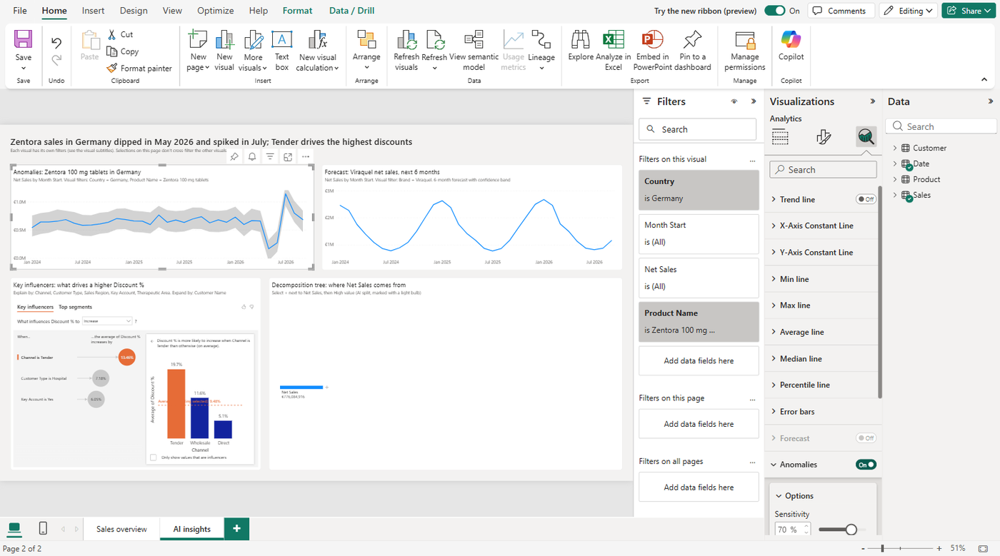

Anomaly detection works only on line charts with a date axis, no legend and at least four points. It can't be combined with a forecast ([Anomaly detection](https://learn.microsoft.com/power-bi/visuals/power-bi-visualization-anomaly-detection)).

### 8.2 Forecast

1. Add another line chart, **Month Start** × **Net Sales**, filtered to **Brand** = *Viraquel* (an antiviral with winter peaks).
2. Select **Analytics** > **Forecast** > on. Set **Forecast length** to 6 months and select **Apply** ([Analytics pane – forecast](https://learn.microsoft.com/power-bi/transform-model/desktop-analytics-pane#forecast)).

   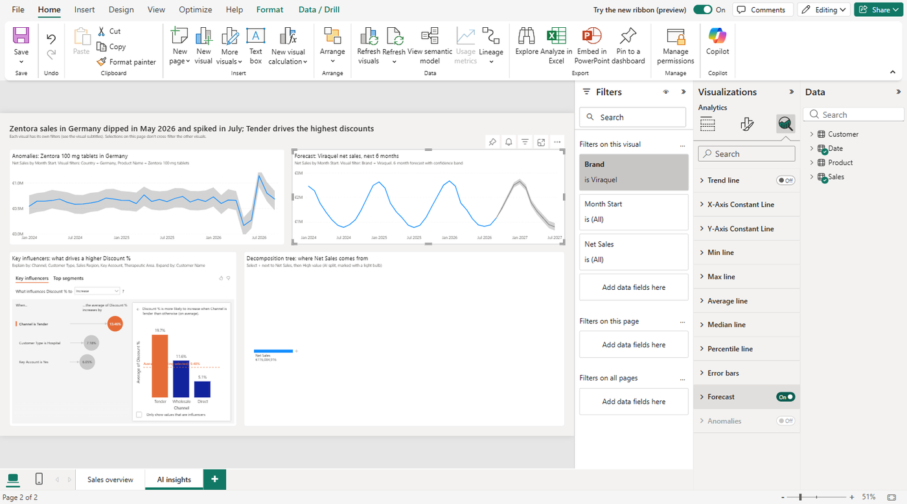

### 8.3 Key influencers – what drives discounts?

1. Add a **Key influencers** visual:
   - **Analyze:** **Discount %**
   - **Explain by:** **Channel**, **Customer Type**, **Sales Region**, **Key Account**, **Therapeutic Area**
   - **Expand by:** **Customer Name**
2. Read the **Key influencers** tab, then the **Top segments** tab.

✅ **Check:** **Channel** = *Tender* is the strongest influencer of a higher discount.

For a measure, the analysis runs at the level of the **Explain by** and **Expand by** fields ([Key influencers](https://learn.microsoft.com/power-bi/visuals/power-bi-visualization-influencers#analyze-a-metric-that-is-a-measure-or-a-summarized-column)).

### 8.4 Decomposition tree – where do sales come from?

1. Add a **Decomposition tree**:
   - **Analyze:** **Net Sales**
   - **Explain by:** **Sales Region**, **Country**, **Therapeutic Area**, **Brand**, **Channel**, **Customer Type**
2. Select **+** next to **Net Sales**, then **High value**. The lightbulb marks an AI split. Continue for 2–3 levels, then try **Low value** on a node ([Decomposition tree](https://learn.microsoft.com/power-bi/visuals/power-bi-visualization-decomposition-tree)).

### 8.5 Narrative with Copilot (if time allows)

1. In **Visualizations**, select **Narrative**. It opens in Copilot mode.
2. Use the prompt from [copilot-prompts.md – step 8](copilot-prompts.md#step-8--narrative-visual-with-copilot) and select **Create** ([Narrative visual with Copilot](https://learn.microsoft.com/power-bi/create-reports/copilot-create-narrative)).

Save the report.

> **Q&A** is being retired. Microsoft recommends Copilot instead ([Q&A for business users](https://learn.microsoft.com/power-bi/explore-reports/end-user-q-and-a)). This lab doesn't use the Q&A visual.

**Bridge to Lab 2:** open the **Copilot** pane and ask the question from [copilot-prompts.md](copilot-prompts.md#bridge-to-lab-2--copilot-pane). The model shows *what* happened. The *why* (a stock-out after quality complaints) sits in lakehouse tables that aren't in the model. Lab 2 answers it.

## Step 9 – Secure and govern

1. **RLS role:** in the model editor (**Editing**), select **Manage roles** on the **Home** ribbon. In **Manage security roles** > **Create**:
   1. Under **Roles**, select **+ New**. Select **…** next to **Untitled** > **Rename**, and enter `DACH`.
   2. Under **Tables**, select **Customer**.
   3. Under **Rules**, select **+ New**: **Column** = **Sales Region**, **Condition** = **Equals**, **Value** = `DACH`.
   4. Select **Save** ([Edit semantic models – RLS](https://learn.microsoft.com/power-bi/transform-model/service-edit-data-models#define-row-level-security-roles-and-rules)).

   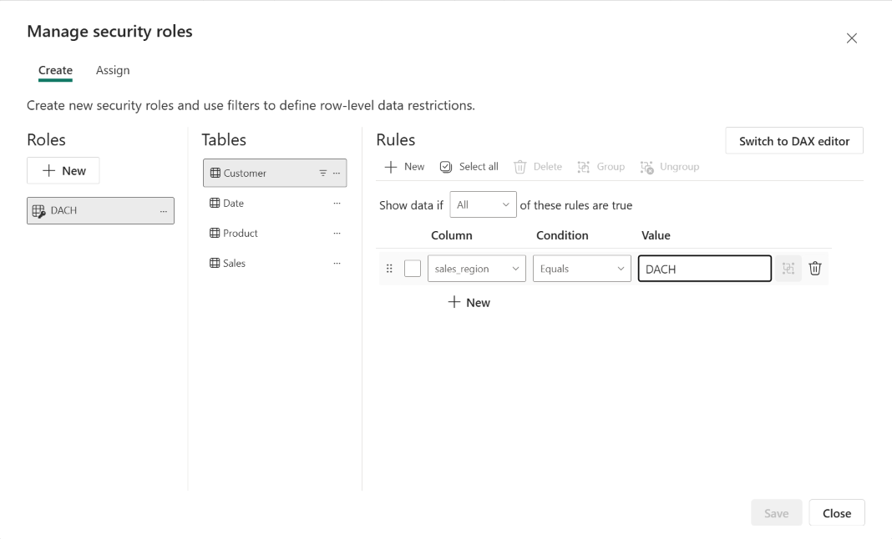

2. **Test the role (instructor demo):** on a new Direct Lake model, **Test as role** shows *Not supported – Test as role does not work with Single Sign-On (SSO)*. By default, Direct Lake reads OneLake with the identity of the person who runs the query (SSO).

   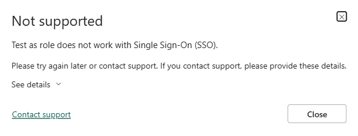

   The instructor shows the production pattern on `REF_Sales_Model`. The model reads the lakehouse through a cloud connection with a fixed identity (the workspace identity), so report readers need no access to the lakehouse and can't bypass RLS there. **Test as role** works on this model, and a report reader in **DACH** sees only Germany, Austria and Switzerland. Steps: [governance/README.md – RLS that holds](../governance/README.md#rls-that-holds-fixed-identity) ([Integrate Direct Lake security](https://learn.microsoft.com/fabric/fundamentals/direct-lake-security-integration#data-access-rule-options), [Row-level security](https://learn.microsoft.com/fabric/security/service-admin-row-level-security#validate-the-role-within-the-power-bi-service)).
   > RLS restricts only users with the **Viewer** role or with access to the model or report alone. As a Contributor you always see all data.
3. **Sensitivity label:** open the workspace, select **…** next to `P07_Sales_Model` > **Settings**, then **<< Open settings page** at the bottom of the pane. Expand **Sensitivity label**, choose **Confidential**, then select **Apply**. Reports created from the model inherit the label ([Apply sensitivity labels](https://learn.microsoft.com/fabric/enterprise/powerbi/service-security-apply-data-sensitivity-labels), [Information protection](https://learn.microsoft.com/fabric/governance/information-protection)).

   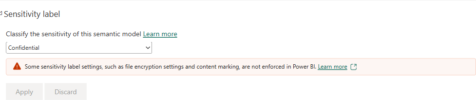

4. **Endorse:** on the same settings page, expand **Endorsement and discovery**, select **Promoted**, then **Apply** ([Endorse content](https://learn.microsoft.com/power-bi/collaborate-share/service-endorse-content)). In the dry run, **Make discoverable** was turned on with it: people without access can then find the model and request access. Clear it if that isn't wanted ([Semantic model discoverability](https://learn.microsoft.com/power-bi/collaborate-share/service-discovery)).

   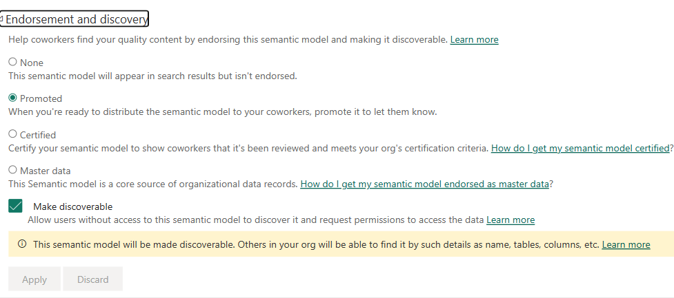

   > Use the full settings page. The side pane can show *These settings are turned off because you don't have the right permissions to change them* for these two settings, even for the model owner.
5. **Instructor demo:**
   - **Audit trail:** Microsoft Purview Audit shows `ApplyChangeToPowerBIModel`, `SensitivityLabelApplied` and `CopilotInteraction` records for this lab ([Operation list](https://learn.microsoft.com/fabric/admin/operation-list)).
   - **DLP policy tip** on the lakehouse `GOV/LH_Customer_Finance`, which holds synthetic bank account numbers: [governance/purview-demo.md](../governance/purview-demo.md) ([DLP for Fabric](https://learn.microsoft.com/purview/dlp-powerbi-get-started)).
   - The model setting **Copilot and Microsoft's MCP tools** (*Allow any person with only read permissions to use AI…*) under **Settings** > **Copilot** ([Use Copilot with semantic models](https://learn.microsoft.com/power-bi/create-reports/copilot-semantic-models)).

   More in [governance/README.md](../governance/README.md).

## Wrap-up

Go through the [best-practices checklist](best-practices-checklist.md). In Lab 2 you build a data agent on `P07_Sales_Model` and two lakehouse tables.

## Troubleshooting

| Problem | Fix |
| --- | --- |
| No **Copilot** button | The workspace must be on a paid F2+ or P1+ capacity, with Copilot enabled by the admin. Use the manual fallback and continue ([Copilot overview](https://learn.microsoft.com/power-bi/create-reports/copilot-introduction)) |
| **LH_ContosoPharma** isn't listed in the OneLake catalog | Ask the instructor to check that you're a Contributor in **ContosoPharma_Workshop** |
| The model editor doesn't open after **Confirm** | Allow pop-ups for the Fabric portal, then open the model from the workspace with **…** > **Open semantic model** |
| The model opens read-only | Select **Viewing** > **Editing** at the top right |
| The **Year** slicer shows **(Blank)** | A relationship doesn't assume referential integrity, so Direct Lake keeps a blank member in the dimension. In the model, select **Manage relationships**, select the relationship, then **Edit**. Select **Assume referential integrity** and **Save**. Repeat for each relationship ([Assume referential integrity](https://learn.microsoft.com/power-bi/connect-data/desktop-assume-referential-integrity), [Model relationships](https://learn.microsoft.com/power-bi/transform-model/desktop-relationships-understand#relationship-evaluation)) |
| **Prep data for AI** tabs are disabled | Select **Turn on Q&A** |
| Copilot can't create a report page | Turn the model's Q&A switch on, and don't disable implicit measures |
| **Net Sales** shows £, $ or another currency | Select **Net Sales** in the model. In **Properties** > **Formatting**, set **Currency format** to **€ Euro (€ 123)** and **Decimal places** to `0` (step 4a) |
| A KPI formula shows a red underline after the renames in step 5 | Select another field, then the KPI again. The formula updates to the new column names by itself |
| **Anomalies** is unavailable | Remove any legend or second measure. The X-axis must be a date |
| You broke the model | **File** > **Version history** > restore, or continue with `REF_Sales_Model` in the folder **REF** |
