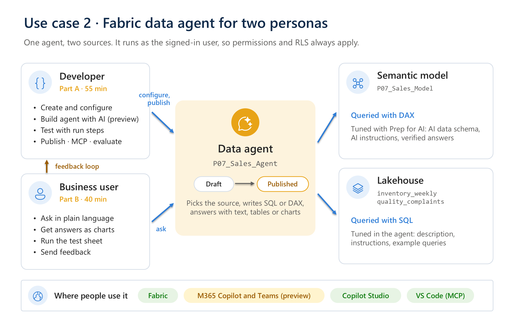

# Lab 2 – Build, test and use a Fabric data agent

**Time:** 120 minutes · **Level:** beginner · **Tools:** browser. VS Code is optional for the MCP part.

A Fabric data agent answers questions in plain language over your data. In this lab it combines two sources:

- **Your semantic model from Lab 1** (`P07_Sales_Model`): sales, discounts, units. The agent queries it with **DAX**.
- **Two lakehouse tables** (`inventory_weekly`, `quality_complaints`): stock and quality. The agent queries them with **SQL**.

Together they answer the question Lab 1 couldn't: *why* did sales of Zentora 100 mg tablets in Germany drop in May 2026?

## Two personas

You play both roles. Work in pairs: you build your own agent as the **developer**, then test your partner's agent as the **business user**.

| Persona | Goal | Part |
| --- | --- | --- |
| **Developer** | Create, configure, test and publish the agent. Connect to it through MCP. Evaluate it in batch | [Part A – Developer](part-a-developer.md) |
| **Power business user** | Test the agent against business questions, get answers as charts, give structured feedback, and shape its configuration | [Part B – Business user](part-b-business-user.md) |

## Agenda

| Time | Step | Min |
| --- | --- | ---: |
| 0:00 | Intro: data agent vs Copilot, personas, what is GA and what is preview | 10 |
| 0:10 | **Part A – Developer**: create, add sources, Build agent with AI, instructions, test, publish, MCP | 55 |
| 1:05 | **Part B – Business user**: explore, charts, structured test, feedback loop, Microsoft 365 Copilot | 40 |
| 1:45 | Governance demo: RLS through the agent, audit and DSPM for AI, labels ([governance](../governance/README.md)) | 10 |
| 1:55 | Which gaps are closed today, and which are on the roadmap ([gap matrix](gap-closure.md)) | 5 |

## Before you start

- **Semantic model:** `P07_Sales_Model` from Lab 1, including step 6 (Prep data for AI). If you don't have it, use `REF_Sales_Model` in the folder **REF**.
- **Capacity:** data agents need a paid F2+ or P1+ capacity. Your tenant must allow Copilot and Azure OpenAI features ([Data agent tenant settings](https://learn.microsoft.com/fabric/data-science/data-agent-tenant-settings)).
- **Optional for A8:** Visual Studio Code with GitHub Copilot.

## How the agent works, in 4 points

1. It reads your question, picks the most relevant source using the source descriptions, schema and examples, and generates a query: SQL for the lakehouse, DAX for the semantic model ([Data agent concepts](https://learn.microsoft.com/fabric/data-science/concept-data-agent)).
2. For the semantic model, it uses the model's **Prep for AI** settings (AI data schema, AI instructions, verified answers) and **ignores the agent-level instructions**. That's why Lab 1, step 6 matters ([Semantic model best practices](https://learn.microsoft.com/fabric/data-science/semantic-model-best-practices)).
3. It runs read-only queries **as the signed-in user**, so RLS and source permissions apply. To query a semantic model through an agent, a user needs **Read** permission on the model ([Publish and share data agents](https://learn.microsoft.com/fabric/data-science/data-agent-sharing)). Your model is Direct Lake, so the user also needs **Read** and **ReadAll** on the lakehouse. As a Contributor you have both ([Direct Lake security](https://learn.microsoft.com/fabric/fundamentals/direct-lake-security-integration#permission-requirements)).
4. Every answer shows its **run steps** (the generated query), so you can verify it.

## Files

| File | Use |
| --- | --- |
| [config/agent-instructions.md](config/agent-instructions.md) | Agent instructions and publish description |
| [config/lakehouse-datasource.md](config/lakehouse-datasource.md) | Lakehouse description, instructions and 5 example queries |
| [testing/business-test-sheet.csv](testing/business-test-sheet.csv) | Test sheet for the business user (Part B) |
| [testing/answer-key.csv](testing/answer-key.csv) | Expected answers (instructor) |
| [testing/ground_truth.csv](testing/ground_truth.csv) | Question and expected-answer pairs for the evaluation SDK |
| [notebooks/evaluate_data_agent.ipynb](notebooks/evaluate_data_agent.ipynb) | Batch evaluation with the Fabric data agent SDK (preview) |
| [mcp/README.md](mcp/README.md) | Use the agent through MCP, and manage it as code |
| [gap-closure.md](gap-closure.md) | Common gaps from Copilot and data agent evaluations: closed now, workaround, or roadmap |

## Feature status (October 2026)

| GA | Preview |
| --- | --- |
| Data agent, publishing and sharing, visual responses, data source routing, the data agent MCP server, Fabric data agents in Copilot Studio | Build agent with AI, preview runtime, Topics, schema object descriptions, evaluation SDK, Purview audit and DSPM for data agents, data agents in Microsoft 365 Copilot, data agent feedback in Microsoft 365 Copilot, Git integration for data agents |

Sources: [What's new in Fabric](https://learn.microsoft.com/fabric/fundamentals/whats-new), and the Learn pages linked in each step.
