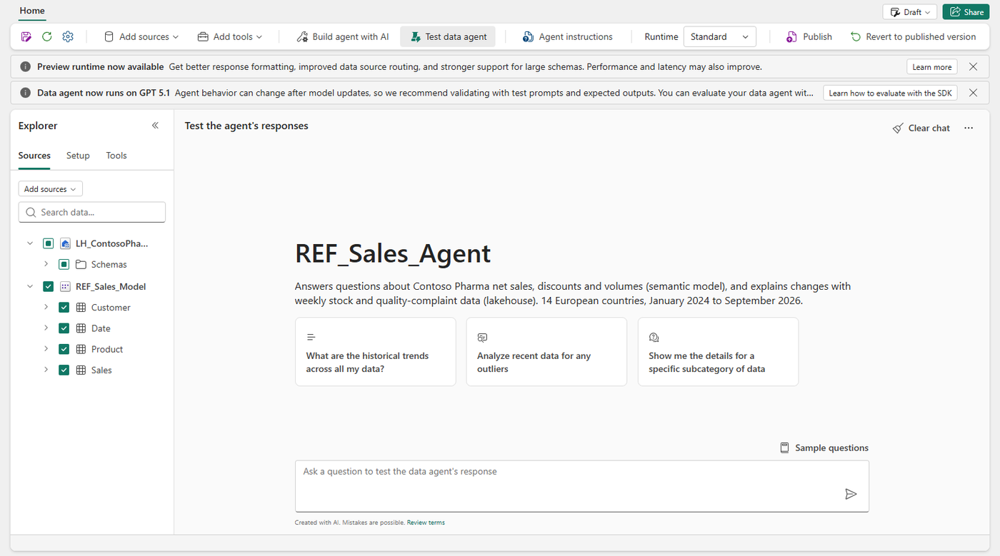
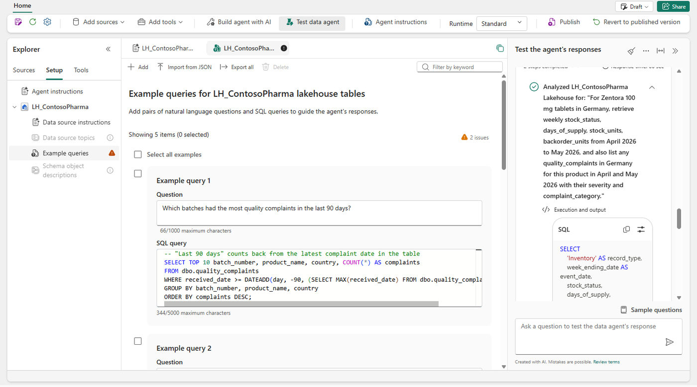
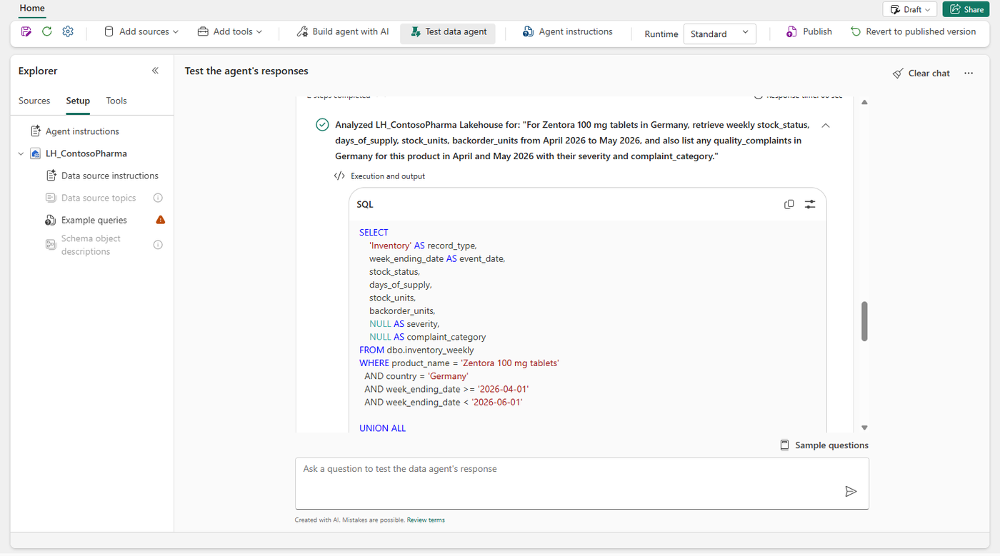
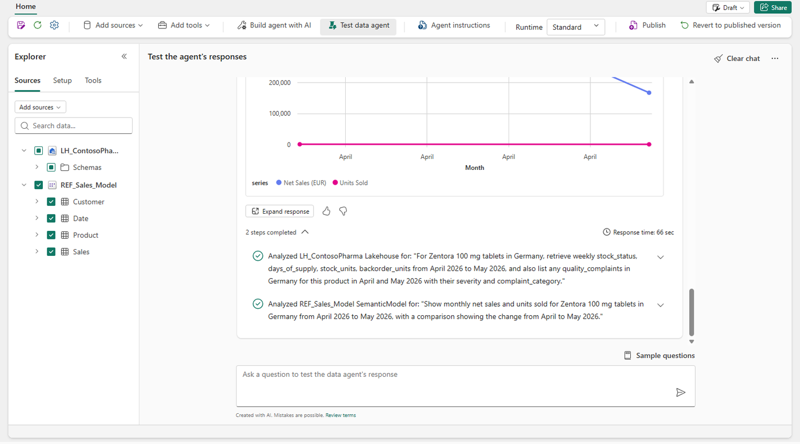
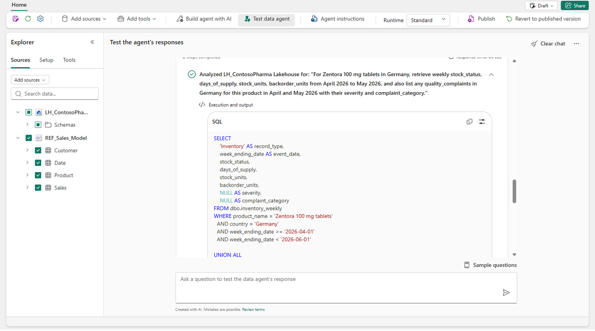
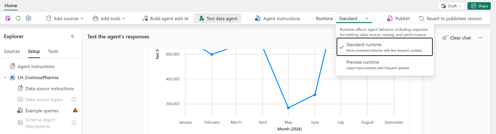
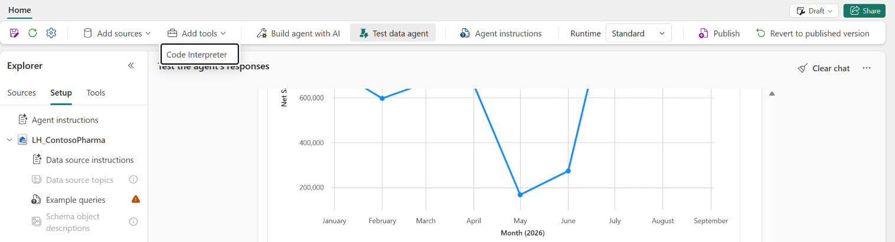
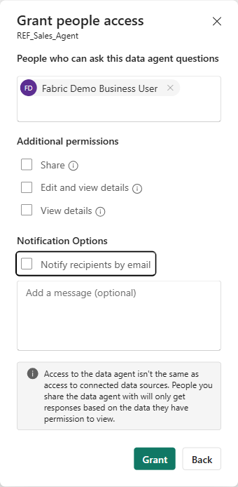
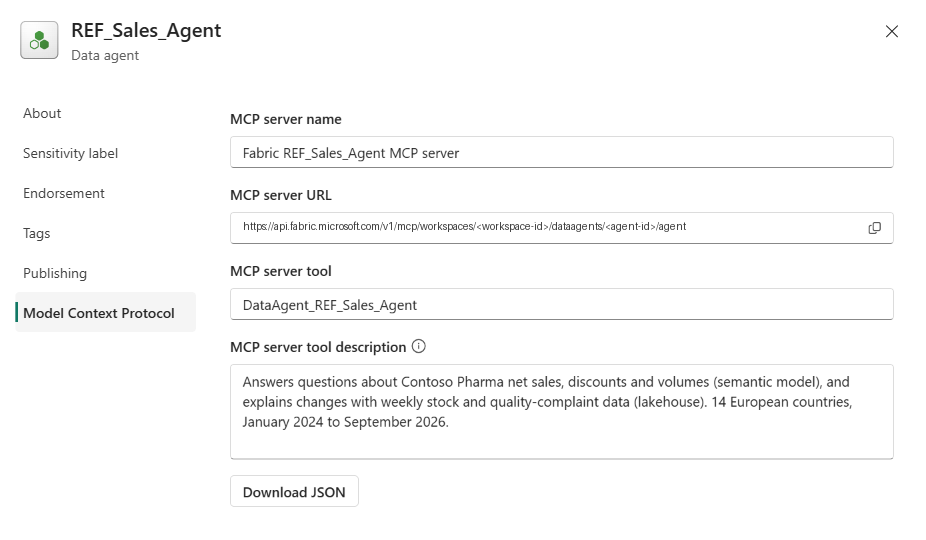

# Part A – Developer: create, configure, test and publish

**Time:** 55 minutes. Replace `P07` with your ID.

| Step | What you do | Min |
| --- | --- | ---: |
| [A1](#a1-create-the-agent) | Create the agent | 5 |
| [A2](#a2-add-the-lakehouse-tables) | Add the lakehouse tables | 5 |
| [A3](#a3-generate-the-lakehouse-configuration-with-build-agent-with-ai) | Generate the lakehouse configuration with Build agent with AI | 10 |
| [A4](#a4-add-the-semantic-model) | Add the semantic model | 5 |
| [A5](#a5-add-the-agent-instructions) | Add the agent instructions | 5 |
| [A6](#a6-test-and-inspect) | Test and inspect | 15 |
| [A7](#a7-publish-and-share) | Publish and share | 5 |
| [A8](#a8-mcp-and-automation) | MCP and automation (demo, optional hands-on) | 5 |

> **Order matters.** You add the lakehouse first and the semantic model second. **Build agent with AI** works only while the agent has SQL or Eventhouse sources. Once a semantic model is attached, that mode is unavailable ([Build agent with AI](https://learn.microsoft.com/fabric/data-science/data-agent-creator-agent-overview)).

## A1. Create the agent

1. Open **ContosoPharma_Workshop** and your folder **P07**.
2. Select **+ New item**. On the **All items** tab, search for **Fabric data agent** and select it.
3. Enter the name `P07_Sales_Agent` and create it.

✅ The agent opens and the **OneLake catalog** appears so you can add a data source ([Create a data agent](https://learn.microsoft.com/fabric/data-science/how-to-create-data-agent)).

The agent screen, with the finished `REF_Sales_Agent` as the example. The ribbon has **Add sources**, **Add tools**, **Build agent with AI**, **Test data agent**, **Agent instructions**, **Runtime**, **Publish** and **Revert to published version**. The **Explorer** on the left has three tabs: **Sources**, **Setup** and **Tools**.



## A2. Add the lakehouse tables

1. In the OneLake catalog, select **LH_ContosoPharma**, the shared lakehouse from the folder **00_Shared**, then **Add**.
2. In the **Explorer**, expand the lakehouse. Select only `inventory_weekly` and `quality_complaints`, and clear everything else.

Select only the objects the agent needs. A focused schema means better routing and better queries ([Configure your data agent – schema selection](https://learn.microsoft.com/fabric/data-science/data-agent-configurations#data-agent-schema-selection)).

## A3. Generate the lakehouse configuration with Build agent with AI

*Preview.*

1. Select **Build agent with AI** on the ribbon.
2. Paste this prompt:

   ```text
   I'm building an agent that explains changes in sales with stock and quality data.
   Explore the schema of inventory_weekly and quality_complaints and summarize the key columns.
   Then propose a data source description, data source instructions, and 3 example queries for:
   complaints per batch in the last 90 days, products with the lowest days of supply last week,
   and average days to close a complaint by category in 2026.
   ```

3. Ask it to run one of the example queries to check the result. Review the proposal, then select **Accept**. Accepting replaces any existing configuration of the same type.
4. Select **Test data agent** to switch back to test mode.

**Fallback** (if the mode isn't available): copy the description, instructions and example queries from [config/lakehouse-datasource.md](config/lakehouse-datasource.md). Add example queries with **Example queries** > **Add or Edit Example Queries**. Only queries that pass validation are used ([Example queries](https://learn.microsoft.com/fabric/data-science/data-agent-example-queries)).



> **If an example query shows a warning (⚠) with *Failed to connect to server …datawarehouse.fabric.microsoft.com*:** the query itself can be fine. In the workshop tenant, two correct queries kept this status even though they ran without errors in the SQL analytics endpoint. Run the query in the lakehouse's SQL analytics endpoint. If it works, keep it and continue: the agent then ignores that example, and the data source instructions still apply. If the capacity was paused, resume it and add the example again.

## A4. Add the semantic model

1. In the **Explorer**, select **+ Data source**. Select `P07_Sales_Model`, or `REF_Sales_Model` from the folder **REF** if you skipped Lab 1, then **Add**.
2. Select the tables **Sales**, **Customer**, **Product** and **Date**. Use the same fields you kept in the AI data schema in Lab 1.

For semantic models, the agent doesn't support data source instructions, descriptions or example queries. It uses the model's **Prep for AI** settings instead: the AI data schema, AI instructions and verified answers from Lab 1 ([Semantic model best practices](https://learn.microsoft.com/fabric/data-science/semantic-model-best-practices), [Add data sources](https://learn.microsoft.com/fabric/data-science/data-agent-add-datasources)).

## A5. Add the agent instructions

1. Select **Data agent instructions**.
2. Paste the text from [config/agent-instructions.md](config/agent-instructions.md). Replace `<SALES_MODEL>` with the model you attached (`P07_Sales_Model` or `REF_Sales_Model`). The limit is 15,000 characters.

These instructions control routing between the two sources, shared terminology and the answer format. They don't change the DAX that's generated for the model ([Configure your data agent](https://learn.microsoft.com/fabric/data-science/data-agent-configurations#data-agent-instructions)).

### Where each setting goes

Open **Setup** in the **Explorer** to see all of them.



| Setting | Use it for | Applies to |
| --- | --- | --- |
| **Agent instructions** | Which source to use for which question, terms shared across sources, the answer format | The whole agent |
| **Data source description** | When the agent should pick this source | One source |
| **Data source instructions** | Rules that every query on the source must follow: joins, filters, definitions. Sent with every question | Lakehouse, warehouse, SQL database |
| **Example queries** | Question and SQL pairs for logic that's easy to get wrong. The agent uses the most relevant ones | Lakehouse, warehouse, SQL database |
| **Data source topics** *(preview runtime)* | Long guidance organized by subject (up to 1 million characters). Only the matching sections are sent | Lakehouse, warehouse, SQL database |
| **Schema object descriptions** *(preview runtime)* | What one table or column means | Lakehouse, warehouse, SQL database |
| **Prep data for AI** (in the model, Lab 1 step 6) | Everything for the semantic model: AI data schema, AI instructions, verified answers | Semantic model |

**Data source topics** and **Schema object descriptions** are greyed out until you switch to the preview runtime (A6). Put a rule in data source instructions when every query needs it, and in a topic when only questions about that subject need it. Put a definition in a schema object description when it applies to one object ([Configuration best practices](https://learn.microsoft.com/fabric/data-science/data-agent-configuration-best-practices), [Topics](https://learn.microsoft.com/fabric/data-science/data-agent-topics), [Schema object descriptions](https://learn.microsoft.com/fabric/data-science/data-agent-schema-object-descriptions)).

## A6. Test and inspect

1. Ask these five questions one at a time. Select **Clear chat** before each one, so an earlier answer doesn't influence the next:

   | # | Question | Expected source |
   | --- | --- | --- |
   | 1 | What were total net sales in 2025? | Semantic model |
   | 2 | How many quality complaints were received for Zentora 100 mg tablets in Germany in April 2026? | Lakehouse |
   | 3 | Show monthly net sales of Zentora 100 mg tablets in Germany in 2026 as a line chart. | Semantic model, chart |
   | 4 | Why did net sales of Zentora 100 mg tablets in Germany drop in May 2026? | Both |
   | 5 | How are we doing in DACH? | Should ask a clarifying question |

2. For each answer, open the **run steps** (*2 steps completed* under the answer). Check which source the agent chose, the SQL or DAX it generated, and, for the lakehouse, which example queries it used ([Example queries – run steps](https://learn.microsoft.com/fabric/data-science/data-agent-example-queries)).

   

   
3. Fix one weak answer, test again, and note the change:
   - wrong source → improve the agent instructions or the lakehouse description
   - wrong SQL → add or fix an example query
   - wrong DAX → fix the AI instructions or add a verified answer in the model
   - a clarifying question you didn't expect → add the missing rule. In the dry run, question 4 first came back with "April to May, or May 2026 against May 2025?". The line *A drop or increase "in" a month means compared with the previous month* in the agent instructions fixed it.
4. Optional: switch **Runtime** on the ribbon from **Standard** to **Preview** and ask question 4 again. The dropdown explains it in one line each: *Standard runtime – More consistent behavior with less frequent updates* and *Preview runtime – Latest improvements with frequent updates*.

   

   | Runtime | What it is | Use it for |
   | --- | --- | --- |
   | **Standard** | The generally available default. Changes rarely | Agents that people rely on |
   | **Preview** | The newest query generation: Advanced NL2SQL and Advanced DAX generation reason in several steps, search filter values and ask clarifying questions. Unlocks topics and schema object descriptions. Changes often | Trying improvements before they reach Standard |

   A published agent keeps the runtime it had when you published it ([Data agent runtime](https://learn.microsoft.com/fabric/data-science/data-agent-runtime)).
5. Optional, *preview*: add the **code interpreter** tool. It gives the agent a sandboxed Python environment for analysis, calculations and custom charts on the data it retrieves. Select **Add tools** > **Code Interpreter** on the ribbon (or open the **Tools** tab), then **Confirm**. Select **Clear chat**, then ask:

   

   ```text
   Plot weekly stock units and backorder units for Zentora 100 mg tablets in Germany in 2026, and mark the stock-out weeks.
   ```

   The run steps show the Python code it wrote ([Code interpreter](https://learn.microsoft.com/fabric/data-science/data-agent-code-interpreter)). Without it, the agent still draws standard charts (line, column, pie and others) in Fabric ([Visual responses](https://learn.microsoft.com/fabric/data-science/data-agent-visuals)).
6. Use **Diagnostics** to download the details of an answer, and **Clear chat** to start over. Conversation history is kept for up to 28 days unless it's cleared ([Data agent tenant settings](https://learn.microsoft.com/fabric/data-science/data-agent-tenant-settings)).

✅ Expected answers: 1 = EUR 293.8 M, 2 = 43 complaints. Question 4 should mention the stock-out from week ending 3 May to 14 June 2026, and the packaging complaints on batch ZT100-2603B.

## A7. Publish and share

1. Select **Publish**. Paste the description from [config/agent-instructions.md](config/agent-instructions.md#agent-description-used-when-you-publish).
2. You now have a **published** version (what users query) and a **draft** that you keep editing. You can switch between them to compare answers ([Publish and share data agents](https://learn.microsoft.com/fabric/data-science/data-agent-sharing)).
3. Share the agent with your partner and choose a permission:

   | Option | The user can |
   | --- | --- |
   | No extra permission | Query the **published** version only |
   | **View details** | Also see the configuration of the draft and published versions |
   | **Edit and view details** | Also change the configuration. Use this for power users who co-author it |

   For this exercise, choose **View details**. The dialog also says it: *Access to the data agent isn't the same as access to connected data sources*.

   

   > In this workshop every participant is a Contributor in the workspace. That role already allows editing every item, so the share options don't restrict your partner. They apply to people **without a workspace role**, one way business users get access. Business users can also be workspace **Viewers**: they can't change items, and they don't get **Test data agent** ([Part B](part-b-business-user.md)). The instructor shows sharing in the governance demo with a test account.

Users also need access to every source behind the agent: **Read** on the semantic model, and **Read** on the lakehouse item. RLS and CLS still apply. A Direct Lake model that uses SSO also needs **ReadAll** on the lakehouse; `REF_Sales_Model` uses a fixed-identity connection instead, so its readers need no lakehouse access ([governance – RLS that holds](../governance/README.md#rls-that-holds-fixed-identity)). In this workshop, every participant already has this access as a Contributor ([Direct Lake security](https://learn.microsoft.com/fabric/fundamentals/direct-lake-security-integration#permission-requirements)).

## A8. MCP and automation

*The instructor demos this. You can try it later with [mcp/README.md](mcp/README.md).*

| Task | How | Status |
| --- | --- | --- |
| Use the agent from VS Code, GitHub Copilot or any MCP client | Agent **Settings** > **Model Context Protocol** > copy the **MCP server URL** or download `mcp.json` | Available ([Data agent MCP server](https://learn.microsoft.com/fabric/data-science/data-agent-mcp-server)) |
| Read the agent's configuration as code | Fabric Core MCP server: `search_catalog` and `get_item_definition` | Available ([Core MCP tools](https://learn.microsoft.com/rest/api/fabric/articles/mcp-servers/core-remote/tools-core-mcp-server)) |
| Create or update the agent from code | REST item definition, Fabric data agent Python SDK, or Git integration | Definition: available. SDK and Git: preview ([Definition](https://learn.microsoft.com/rest/api/fabric/articles/item-management/definitions/data-agent-definition), [SDK](https://learn.microsoft.com/fabric/data-science/fabric-data-agent-sdk), [Git](https://learn.microsoft.com/fabric/data-science/data-agent-source-control)) |
| Run the test set in batch | [notebooks/evaluate_data_agent.ipynb](notebooks/evaluate_data_agent.ipynb) | Preview ([Evaluate your data agent](https://learn.microsoft.com/fabric/data-science/evaluate-data-agent)) |



Continue with [Part B – Business user](part-b-business-user.md).
