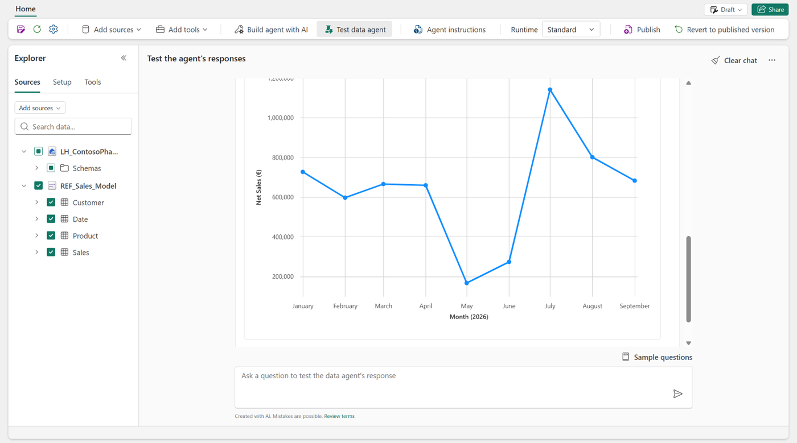
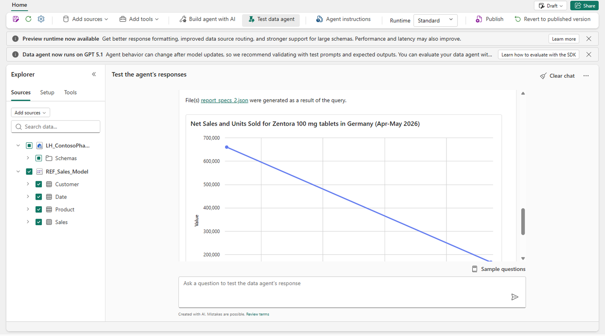

# Part B – Power business user: test, visualize, improve

**Time:** 40 minutes. You test your **partner's** published agent, for example `P08_Sales_Agent`.

> **Your view isn't a business user's view.** You're a Contributor in this workshop, so you can also open the draft and change the configuration. A workspace **Viewer** sees the agent read-only: the configuration can't be changed, and the ribbon has no **Build agent with AI** or **Test data agent**. Business users can also use the published agent in Microsoft 365 Copilot or Teams ([B5](#b5-use-the-agent-where-you-work-demo)) and report problems from there ([B4](#b4-report-problems-back-to-the-developer)).

| Step | What you do | Min |
| --- | --- | ---: |
| [B1](#b1-open-the-published-agent) | Open the published agent | 5 |
| [B2](#b2-ask-and-get-answers-as-charts) | Ask questions and get answers as charts | 10 |
| [B3](#b3-test-the-agent-with-a-fixed-question-list) | Test the agent with a fixed question list (workshop exercise) | 15 |
| [B4](#b4-report-problems-back-to-the-developer) | Report problems back to the developer | 10 |
| [B5](#b5-use-the-agent-where-you-work-demo) | Use the agent where you work (demo) | — |

## B1. Open the published agent

1. Open your partner's agent from the workspace, or from the link they shared.
2. If you see a version switch, select **Published**. That's the version other people use. The draft can change while the developer works on it ([Publish and share data agents](https://learn.microsoft.com/fabric/data-science/data-agent-sharing)).

Selecting **Published** lets you test the version that business users get. In Microsoft 365 Copilot their final answer can still differ from what you see here, because Copilot's orchestrator shapes it from the agent's output ([Control how Microsoft Copilot handles the output](https://learn.microsoft.com/fabric/data-science/data-agent-microsoft-365-copilot#control-how-microsoft-copilot-handles-the-output-from-fabric-data-agent)).

Ask the agent what it can do:

```text
What kind of questions can you answer, and which data do you use?
```

## B2. Ask and get answers as charts

In the Fabric agent screen, the agent returns charts as well as text and tables. It picks a chart when you ask for one, when your question implies one, or when the data suits one. Supported charts: line, multi-line, column, multi-column, stacked column, pie, scatter, area and stacked area ([Visual responses](https://learn.microsoft.com/fabric/data-science/data-agent-visuals)).

These charts render only in the data agent experience in Fabric. They don't render in Microsoft 365 Copilot, Teams, the SDK or Foundry. A business user in Microsoft 365 Copilot asks Copilot to create a chart from the agent's answer, and Copilot uses code interpreter for it ([Visual responses – limitations](https://learn.microsoft.com/fabric/data-science/data-agent-visuals#limitations), [Consume in Microsoft 365 Copilot](https://learn.microsoft.com/fabric/data-science/data-agent-microsoft-365-copilot)).

Try these, one after the other, in the same chat:

```text
Show net sales by therapeutic area for 2025.
Now show it as a pie chart.
Show monthly net sales for Immunara in 2025 and 2026 as a line chart.
Break 2025 net sales down by customer type as a column chart.
Show the weekly stock status of Zentora 100 mg tablets in Germany from April to July 2026.
```



When you ask *why*, the agent can combine both sources in one answer and attach a chart. The run steps show one step per source:



Good to know:

- Hover over a chart to see tooltips. Charts use at most 200 rows. Colours, fonts and titles are preset.
- The developer can steer charts through the agent instructions, for example "line charts for trends" ([Configure your data agent](https://learn.microsoft.com/fabric/data-science/data-agent-configurations#data-agent-instructions)).

## B3. Test the agent with a fixed question list

*Workshop exercise, not a Fabric feature.* Microsoft's data agent tutorial recommends testing the agent and gathering feedback from colleagues to refine it ([Test and revise the Fabric data agent](https://learn.microsoft.com/fabric/data-science/data-agent-end-to-end-tutorial#test-and-revise-the-fabric-data-agent)). Here you do that for your partner: ask a fixed list of questions, check the run steps, and compare each answer with the expected one. The expected answers are computed from the lab data by [build_answer_key.py](../scripts/build_answer_key.py).

1. Open [testing/business-test-sheet.csv](testing/business-test-sheet.csv) in Excel.
2. Ask questions Q01 to Q11 one at a time, and select **Clear chat** before each question ([Create a data agent – Ask questions](https://learn.microsoft.com/fabric/data-science/how-to-create-data-agent#ask-questions)). Each scored answer must stand on its own, without help from earlier questions. Test follow-up questions separately, as in B2. For each question, fill in:
   - **source_used:** open the run steps. *SQL* means the lakehouse, *DAX* means the semantic model.
   - **visual_shown:** yes or no.
   - **result_pass_partial_fail:** compare the answer with **what_good_looks_like**.
   - **feedback_for_developer:** one sentence.
3. Compare your numbers with your neighbour's. The instructor shares [the answer key](testing/answer-key.csv) at the end.

**Ways to test that Microsoft documents**

| Option | Who | What it does | Status |
| --- | --- | --- | --- |
| **Test data agent** mode and draft vs published | Developer or power user with **Edit and view details** | Try configuration changes in the draft before users see them | Data agent: GA ([Data agent concepts](https://learn.microsoft.com/fabric/data-science/concept-data-agent)). Build agent with AI: preview ([Build agent with AI](https://learn.microsoft.com/fabric/data-science/data-agent-creator-agent-overview)) |
| Evaluation SDK | Developer | Runs questions with expected answers as a batch (for example [testing/ground_truth.csv](testing/ground_truth.csv)), scores each answer correct, incorrect or unclear, and stores the results in a table | Preview ([Evaluate your data agent](https://learn.microsoft.com/fabric/data-science/evaluate-data-agent)) |
| Copilot Studio **Evaluate** tab | Maker of a Copilot Studio agent that uses this data agent | Test sets created manually, generated by AI or uploaded from a CSV. Its only method today (General quality) doesn't compare against expected answers | Preview ([Evaluate an agent](https://learn.microsoft.com/microsoft-copilot-studio/agents-experience/analytics-agent-evaluation-intro)) |

## B4. Report problems back to the developer

Microsoft documents two ways for people who use the agent to report a problem:

| Where the business user asks | How they report a problem | How it reaches the developer | Status |
| --- | --- | --- | --- |
| Microsoft 365 Copilot, with the agent published there ([B5](#b5-use-the-agent-where-you-work-demo)) | Thumbs up or thumbs down on an answer. In the **Submit feedback to Microsoft** window they can type a comment, select **Capture screenshot**, and select **Share relevant prompts, responses, and diagnostic data?**, then **Submit** | The feedback goes to Microsoft. Microsoft shares it with the agent's creator only if the Microsoft 365 admin turned on **Agents** > **Settings** > **Agent feedback sharing** for the agent, and the agent was published to Microsoft Copilot again after that. Anyone who can edit the agent can then read it in a Fabric notebook with `list_feedback` from the Fabric data agent Python SDK: question, response, rating, comment and attachments, without user identifiers or the full chat history | Preview ([Get user feedback in Microsoft Copilot](https://learn.microsoft.com/fabric/data-science/data-agent-microsoft-copilot-feedback), [Agent feedback sharing](https://learn.microsoft.com/microsoft-365/admin/manage/agent-settings#agent-feedback-sharing)) |
| A Copilot Studio agent that uses the data agent as a tool | Thumbs up or thumbs down on an answer, then an optional comment | The maker of the Copilot Studio agent sees the reactions and comments on its **Monitor** page. Reading comments needs the **Bot Transcript Viewer** role. Reactions are on by default in every channel except Microsoft Copilot, where the Microsoft 365 admin must allow agent feedback sharing first | Available ([Monitor conversational agents – Reactions](https://learn.microsoft.com/microsoft-copilot-studio/analytics-improve-agent-effectiveness#reactions)) |

In Microsoft 365 Copilot, your organization's feedback policies decide which of these options users see. An administrator can turn off feedback, screenshots, or the sharing of prompts and responses ([How users give feedback](https://learn.microsoft.com/fabric/data-science/data-agent-microsoft-copilot-feedback#how-users-give-feedback)).

**In this workshop**, Microsoft 365 Copilot is only an optional demo, so you give your findings to your partner directly. Turn your test results into three concrete requests. Write each one like the comment you'd submit with a thumbs down: the question, what was wrong, and what a good answer looks like. Use this format:

| Type | Example | Where the developer puts it |
| --- | --- | --- |
| Term or acronym | "*GTN* means discount %, not net sales." | AI instructions in the model (Prep for AI), or agent instructions for terms shared across sources |
| Question and expected answer | "*Which hospitals buy the most Onkivex?* → top 5 hospitals by net sales." | Verified answer (semantic model) or example query (lakehouse) |
| Answer format | "Always show EUR in millions, and name the period." | Agent instructions → Response guidelines |

Then:

1. The developer applies your requests to the **draft**, tests them in **Test data agent** mode, and publishes again. Feedback from Microsoft 365 Copilot goes through the same steps.
2. You run your failed questions again on the **Published** version.
3. Add your questions and expected answers to a CSV with the columns `question,expected_answer`, like [testing/ground_truth.csv](testing/ground_truth.csv). The developer can then run the whole set automatically after every change (regression test).

A power user with **Edit and view details** can change the draft directly. Agree with the developer who publishes.

## B5. Use the agent where you work (demo)

The instructor shows where else people can use the agent. Each channel needs a **published** agent.

| Channel | How | Status |
| --- | --- | --- |
| Microsoft 365 Copilot and Teams | In the **Publish** window, select **Publish to Microsoft Copilot** (the consume article calls it **Publish to Agent Store**). Then open the agent in Microsoft 365 Copilot or @mention it. Users rate answers there with thumbs up or down ([B4](#b4-report-problems-back-to-the-developer)) | Preview ([Consume in Microsoft 365 Copilot](https://learn.microsoft.com/fabric/data-science/data-agent-microsoft-365-copilot), [What's new](https://learn.microsoft.com/fabric/fundamentals/whats-new)) |
| Copilot Studio | Add the agent as a **Fabric IQ Data MCP** tool, then publish to Teams and Microsoft 365 | GA ([Data agent in Copilot Studio](https://learn.microsoft.com/fabric/data-science/data-agent-microsoft-copilot-studio-tool)) |
| VS Code or any MCP client | Use the MCP server URL from the agent settings | Available ([Data agent MCP server](https://learn.microsoft.com/fabric/data-science/data-agent-mcp-server)) |

Back to the [Lab 2 overview](README.md) for the governance demo and the gap matrix.
