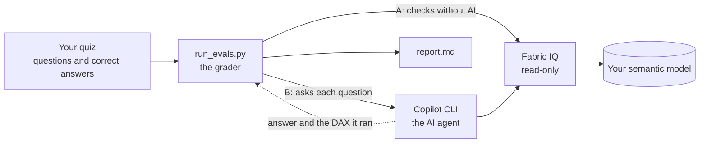

# Lab 3 – Evaluate how AI-ready your semantic model is, with Fabric IQ MCP

**Time:** 60 minutes · **Level:** intermediate · **Tools:** Python, Azure CLI, GitHub Copilot CLI. VS Code is optional

In Lab 1 you prepared `P07_Sales_Model` for AI with **Prep data for AI**. This lab tests whether that works: a script asks an AI agent your business questions about the model, and grades every answer.

> **Your own model?** See [Use Lab 3 on your own semantic model](use-on-your-model.md). **Script details:** [eval/README.md](eval/README.md).

## How it works

It's a quiz for your semantic model:

1. **You write the quiz:** business questions and their correct answers, in [testset/questions.csv](testset/questions.csv).
2. **An AI agent takes the quiz.** GitHub Copilot CLI reads your model only through **Fabric IQ**, the read-only access point to Power BI models.
3. **A script grades it:** is the number right, and did the agent use the right measure and filters? It writes a report.



There are two paths:

| Path | What it checks | AI | Time |
| --- | --- | --- | --- |
| **A. Checks without AI** | What the model gives an agent: fields, descriptions, AI instructions. Whether business words hit the right columns. Whether the measures return the correct numbers | No | Under a minute |
| **B. The AI quiz** | Whether an agent answers each question correctly, with the right measure and filters | Yes | About 30 seconds per question |

The report calls them four layers: path A is **L1** (readiness), **L2** (word lookup) and **L3** (correct numbers); path B is **L4** (agent).

### How a question is graded

A real question from the last run:

| | |
| --- | --- |
| **Question** | *What was GTN in DACH last year?* |
| **Correct answer** (computed from the source data, not from the model) | 8,504,817.16, or 9.567% of gross sales |
| **The agent's answer** | *In 2025, GTN in DACH was €8,504,817 in discounts and rebates, or 9.6% of gross sales.* |
| **Checks** | ✅ the number matches · ✅ the DAX uses Discount Amount or Discount % · ✅ the DAX filters on DACH |
| **Result** | **PASS** |

The DAX the agent ran:

```dax
EVALUATE
SUMMARIZECOLUMNS(
    TREATAS({"DACH"}, 'Customer'[Sales Region]),
    TREATAS({2025}, 'Date'[Year]),
    "GTN Amount", [Discount Amount],
    "GTN Percent", [Discount %]
)
```

A question passes only if every check passes. Two questions test behaviour instead of numbers: a vague question must get a question back, and a question about data that isn't in the model must get *that's not in the model*.

### What you need

| Tool | Why | Path |
| --- | --- | --- |
| **Python 3.10+** | Runs the grader | A and B |
| **Azure CLI** (`az login`) | Signs you in. Fabric IQ accepts only a user's sign-in, not a service account | A and B |
| **GitHub Copilot CLI** | The AI agent that takes the quiz. A script can start it with one question, and it reports back every DAX query it ran. On Windows it needs PowerShell 7 | B |
| **Skills for Fabric** (recommended) | The manual the agent follows for Fabric IQ, see below | B |
| **VS Code** (optional) | Editor and terminal, and an optional interactive review with Copilot Chat | – |

**Why Skills for Fabric:** Fabric IQ only gives the agent tools, such as *read the schema* and *run DAX*; it doesn't answer questions ([Fabric IQ MCP](https://learn.microsoft.com/fabric/iq/connectors/fabric-iq-mcp)). The fabriciq skill is a text file that tells the agent how to use them: read the schema first, always follow the model's AI instructions, look up names before filtering, never invent numbers. With it, every run follows the same Microsoft-defined steps, so a failed question points at your model and not at an improvising agent. It's only instructions: all data still comes through Fabric IQ.

**Your data:** path A sends nothing to an AI. Path B sends the model's metadata and query results to the AI model that GitHub Copilot uses. Everything runs as you, so RLS applies.

> **What this measures:** how well an agent that reads your model through Fabric IQ answers your questions. Copilot in Power BI uses the same model context but a different agent, so treat the score as a regression test for the model, and confirm important results in the Copilot pane. It follows Microsoft's advice for Fabric IQ: test a representative set of business questions against validated results ([Prepare the semantic model for Fabric IQ](https://learn.microsoft.com/power-bi/create-reports/copilot-ask-data-question#prepare-the-semantic-model-for-fabric-iq)).

## What Fabric IQ gives an agent

We compared what Fabric IQ returns with the model definition for two models, in November 2026. Repeat it on your model with [inspect_model.py](eval/README.md#inspect_modelpy).

| Prep data for AI setting | Does the agent get it? | Evidence |
| --- | --- | --- |
| **AI instructions** | Yes, word for word | Identical to the text stored in the model, 2 of 2 models |
| **AI data schema** (Simplify the data schema) | Yes: fields you untick aren't returned. Except relationship columns, which are always returned | 33 of 33 unticked fields weren't returned |
| **Hiding a field in the model** | Not enough on its own | A hidden field that was still ticked in the AI data schema was returned |
| **Verified answers** | No | Not returned for either model. Microsoft: *"When Fabric IQ is enabled, Copilot doesn't return verified answers"* ([Verified answers – limitations](https://learn.microsoft.com/power-bi/create-reports/copilot-prepare-data-ai-verified-answers#general-limitations)) |

So: keep fields away from agents with **Simplify the data schema**, put business rules in the **AI instructions**, and test verified answers in the Copilot pane, because this lab can't.

## The 16 questions

Each question in [testset/questions.csv](testset/questions.csv) tests one thing:

| What it tests | Questions | Example |
| --- | --- | --- |
| AI instructions: terminology | Q01, Q03, Q04, Q08, Q09, Q10, Q11 | *What was GTN in DACH last year?* must use Discount Amount or Discount %, Sales Region = DACH, 2025 |
| AI instructions: default period | Q02 | *What is our revenue?* must use 2025 and say so |
| AI instructions: brand rule | Q05 | *Zentora sales in Germany in May 2026* must filter on Brand (EUR 843 k), not on one product (EUR 167 k) |
| AI instructions: year over year, trend, data range | Q07, Q13, Q14 | Trends must not use Order Date |
| AI instructions: ambiguity | Q15 | *How are we doing?* must get a clarifying question |
| Value lookup, descriptions | Q06, Q12 | A product with its strength; top 3 countries |
| Data that isn't in the model | Q16 | Quality complaints aren't in the model: the agent must say so |

## Before you start

- **Model:** `P07_Sales_Model` from Lab 1, or `REF_Sales_Model` in the folder **REF**. Copy its URL from the browser.
- **Install and sign in**, in a terminal (in VS Code: **Terminal** > **New Terminal**):

  ```powershell
  pip install -r lab-03-ai-readiness-evals/eval/requirements.txt
  az login
  winget install GitHub.Copilot      # or: npm install -g @github/copilot (Node.js 22+)
  copilot                            # sign in once, then type /quit
  ```

- **Recommended:** in Copilot CLI, `/plugin marketplace add microsoft/skills-for-fabric`, then `/plugin install fabric-skills@fabric-collection` ([Install Skills for Fabric](https://learn.microsoft.com/fabric/fundamentals/skills-for-fabric-install)).

## Step 1 – See what an agent sees (5 min)

```powershell
cd lab-03-ai-readiness-evals/eval
python inspect_model.py --model "<semantic model URL>"
```

It prints the AI instructions the agent gets, whether verified answers come back, and which hidden fields Fabric IQ still returns.

<details>
<summary>Optional: the same review with Copilot Chat in VS Code</summary>

1. Run **Chat: Open Customizations** from the Command Palette and select **MCP Servers**. If **FabricIQ** isn't listed, select **Add Server** (**+**) > **HTTP**, enter `https://fabriciq.svc.cloud.microsoft/v1/mcp/fabriciq`, name it `FabricIQ`, and choose **Global** > **Copilot Global** ([Add MCP servers in VS Code](https://code.visualstudio.com/docs/agent-customization/mcp-servers)).
2. Open [copilot/ai-readiness-review.prompt.md](copilot/ai-readiness-review.prompt.md) and select the play button in the editor title bar ([Use prompt files](https://code.visualstudio.com/docs/agent-customization/prompt-files)).
3. Paste the model URL when asked, sign in with your work account, and approve the Fabric IQ tool calls. They're read-only.

</details>

## Step 2 – Path A: checks without AI (5 min)

```powershell
python run_evals.py --model "<semantic model URL>" --layers lint,grounding,truth
```

## Step 3 – Path B: the AI quiz (10 min)

```powershell
python run_evals.py --model "<semantic model URL>"
```

Each line shows a question, PASS or FAIL, and the time. Useful options: `--questions Q02,Q05` runs only some questions, and `--repeat 3` runs each question three times, because AI answers vary. All options: [run_evals.py](eval/README.md#run_evalspy).

## Step 4 – Read the report (10 min)

Open `results/<timestamp>/report.md`; in VS Code, press **Ctrl+Shift+V** for the preview:

- **Scorecard:** pass, warn, fail and info per layer.
- **By Prep data for AI feature:** where the model is weakest, and where in Power BI you fix it.
- **Failed runs:** the question, the expected answer, the agent's answer, what failed and the DAX it ran.

Read every failed run in this order:

1. **L3 failed?** The model returns the wrong number. Fix the measure first: no AI setting can fix wrong DAX.
2. **The DAX uses the wrong measure or column?** Fix the AI instructions (terminology), the AI data schema (untick the competing field) or the descriptions.
3. **The DAX uses the wrong value?** Check L2. For example, *UK & Ireland* also matches the country *Ireland*.
4. **The DAX is right but the answer is wrong?** That's the agent. Rerun with `--repeat 3` before you change the model.

To see exactly what the agent did, open `results/<timestamp>/traces/<question id>-run1.jsonl`. Every Fabric IQ call and its result is there.

### Example: REF_Sales_Model, November 2026

One run with the Copilot CLI default model:

| Layer | Result |
| --- | --- |
| L1 readiness | 11 pass, 2 warn, 1 info |
| L2 word lookup | 7 pass, 3 warn |
| L3 correct numbers | 12 of 12 |
| L4 agent | 15 of 16 |

What the run found, and what to do about it:

| Finding | Layer | Fix |
| --- | --- | --- |
| **Vague questions get an answer, not a question.** *How are we doing?* returned a full 2025 analysis, in two runs on different days. The rule *no period → use 2025* wins over *ambiguous → ask one question* | L4 | Make the ambiguity rule explicit in the AI instructions, for example: *If the user doesn't name a metric, ask which one before you answer. The default period applies only when the metric is clear* |
| **AI instructions differ from source control.** The model says GTN means *Discount Amount or Discount %* and adds *packs = Units Sold*. [ai-instructions.md](../lab-01-semantic-model/ai-instructions.md) says *Discount %* only, and has a growth synonym and a full-year YoY rule that the model doesn't | L1 | Decide which text is right, then update the other |
| **Search doesn't find the model by name.** Agents that start from a name, not a URL, won't reach it | L1 | Add a model description, endorse the model, and mark it **Approved for Copilot** |
| **Ambiguous values.** *UK & Ireland* also matches the country *Ireland*, and *Wholesale* (channel) is close to *Wholesaler* (customer type) | L2 | Add both distinctions to the AI instructions |
| **A relationship column without a description.** Agents see `Sales[Order Date]`, because Fabric IQ always returns relationship columns | L1 | Describe it, for example *Order date. Use the Date table for time filters* |
| **No verified answers reach Fabric IQ agents** | L1, info | Nothing to fix for Fabric IQ. Test verified answers in the Copilot pane |

L3 and the AI data schema check passed: every measure returns the validated number, and none of the 10 technical fields reaches an agent.

## Step 5 – Fix, wait, rerun (15 min)

1. Make one change in **Prep data for AI**, for example the ambiguity rule above, or align the AI instructions with [ai-instructions.md](../lab-01-semantic-model/ai-instructions.md).
2. Wait a few minutes: Prep data for AI changes can take a few minutes to reach AI experiences ([Prepare your data for AI](https://learn.microsoft.com/power-bi/create-reports/copilot-prepare-data-ai#power-bi-service)).
3. Rerun only the questions you expect to change, for example `--questions Q15`. Then rerun everything to check that nothing else broke.

## Step 6 – Use it on your own model

The Python code is the grader and stays the same. Your model needs its own quiz, which is three files:

| File | What you write | Example |
| --- | --- | --- |
| `questions.csv` | Questions, correct answers, and what the DAX must use | *What was GTN in DACH last year?* → 8504817.16 → `Discount Amount`, `DACH` |
| `value-probes.csv` | Words your users type, and the column each must hit | `DACH` → `Customer[Sales Region]` |
| `readiness-rules.json` | A few rules for path A | Fields agents must not see; words the AI instructions must mention |

Only `questions.csv` is real work. Step by step: [Use Lab 3 on your own semantic model](use-on-your-model.md).

## Limits

- **A proxy for Copilot.** Same model context, different agent. Confirm important results in the Copilot pane.
- **Verified answers aren't tested.** Fabric IQ doesn't return them.
- **A person signs in.** Fabric IQ doesn't support service principals ([Fabric IQ MCP – limitations](https://learn.microsoft.com/fabric/iq/connectors/fabric-iq-mcp#limitations-and-considerations)), so the evaluation can't run unattended as a service account.
- **Throttling.** Fabric IQ calls count against Power BI limits. Run one question at a time (the default).
- **RLS.** Results are what *you* can see. Run as a test user to evaluate a role.

## Files

| File | Use |
| --- | --- |
| [use-on-your-model.md](use-on-your-model.md) | Adapt the quiz to your own semantic model |
| [eval/README.md](eval/README.md) | Script reference: options, outputs, scoring, troubleshooting |
| [eval/run_evals.py](eval/run_evals.py) | The grader: runs paths A and B and writes the report |
| [eval/inspect_model.py](eval/inspect_model.py) | Shows what an agent gets from a model |
| [testset/](testset/) | The workshop quiz: questions, word probes and rules |
| [copilot/](copilot/) | Optional: review prompt and MCP configuration for VS Code and Copilot CLI |

## Sources

- [Get started with the Fabric IQ MCP server](https://learn.microsoft.com/fabric/iq/connectors/fabric-iq-mcp)
- [Ask data questions with Copilot and Fabric IQ](https://learn.microsoft.com/power-bi/create-reports/copilot-ask-data-question)
- [Prepare your data for AI to improve Copilot results](https://learn.microsoft.com/power-bi/create-reports/copilot-prepare-data-ai)
- [Prepare your data for AI: AI instructions](https://learn.microsoft.com/power-bi/create-reports/copilot-prepare-data-ai-instructions)
- [Prepare your data for AI: Verified answers](https://learn.microsoft.com/power-bi/create-reports/copilot-prepare-data-ai-verified-answers)
- [Prepare your data for AI: AI data schemas](https://learn.microsoft.com/power-bi/create-reports/copilot-prepare-data-ai-data-schema)
- [Install Skills for Fabric](https://learn.microsoft.com/fabric/fundamentals/skills-for-fabric-install)
- [Installing GitHub Copilot CLI](https://docs.github.com/copilot/how-tos/set-up/install-copilot-cli)
- [Add MCP servers in VS Code](https://code.visualstudio.com/docs/agent-customization/mcp-servers)
