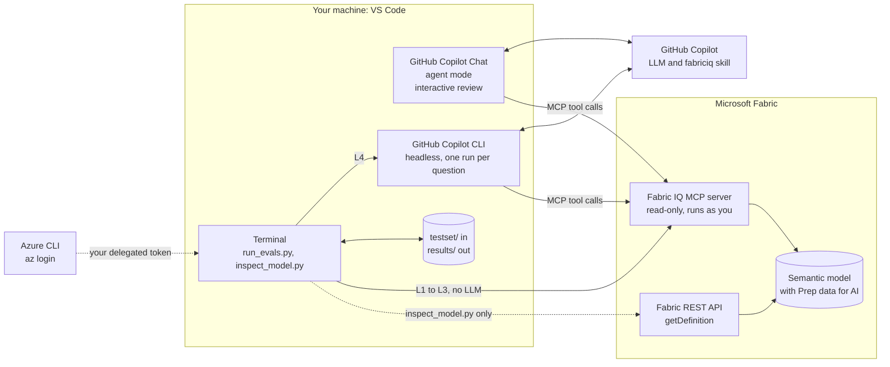

# Lab 3 – Evaluate how AI-ready your semantic model is, with Fabric IQ MCP

**Time:** 60 minutes · **Level:** intermediate · **Tools:** VS Code with GitHub Copilot, Python 3.10+, Azure CLI, GitHub Copilot CLI

In Lab 1 you prepared `P07_Sales_Model` for AI: descriptions, and **Prep data for AI** (AI data schema, AI instructions). In Lab 2 you evaluated a data agent in batch with the evaluation SDK. This lab does the same for the **semantic model itself**: a repeatable, scripted test that tells you whether an AI agent gets the right answers from your model, and which Prep data for AI setting to fix when it doesn't.

> **Using this on your own semantic model?** Read [Use Lab 3 on your own semantic model](use-on-your-model.md): what to explain to stakeholders, what you need, and what to change.
> **Script reference:** [eval/README.md](eval/README.md): every option, input file and output.

## Why a separate lab

| | Lab 2 · data agent | Lab 3 · semantic model |
| --- | --- | --- |
| **What answers the question** | The published data agent | Any MCP agent, here GitHub Copilot with the fabriciq skill |
| **How you reach the data** | Data agent SDK | [Fabric IQ MCP](https://learn.microsoft.com/fabric/iq/connectors/fabric-iq-mcp), read-only, as the signed-in user |
| **What it evaluates** | Agent instructions, example queries, data sources | AI data schema, AI instructions, descriptions, values, model design |
| **Scoring** | LLM critic | Deterministic checks first, optional LLM critic |
| **Output** | Lakehouse tables | `results/<run>/report.md`, CSV files and traces |

Microsoft's guidance for preparing a model for Fabric IQ ([Prepare the semantic model for Fabric IQ](https://learn.microsoft.com/power-bi/create-reports/copilot-ask-data-question#prepare-the-semantic-model-for-fabric-iq)):

> - Identify a representative set of business questions to test.
> - Define the expected measure, grouping, date context, filters, and result for each question.
> - Compare the responses with known, validated results.

In the Copilot pane you do that by hand, one question at a time ([Test your Copilot tooling changes](https://learn.microsoft.com/power-bi/create-reports/copilot-prepare-data-ai#test-your-copilot-tooling-changes)). This lab scripts it.

Fabric IQ MCP makes that possible. It gives any agent the same model context (tables, descriptions, AI instructions) and runs DAX as the signed-in user. It doesn't answer questions itself; *the calling agent writes the DAX* ([Fabric IQ MCP](https://learn.microsoft.com/fabric/iq/connectors/fabric-iq-mcp)). So a wrong answer points at either the agent or what the model told it, and the saved traces show which.

> **What this measures.** How well an agent that reads your model through Fabric IQ answers your business questions. Copilot in Power BI with Fabric IQ uses the same model context, but a different orchestrator and LLM. Treat the result as a regression test for the model, not as a Copilot score, and confirm it in the Copilot pane before you mark the model **Approved for Copilot** ([Approved for Copilot](https://learn.microsoft.com/power-bi/create-reports/copilot-prepare-data-ai#mark-your-model-as-approved-for-copilot)).

## How it works

### Architecture



| Component | Role | Where it runs |
| --- | --- | --- |
| **VS Code** | Your workbench: Copilot Chat for the interactive review, the terminal for the scripts | Your machine |
| **GitHub Copilot Chat** (agent mode) | Interactive agent: runs the [review prompt](copilot/ai-readiness-review.prompt.md) against your model through Fabric IQ | VS Code, with your GitHub Copilot licence |
| **Python scripts** ([eval/](eval/)) | L1 to L3 call Fabric IQ directly. L4 starts Copilot CLI once per question and scores what comes back | VS Code terminal |
| **GitHub Copilot CLI** | The agent under test in L4. Same Copilot account, LLMs and fabriciq skill as Copilot Chat, but it runs headless and reports every tool call | Started by the scripts |
| **[Skills for Fabric](https://learn.microsoft.com/fabric/fundamentals/skills-for-fabric-install)** (fabriciq skill) | Tells the agent how to use Fabric IQ: read the AI instructions, look up values, write DAX. Recommended by Microsoft for Fabric IQ | Loaded by Copilot CLI or VS Code |
| **Fabric IQ MCP server** | Remote, read-only. Returns the model context and runs DAX with your permissions; RLS and OLS apply | Microsoft Fabric |
| **Azure CLI** | Gets your delegated Microsoft Entra token for the scripts. Fabric IQ doesn't accept service principals | Your machine |
| **Fabric REST API** | Only [inspect_model.py](eval/inspect_model.py) uses it, to compare Fabric IQ's output with the model definition | Microsoft Fabric |

### Three ways to use it

| Mode | Where | LLM | Time | Use it to |
| --- | --- | --- | --- | --- |
| **Interactive review** | VS Code Copilot Chat, agent mode | Yes | 5 minutes | Explore a model and explain the findings to its owners |
| **Deterministic checks** (L1 to L3) | VS Code terminal: `run_evals.py --layers lint,grounding,truth` | No | Under a minute | Check every model change |
| **Agent evaluation** (L4) | VS Code terminal: `run_evals.py` | Yes | About 30 seconds per question | Measure answer quality before you approve the model for Copilot, and after every Prep data for AI change |

### Why Copilot CLI runs the batch, not Copilot Chat

Copilot Chat is interactive: you can't send it 16 questions and collect the tool calls it made. Copilot CLI has a programmatic mode, `copilot -p`, that writes every event as JSON lines, including each Fabric IQ tool call and DAX query ([GitHub Copilot CLI](https://docs.github.com/copilot/concepts/copilot-surfaces/copilot-cli)). The runner starts one Copilot CLI process per question, in an empty folder, with only the Fabric IQ tools visible. Details: [How an agent run works](eval/README.md#how-an-agent-run-works-l4).

### Who signs in, and where the data goes

| Step | Signs in as | Data leaves Fabric to |
| --- | --- | --- |
| L1 to L3, `inspect_model.py` | You, with `az login` (delegated Power BI token) | Your machine only. No LLM |
| L4 and `--judge` | You for Fabric IQ, plus your GitHub account for Copilot | The LLM that GitHub Copilot uses: model metadata and query results |
| Interactive review | You in VS Code, plus your GitHub account | Same as L4 |
| Results | – | Your `results/` folder, which is in `.gitignore` |

Everything runs with your permissions: RLS and OLS apply, and you only see models you can open. Fabric IQ doesn't support service principals or app-only tokens ([Fabric IQ MCP – authenticate](https://learn.microsoft.com/fabric/iq/connectors/fabric-iq-mcp#authenticate)).

## What Fabric IQ gives an agent

The checks only make sense if you know what Fabric IQ passes on. We compared what Fabric IQ returns with the model definition for two models in November 2026. Repeat it on your model with [inspect_model.py](eval/README.md#inspect_modelpy).

| Setting | Does an agent get it through Fabric IQ? | Evidence |
| --- | --- | --- |
| **AI instructions** | Yes, word for word, as `CustomInstructions` | Identical to the text stored in the model's linguistic schema, 2 of 2 models |
| **AI data schema** (Simplify the data schema) | Yes: fields you untick aren't returned. Exception: relationship columns are always returned | One model: 33 of 33 fields hidden from AI weren't returned. `REF_Sales_Model`: its 5 hidden relationship columns were returned |
| **Hiding a field in the model** | Not on its own: a hidden field that's still selected in the AI data schema is returned | One model, one field |
| **Descriptions, format strings, active relationships** | Yes | Both models |
| **Verified answers** | No | Not returned for either model. Microsoft: *"When Fabric IQ is enabled, Copilot doesn't return verified answers"*, and verified answers don't support REST APIs or Git ([Verified answers – limitations](https://learn.microsoft.com/power-bi/create-reports/copilot-prepare-data-ai-verified-answers#general-limitations)) |
| **Marked as date table, inactive relationships, Q&A, Approved for Copilot, endorsement** | No | Not in the response. Check them in the service |

What that means for you:

- Use **Prep data for AI > Simplify the data schema** to keep fields away from agents. Hiding them in the model isn't enough.
- **AI instructions** are the strongest lever for Fabric IQ agents: they arrive word for word.
- **Verified answers** help Copilot in Power BI without Fabric IQ. Test them in the Copilot pane; this lab can't.

## The four layers

| Layer | What it checks | Fabric IQ tool | LLM |
| --- | --- | --- | --- |
| **L1 readiness lint** | Fields agents shouldn't see (AI data schema), description coverage and length, format strings, date table, relationships, AI instructions (present, under 10,000 characters, business terms covered, named objects exist, same as source control), discoverability by name. Verified answers are reported as information only | `GetSemanticModelSchema`, `DiscoverArtifacts` | No |
| **L2 value grounding** | Business terms (Zentora, DACH, Tender, UK & Ireland) resolve to the right column and value, and aren't ambiguous | `ValueSearch` | No |
| **L3 ground truth** | Reference DAX returns the expected numbers, which come from the source CSV files and not from the model | `ExecuteQuery` | No |
| **L4 agent** | Copilot CLI answers 16 questions. Each answer is scored on numbers, mentions and the DAX the agent ran (measure, filters, columns it must avoid). Optional LLM critic | All six | Yes |

The 16 questions in [testset/questions.csv](testset/questions.csv) each target one Prep data for AI feature:

| Feature | Questions | Example |
| --- | --- | --- |
| AI instructions: terminology | Q01, Q03, Q04, Q08, Q09, Q10, Q11 | *What was GTN in DACH last year?* must use Discount Amount or Discount %, Sales Region = DACH, 2025 |
| AI instructions: default period | Q02 | *What is our revenue?* must use 2025 and say so |
| AI instructions: brand rule | Q05 | *Zentora sales in Germany in May 2026* must filter on Brand (EUR 843 k), not on one product (EUR 167 k) |
| AI instructions: year over year, trend, data range | Q07, Q13, Q14 | Trends must not use Order Date |
| AI instructions: ambiguity | Q15 | *How are we doing?* must get a clarifying question |
| Value grounding, descriptions | Q06, Q12 | A product with its strength; top 3 countries |
| Groundedness | Q16 | Quality complaints aren't in the model: the agent must say so |

## Before you start

- **Model:** `P07_Sales_Model` from Lab 1, or `REF_Sales_Model` in the folder **REF**. You need access to it. Fabric IQ uses your existing permissions ([Fabric IQ MCP – prerequisites](https://learn.microsoft.com/fabric/iq/connectors/fabric-iq-mcp#prerequisites)).
- **VS Code** with GitHub Copilot, and this repository open (**File** > **Open Folder**).
- **Python 3.10+**, then in the VS Code terminal: `pip install -r lab-03-ai-readiness-evals/eval/requirements.txt`.
- **Azure CLI**, signed in with your work account: `az login`.
- **GitHub Copilot CLI** for L4: `winget install GitHub.Copilot` or `npm install -g @github/copilot` (Node.js 22 or later), then run `copilot` once and sign in. On Windows it needs PowerShell 7 ([Install Copilot CLI](https://docs.github.com/copilot/how-tos/set-up/install-copilot-cli)).
- **Skills for Fabric** in Copilot CLI (recommended): `/plugin marketplace add microsoft/skills-for-fabric`, then `/plugin install fabric-skills@fabric-collection` ([Install Skills for Fabric](https://learn.microsoft.com/fabric/fundamentals/skills-for-fabric-install)).

> Query results go to the LLM that GitHub Copilot uses. Use the workshop data, or check your organization's policy before you point this at production data.

## Step 1 – Look at what AI sees, in VS Code (10 min)

**A. With Copilot Chat (interactive)**

1. Open the Command Palette (**Ctrl+Shift+P**), run **Chat: Open Customizations** and select **MCP Servers**. If **FabricIQ** is listed, go to step 3. Skills for Fabric may have added it already.
2. Otherwise add it: select **Add Server** (**+**) > **HTTP**, enter `https://fabriciq.svc.cloud.microsoft/v1/mcp/fabriciq`, name it `FabricIQ`, and choose **Global** > **Copilot Global**. That writes `~/.copilot/mcp-config.json`, the same file Copilot CLI reads, so one setup serves both ([Add MCP servers in VS Code](https://code.visualstudio.com/docs/agent-customization/mcp-servers)). You can also copy [copilot/mcp-config.json](copilot/mcp-config.json) there.
3. Check the connection: in Copilot Chat (**Ctrl+Alt+I**), ask *"Use the FabricIQ MCP tools to resolve this semantic model URL and list its tables: &lt;URL&gt;. Don't change anything."* Sign in with your work account when asked, then expand the tool call to check that FabricIQ answered.
4. Open [copilot/ai-readiness-review.prompt.md](copilot/ai-readiness-review.prompt.md) and select the play button in the editor title bar ([Use prompt files in VS Code](https://code.visualstudio.com/docs/agent-customization/prompt-files)). When it asks for the model, paste the model's browser URL. Approve each Fabric IQ tool call; the tools are read-only.

**B. With a script (repeatable)**

```powershell
cd lab-03-ai-readiness-evals/eval
python inspect_model.py --model "<semantic model URL or ID>"
```

It prints the AI instructions an agent gets, whether verified answers come back, and every hidden field with whether Fabric IQ still returns it. Details: [inspect_model.py](eval/README.md#inspect_modelpy).

## Step 2 – Run the deterministic checks (5 min)

```powershell
python run_evals.py --model "<semantic model URL or ID>" --layers lint,grounding,truth
```

You can also pass the model name, but only if Fabric IQ search finds it. If it doesn't, the L1 check **Discoverable by name** shows that, and you pass the URL or ID instead.

## Step 3 – Run the agent evaluation (10 min)

```powershell
python run_evals.py --model "<semantic model URL or ID>"
```

The most useful options: `--questions Q02,Q05` to run only some questions, `--repeat 3` because answers are nondeterministic, `--llm <model>` to pin the LLM so runs are comparable, and `--judge` to add an LLM critic like in Lab 2. All options: [run_evals.py](eval/README.md#run_evalspy).

While it runs, each line shows the question, PASS or FAIL, and the time. If Power BI throttles you, the runner pauses and retries.

## Step 4 – Read the report (10 min)

Open `results/<timestamp>/report.md` in VS Code and press **Ctrl+Shift+V** for the preview:

- **Scorecard:** pass, warn, fail and info per layer.
- **By Prep data for AI feature:** where the model is weakest, and where in Power BI you fix it.
- **Failed runs:** the question, the expected answer, the agent's answer, what failed and the DAX it ran.

Read every failed run in this order:

1. **L3 failed?** The model returns the wrong number. Fix the measure first: no AI setting can fix wrong DAX.
2. **The DAX uses the wrong measure or column?** Fix the AI instructions (terminology), the AI data schema (untick the competing field) or the descriptions.
3. **The DAX uses the wrong value?** Check L2. For example, *UK & Ireland* also matches the country *Ireland*.
4. **The DAX is right but the answer is wrong?** That's the agent. Rerun with `--repeat 3` before you change the model.

To see exactly what the agent did, open `results/<timestamp>/traces/<question id>-run1.jsonl`. Every Fabric IQ call and its result is there.

### Example: REF_Sales_Model, November 2026

One run with the Copilot CLI default model:

| Layer | Result |
| --- | --- |
| L1 readiness | 11 pass, 2 warn, 1 info |
| L2 grounding | 7 pass, 3 warn |
| L3 ground truth | 12 of 12 |
| L4 agent | 15 of 16 |

What the run found, and what to do about it:

| Finding | Layer | Fix |
| --- | --- | --- |
| **Vague questions get an answer, not a question.** *How are we doing?* returned a full 2025 analysis, in two runs on different days. The rule *no period → use 2025* wins over *ambiguous → ask one question* | L4 | Make the ambiguity rule explicit in the AI instructions, for example: *If the user doesn't name a metric, ask which one before you answer. The default period applies only when the metric is clear* |
| **AI instructions differ from source control.** The model says GTN means *Discount Amount or Discount %* and adds *packs = Units Sold*. [ai-instructions.md](../lab-01-semantic-model/ai-instructions.md) says *Discount %* only, and has a growth synonym and a full-year YoY rule that the model doesn't | L1 | Decide which text is right, then update the other |
| **Search doesn't find the model by name.** Agents that start from a name, not a URL, won't reach it | L1 | Add a model description, endorse the model, and mark it **Approved for Copilot** |
| **Ambiguous values.** *UK & Ireland* also matches the country *Ireland*, and *Wholesale* (channel) is close to *Wholesaler* (customer type) | L2 | Add both distinctions to the AI instructions |
| **A relationship column without a description.** Agents see `Sales[Order Date]`, because Fabric IQ always returns relationship columns | L1 | Describe it, for example *Order date. Use the Date table for time filters* |
| **No verified answers reach Fabric IQ agents** | L1, info | Nothing to fix for Fabric IQ. Test verified answers in the Copilot pane |

L3 and the AI data schema check passed: every measure returns the validated number, and none of the 10 technical fields reaches an agent.

## Step 5 – Fix, wait, rerun (15 min)

1. Make one change in **Prep data for AI**, for example the ambiguity rule above, or align the AI instructions with [ai-instructions.md](../lab-01-semantic-model/ai-instructions.md).
2. Wait a few minutes: Prep data for AI changes can take a few minutes to reach AI experiences ([Prepare your data for AI](https://learn.microsoft.com/power-bi/create-reports/copilot-prepare-data-ai#power-bi-service)). If you deploy the model through Git or a deployment pipeline, refresh it in the service so the AI settings sync.
3. Rerun only the questions you expect to change, for example `--questions Q15`. Then rerun everything to check that nothing else broke.

## Step 6 – Use it on your own model

Follow [Use Lab 3 on your own semantic model](use-on-your-model.md). In short: you keep the Python code as it is, and write a test set for your model: your users' questions with validated answers, your business terms, and your readiness rules.

## Limits

- **A proxy for Copilot.** Same model context, different agent. A model that scores well here is well described; Copilot can still answer differently.
- **Verified answers aren't tested.** Fabric IQ doesn't return them. Test them in the Copilot pane.
- **Delegated sign-in only.** Fabric IQ doesn't support service principals ([Fabric IQ MCP – limitations](https://learn.microsoft.com/fabric/iq/connectors/fabric-iq-mcp#limitations-and-considerations)). Run it from a developer machine, or a pipeline agent that runs as a user.
- **Throttling.** Fabric IQ calls count against Power BI limits. Several agents in parallel can block your account for a few minutes.
- **RLS.** Results are what *you* can see. Run as a test user to evaluate a role.
- **What the lint can't see.** Fabric IQ doesn't return whether the date table is marked, whether Q&A is on, inactive relationships, or whether the model is approved for Copilot. Check those in the service.

## Files

| File | Use |
| --- | --- |
| [use-on-your-model.md](use-on-your-model.md) | How to explain, set up and adapt Lab 3 for your own semantic model |
| [eval/README.md](eval/README.md) | Script reference: options, inputs, outputs, how scoring works, troubleshooting |
| [eval/run_evals.py](eval/run_evals.py) | Runs the layers and writes the report |
| [eval/inspect_model.py](eval/inspect_model.py) | Read-only: what Fabric IQ returns next to what the model definition stores |
| [eval/fabriciq_client.py](eval/fabriciq_client.py), [model_checks.py](eval/model_checks.py), [agent_eval.py](eval/agent_eval.py), [scoring.py](eval/scoring.py) | Modules used by the two scripts |
| [testset/questions.csv](testset/questions.csv) | 16 questions with expected answers, checks and reference DAX |
| [testset/value-probes.csv](testset/value-probes.csv) | Business terms and the column each should resolve to |
| [testset/readiness-rules.json](testset/readiness-rules.json) | Rules for the L1 lint |
| [copilot/ai-readiness-review.prompt.md](copilot/ai-readiness-review.prompt.md) | Interactive review prompt for Copilot Chat or Copilot CLI |
| [copilot/mcp-config.json](copilot/mcp-config.json) | Fabric IQ MCP server for VS Code and Copilot CLI (copy to `~/.copilot/mcp-config.json`) |

## Sources

- [Get started with the Fabric IQ MCP server](https://learn.microsoft.com/fabric/iq/connectors/fabric-iq-mcp)
- [Ask data questions with Copilot and Fabric IQ](https://learn.microsoft.com/power-bi/create-reports/copilot-ask-data-question)
- [Prepare your data for AI to improve Copilot results](https://learn.microsoft.com/power-bi/create-reports/copilot-prepare-data-ai)
- [Prepare your data for AI: AI instructions](https://learn.microsoft.com/power-bi/create-reports/copilot-prepare-data-ai-instructions)
- [Prepare your data for AI: Verified answers](https://learn.microsoft.com/power-bi/create-reports/copilot-prepare-data-ai-verified-answers)
- [Prepare your data for AI: AI data schemas](https://learn.microsoft.com/power-bi/create-reports/copilot-prepare-data-ai-data-schema)
- [Optimize your semantic model for Copilot](https://learn.microsoft.com/power-bi/create-reports/copilot-evaluate-data)
- [Semantic model best practices for data agent](https://learn.microsoft.com/fabric/data-science/semantic-model-best-practices)
- [Evaluate your data agent](https://learn.microsoft.com/fabric/data-science/evaluate-data-agent)
- [Install Skills for Fabric](https://learn.microsoft.com/fabric/fundamentals/skills-for-fabric-install)
- [Items – Get Semantic Model Definition](https://learn.microsoft.com/rest/api/fabric/semanticmodel/items/get-semantic-model-definition)
- [Installing GitHub Copilot CLI](https://docs.github.com/copilot/how-tos/set-up/install-copilot-cli)
- [GitHub Copilot CLI](https://docs.github.com/copilot/concepts/copilot-surfaces/copilot-cli)
- [Add MCP servers in VS Code](https://code.visualstudio.com/docs/agent-customization/mcp-servers)
- [Use prompt files in VS Code](https://code.visualstudio.com/docs/agent-customization/prompt-files)
