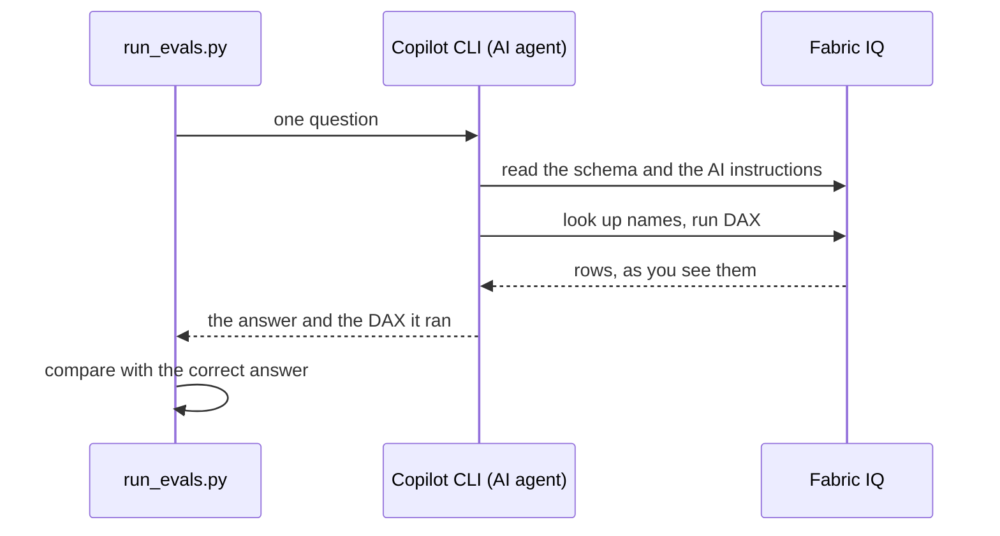

# Lab 3 scripts

The Python scripts behind [Lab 3](../README.md). They read a Power BI semantic model through the [Fabric IQ MCP server](https://learn.microsoft.com/fabric/iq/connectors/fabric-iq-mcp), check what an AI agent gets from it, and score how an agent answers your test questions.

To use them on your own model, read [Use Lab 3 on your own semantic model](../use-on-your-model.md) first.

## Quick start

In VS Code, open the repository folder, then open a terminal (**Terminal** > **New Terminal**):

```powershell
cd lab-03-ai-readiness-evals/eval
pip install -r requirements.txt
az login

python inspect_model.py --model "<semantic model URL or ID>"
python run_evals.py --model "<semantic model URL or ID>" --layers lint,grounding,truth
python run_evals.py --model "<semantic model URL or ID>"
```

| Command | Takes | Needs | Uses an LLM |
| --- | --- | --- | --- |
| `inspect_model.py` | 20 seconds | Python, Azure CLI | No |
| `run_evals.py --layers lint,grounding,truth` | under a minute | Python, Azure CLI | No |
| `run_evals.py` (all layers) | about 30 seconds per question | Python, Azure CLI, GitHub Copilot CLI | Yes |

You can run the scripts from any folder. Python finds the other modules next to the script.

## Files

| File | What it does | You run it |
| --- | --- | --- |
| [run_evals.py](run_evals.py) | Runs the evaluation layers L1 to L4 and writes the report | Yes |
| [inspect_model.py](inspect_model.py) | Shows what Fabric IQ returns for a model, next to what the model definition stores | Yes |
| [fabriciq_client.py](fabriciq_client.py) | Minimal Fabric IQ MCP client: Streamable HTTP, JSON-RPC, your delegated token, retries | No, a module |
| [model_checks.py](model_checks.py) | L1 readiness lint, L2 value grounding, L3 ground truth | No, a module |
| [agent_eval.py](agent_eval.py) | L4: runs GitHub Copilot CLI per question and reads its event stream; optional LLM judge | No, a module |
| [scoring.py](scoring.py) | Scores an answer: numbers, words, clarifying questions, the DAX the agent ran | No, a module |
| [requirements.txt](requirements.txt) | Python dependency: `requests` | – |

## run_evals.py

### Options

| Option | Default | Use |
| --- | --- | --- |
| `--model` | `FABRIC_SEMANTIC_MODEL` environment variable | The semantic model: browser URL, ID, or exact name. A name works only if Fabric IQ search finds it; the URL or ID always works |
| `--layers` | `lint,grounding,truth,agent` | Which layers to run. `lint,grounding,truth` don't use an LLM |
| `--questions` | all | Question IDs to run, for example `Q02,Q05`. Also filters L3 |
| `--repeat` | `1` | Runs per question. Answers are nondeterministic; use 3 for a baseline |
| `--parallel` | `1` | Agent runs at the same time. Power BI throttles bursts; keep it at 1 or 2 |
| `--llm` | Copilot CLI default | The model Copilot CLI uses, for example `claude-sonnet-5`. Pin it so runs are comparable |
| `--judge` | off | Also grade each answer with an LLM critic, like the data agent evaluation SDK in Lab 2. A *no* from the judge fails the run |
| `--testset` | `../testset` | Folder with `questions.csv`, `value-probes.csv` and `readiness-rules.json` |
| `--out` | `../results` | Folder for the results. Each run creates a subfolder named after its start time |
| `--fail-under` | `0` (off) | Exit with code 1 if the L4 pass rate is below this value (0 to 1) or any L1 to L3 check fails |
| `--rescore` | – | Apply the current `questions.csv` checks to a saved results folder, without calling Power BI or the agent |

### Environment variables

| Variable | Use |
| --- | --- |
| `FABRIC_SEMANTIC_MODEL` | Default for `--model` |
| `FABRICIQ_TOKEN` | A delegated Power BI token to use instead of `az account get-access-token`. Use it when your tenant blocks Azure CLI tokens |
| `FABRICIQ_ENDPOINT` | The Fabric IQ endpoint. Set `https://api.fabric.microsoft.com/v1/mcp/fabriciq` if your organization uses private links ([Fabric IQ MCP endpoint](https://learn.microsoft.com/fabric/iq/connectors/fabric-iq-mcp#fabric-iq-mcp-endpoint)) |
| `COPILOT_CLI_PATH` | Full path to the Copilot CLI executable, if `copilot` isn't on your `PATH` |

### Outputs

Each run writes `results/<yyyyMMdd-HHmmss>/`. The `results` folder is in `.gitignore`: it holds answers and query results.

| File | Content |
| --- | --- |
| `report.md` | Scorecard, scores per Prep data for AI feature with where to fix, every check, failed agent runs with the agent's answer and DAX. Open it in VS Code and press **Ctrl+Shift+V** for the preview |
| `findings.csv` | One row per L1 to L3 check: `layer`, `check`, `status` (`PASS`, `WARN`, `FAIL`, `INFO`), `detail`, `feature` |
| `agent-runs.csv` | One row per L4 run: `id`, `run`, `feature`, `question`, `expected`, `status` (`PASS`, `FAIL`, `ERROR` = throttled), `passed`, `checks_passed`, `judge`, `notes`, `answer`, `dax`, `tools`, `llm`, `seconds` |
| `schema.json` | What Fabric IQ returned for the model at the time of the run |
| `traces/<id>-run<n>.jsonl` | The full Copilot CLI event stream of each agent run: every tool call, its arguments and results |

### Exit codes

| Code | Meaning |
| --- | --- |
| 0 | The run finished. Without `--fail-under`, failed checks don't change the exit code |
| 1 | `--fail-under` is set, and an L1 to L3 check failed or the L4 pass rate is below the threshold |
| 2 | Fabric IQ error: sign-in failed, model not found, or no access |

### How an agent run works (L4)



For each question, `agent_eval.py`:

1. Creates an empty temporary folder, so the agent can't read the test set and its expected answers.
2. Writes a Fabric IQ server configuration with your token as an `Authorization` header to that folder. The header replaces the interactive sign-in ([Fabric IQ MCP – set up GitHub Copilot CLI](https://learn.microsoft.com/fabric/iq/connectors/fabric-iq-mcp#set-up-github-copilot-cli)). The file isn't on the command line.
3. Starts `copilot -p "<prompt>" --additional-mcp-config @<file> --allow-tool=FabricIQ --allow-tool=skill --no-ask-user --no-custom-instructions --available-tools <list> --output-format json`:
   - `--available-tools` makes only the Fabric IQ tools and the skill loader visible to the model. The list comes from the server's `tools/list`. Without it, Copilot CLI can approve harmless-looking shell commands by itself, and the agent could read the test set with its expected answers. We tested both cases
   - `--no-custom-instructions` ignores `AGENTS.md` and similar files, so repository instructions don't help the agent
   - `--output-format json` returns the event stream (JSONL) with the final answer and every tool call
4. Reads the final answer and every `ExecuteQuery` DAX from the event stream, and saves the stream to `traces/`.
5. Deletes the temporary folder with the token.

The prompt is in `PROMPT` in [agent_eval.py](agent_eval.py). It names the model, asks the agent to use the fabriciq skill if it's installed, and passes the question. The agent uses the Fabric IQ skill when you've installed [Skills for Fabric](https://learn.microsoft.com/fabric/fundamentals/skills-for-fabric-install) in Copilot CLI. It works without the skill, but Microsoft recommends it ([Fabric IQ MCP – use the Fabric IQ skill](https://learn.microsoft.com/fabric/iq/connectors/fabric-iq-mcp#use-the-fabric-iq-skill-recommended)).

If Power BI throttles a run (`RequestBlocked`), all workers pause until the time Power BI returns, then retry, up to 3 attempts. A run that stays throttled is reported as `ERROR` and isn't counted in the scores. Each run gets a fresh token, so long evaluations don't fail when a token expires.

### How answers are scored

[scoring.py](scoring.py) checks each answer against its row in `questions.csv`. The run passes only if every check passes.

| Check | Passes when |
| --- | --- |
| Numbers (`expected_values`) | The answer contains each expected number (or any, with `match` = `any`). Amounts within 1%; percentages within 0.1 percentage points. Understands `1,234.56`, `1.234,56`, `1 234,56`, `k`, `M`, `Mio`, `bn` and `%` |
| Mentions (`must_mention`) | The answer contains each word, case-insensitive |
| DAX (`dax_must_contain`, `dax_must_not_contain`) | The DAX the agent ran contains each token, and none of the forbidden ones. Quotes, spaces and case are ignored |
| Clarifying question (`expect` = `clarify`) | The answer contains `?` and a phrase like *which* or *do you mean*. English only |
| Out of scope (`expect` = `decline`) | The answer says the data isn't in the model, for example *doesn't contain* or *not available*. English only |
| LLM judge (`--judge`) | The judge answers *yes*. Its prompt is `JUDGE_PROMPT` in [agent_eval.py](agent_eval.py). The judge gets no tools, because it reads the agent's answer |

L3 compares the numbers returned by `reference_dax` with `expected_values`: amounts within 0.01%, percentages within 0.005 percentage points.

## inspect_model.py

Shows what an agent gets from a model through Fabric IQ, next to what the model stores. Read-only.

```powershell
python inspect_model.py --model "<semantic model URL or ID>"
python inspect_model.py --model "<semantic model URL or ID>" --no-definition
```

It prints:

1. The sections Fabric IQ returns, the number of fields, the AI instructions word for word, and the verified answers if any.
2. From the model definition ([Get Semantic Model Definition](https://learn.microsoft.com/rest/api/fabric/semanticmodel/items/get-semantic-model-definition)): whether the stored AI instructions are identical to what Fabric IQ returns, and every field that's hidden in the model or hidden from AI, with whether Fabric IQ still returns it.

The definition part needs *read and write* permission on the model, for example the Contributor role on the workspace. Without it, use `--no-definition`.

Example for `REF_Sales_Model`, shortened:

```text
Sections returned: Tables, ActiveRelationships, CustomInstructions
--- Verified answers: section not returned
AI instructions stored in the model: 1,307 characters; identical to Fabric IQ: True
Hidden in the model (isHidden): 15
Hidden from AI (Prep data for AI > Simplify the data schema): 15
  hidden from AI only:      0, 0 returned by Fabric IQ (0 of them relationship columns)
  hidden in model only:     0, 0 returned by Fabric IQ (0 of them relationship columns)
  hidden in both:          15, 5 returned by Fabric IQ (5 of them relationship columns)
```

Use it together with a change in Fabric to see the effect, for example: untick a field in **Prep data for AI** > **Simplify the data schema**, wait a few minutes, and run it again.

## Change the code

You don't need to change the Python code to use the scripts on another model. Everything model-specific is in the [test set](../testset/). Change the code only for these cases:

| You want to | Change |
| --- | --- |
| Score answers in another language | `CLARIFY_HINTS` and `DECLINE_HINTS` in [scoring.py](scoring.py), and units in `SCALE`, for example `mrd` for German *Milliarden*. Or run with `--judge` |
| Change the tolerances | `rel_tol` and `pct_abs_tol` in `number_matches` in [scoring.py](scoring.py); L3 tolerances in `ground_truth` in [model_checks.py](model_checks.py) |
| Change what the agent is told | `PROMPT` in [agent_eval.py](agent_eval.py). Keep it close to what your users type, or the evaluation no longer reflects them |
| Change the judge | `JUDGE_PROMPT` in [agent_eval.py](agent_eval.py) |
| Add an L1 check | `readiness_lint` in [model_checks.py](model_checks.py). Return `_finding(layer, check, status, detail, feature)` |
| Change the fix hints in the report | `FIX_HINTS` in [run_evals.py](run_evals.py). The `feature` of a check or question is matched by its start, for example `AI instructions: terminology` |
| Allow a longer agent run | `timeout` in `run_question` in [agent_eval.py](agent_eval.py), 420 seconds by default |

## Troubleshooting

| Message | Cause | What to do |
| --- | --- | --- |
| `Could not get a token with the Azure CLI` | Not signed in | Run `az login` with the account that can open the model |
| `HTTP 401` or `HTTP 403` | No access to the model, or your tenant blocks the token | Check access in Fabric. If your tenant blocks Azure CLI tokens, set `FABRICIQ_TOKEN` |
| `Search for '<name>' found …, but no semantic model with that exact name` | Fabric IQ search doesn't return the model | Pass the browser URL or the ID |
| `Power BI is having trouble right now` | The model is loading or Power BI is busy | The client retries automatically. If it keeps failing, wait a few minutes |
| `throttled by Power BI, pausing until …` | Too many requests | Nothing: the runner waits and retries. Use `--parallel 1` |
| `GitHub Copilot CLI not found` | Copilot CLI isn't installed or isn't on `PATH` | Install it ([Install Copilot CLI](https://docs.github.com/copilot/how-tos/set-up/install-copilot-cli)) or set `COPILOT_CLI_PATH` |
| Every L4 answer says the data service is unavailable | Fabric IQ calls fail inside Copilot CLI | Open `traces/<id>-run1.jsonl` and search for `"success":false`. Check that your organization allows Copilot CLI and MCP servers |
| L3 reports `model returned €293.801.286` | The column alias in `reference_dax` is a measure name, so Fabric IQ returns formatted text | Add `+ 0` and use an alias that isn't a measure name, for example `"Value"` |
| `Couldn't download the definition` in `inspect_model.py` | You don't have read and write permission on the model | Use `--no-definition`, or ask for the Contributor role |
