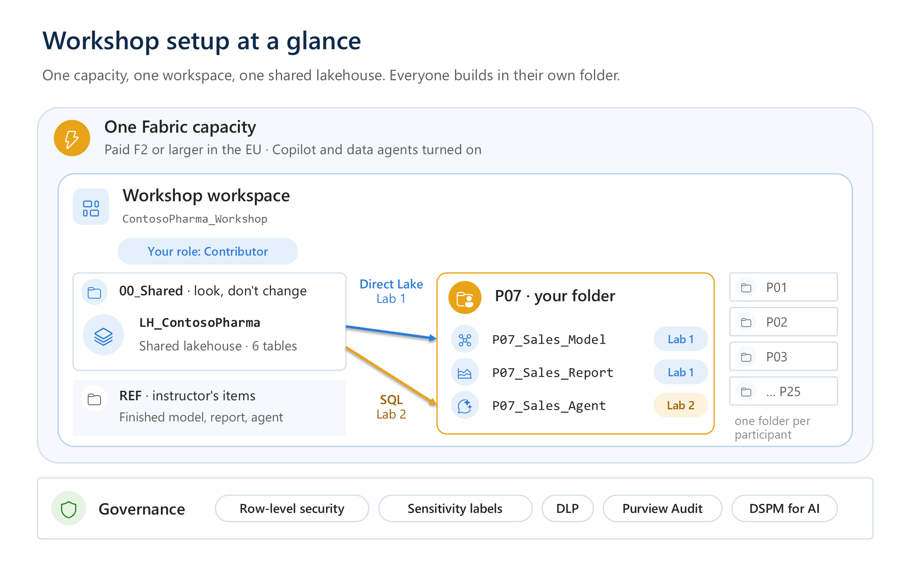

# Instructor setup

Complete these steps at least **one day before** the session. Then do a full dry run of both labs with a participant-like account.

This is the environment you build:



| When | Task | Time |
| --- | --- | --- |
| 1 week before | [1. Check licences and capacity](#1-check-licences-and-capacity) and [2. Check tenant settings](#2-check-tenant-settings) | 30 min (plus admin lead time) |
| 2 days before | [3. Create the workspace and folders](#3-create-the-workspace-and-folders) and [4. Create the lakehouse and upload the data](#4-create-the-lakehouse-and-upload-the-data) | 30 min |
| 1 day before | [5. Build the reference items](#5-build-the-reference-items) (dry run) and [6. Prepare the security demos](#6-prepare-the-security-demos) | 3–4 h |
| Session day | [7. During the session](#7-during-the-session) | — |
| After | [8. Clean up](#8-clean-up) | 15 min |

## 1. Check licences and capacity

- **Capacity:** a paid **F2 or higher** (or P1 or higher) capacity. Copilot and the Azure OpenAI features are **not available on trial SKUs** ([Copilot in Fabric overview](https://learn.microsoft.com/fabric/fundamentals/copilot-fabric-overview)). Data agents need the same: F2+ or P1+ ([Create a data agent](https://learn.microsoft.com/fabric/data-science/how-to-create-data-agent)).
- **Region:** a capacity inside the EU Data Boundary keeps Copilot processing in the EU. You don't need the cross-geo tenant settings ([Copilot in Fabric overview – available regions](https://learn.microsoft.com/fabric/fundamentals/copilot-fabric-overview#available-regions)).
- **Participant licences:** creating Power BI items (semantic models, reports) in a workspace other than *My workspace* requires a **Power BI Pro** (or PPU) licence ([Fabric licenses](https://learn.microsoft.com/fabric/enterprise/licenses)). A data agent is a non-Power BI Fabric item.
- **Capacity load:** Copilot and data agent AI usage are background operations, smoothed over 24 hours. The queries the agent runs are billed to the engine that runs them ([Data agent consumption](https://learn.microsoft.com/fabric/fundamentals/data-agent-consumption)). Microsoft doesn't publish sizing for a fixed number of concurrent users. Watch the [Capacity Metrics app](https://learn.microsoft.com/fabric/enterprise/metrics-app) during the dry run. Optionally, bill all workshop Copilot usage to one capacity by using a [Fabric Copilot capacity](https://learn.microsoft.com/fabric/enterprise/fabric-copilot-capacity).

## 2. Check tenant settings

Ask the Fabric administrator to confirm these settings for a security group that contains all participants. Path: **OneLake catalog** > **Govern** > **Configurations** > **Tenant settings**. Changes can take up to one hour to apply ([Data agent tenant settings](https://learn.microsoft.com/fabric/data-science/data-agent-tenant-settings)).

| Setting | Needed for | Source |
| --- | --- | --- |
| **Users can use Copilot and other features powered by Azure OpenAI** | Copilot, data agents (both labs) | [Data agent tenant settings](https://learn.microsoft.com/fabric/data-science/data-agent-tenant-settings) |
| Semantic model editing in the Power BI service (admin portal setting) | Lab 1, web modeling | [Edit semantic models in the service – admin portal](https://learn.microsoft.com/power-bi/transform-model/service-edit-data-models#enabling-semantic-model-editing-in-the-admin-portal) |
| **Allow users to apply sensitivity labels for content** | Applying labels (both labs) | [Information protection in Fabric](https://learn.microsoft.com/fabric/governance/information-protection) |
| **Allow Microsoft Purview to secure AI interactions** | Audit of data agent prompts and responses (Lab 2 demo) | [Data agent audit logging](https://learn.microsoft.com/fabric/data-science/data-agent-purview-governance) |
| **Capacities can be designated as Fabric Copilot capacities** (optional) | Separate billing of Copilot usage | [Fabric Copilot capacity](https://learn.microsoft.com/fabric/enterprise/fabric-copilot-capacity) |

Optional for the Lab 2 demo of Microsoft 365 Copilot: the Microsoft 365 admin must allow Copilot extensibility, and each user needs a Microsoft 365 Copilot licence ([Consume a data agent in Microsoft 365 Copilot](https://learn.microsoft.com/fabric/data-science/data-agent-microsoft-365-copilot)).

## 3. Create the workspace and folders

1. Create one workspace, `ContosoPharma_Workshop`. In **Workspace settings** > **License info**, assign the Fabric capacity.
2. If the workspace settings show **Users can edit data models in the Power BI service**, turn it on. Writing DAX queries in the browser needs it (Lab 1, step 4, other way), and it works together with the tenant setting for editing semantic models in the browser ([DAX query view in the web](https://learn.microsoft.com/power-bi/transform-model/dax-query-view#dax-query-view-in-web), [Workspace settings](https://learn.microsoft.com/power-bi/guidance/powerbi-implementation-planning-workspaces-workspace-level-planning#workspace-settings)).
3. Add the participants as **Contributor**, as one security group rather than individual users. Contributors can create semantic models, reports and data agents ([Roles in workspaces](https://learn.microsoft.com/fabric/fundamentals/roles-workspaces)).
4. Create the folders:

   | Folder | Contains |
   | --- | --- |
   | `00_Shared` | The shared lakehouse `LH_ContosoPharma` (step 4) |
   | `REF` | Your reference items (step 5) |
   | `GOV` | The DLP demo lakehouse `LH_Customer_Finance` (step 6). Participants don't use it |
   | `P01` … `P25` | One folder per participant |

   Use **New folder** in the workspace ([Create folders in workspaces](https://learn.microsoft.com/fabric/fundamentals/workspaces-folders)), or run the script. It calls the [Create Folder](https://learn.microsoft.com/rest/api/fabric/core/folders/create-folder) REST API:

   ```powershell
   az login
   python scripts/create_participant_folders.py --workspace-id <workspace-guid> --count 25
   ```

5. Hand out the IDs before the session and keep a sign-in sheet (ID ↔ name).

> Every participant is a Contributor, so anyone *could* change the shared lakehouse or the `REF` items. The [naming rules](../docs/naming-and-etiquette.md) forbid it, and you can reload a table in one minute (step 4.5).

## 4. Create the lakehouse and upload the data

1. Open the folder `00_Shared` and select **+ New item** > **Lakehouse**. Name it `LH_ContosoPharma`. Clear **Lakehouse schemas**, then select **Create**. The labs don't need schemas, so every tool shows the tables in one flat list ([Create a lakehouse](https://learn.microsoft.com/fabric/data-engineering/create-lakehouse)).
2. Download this repository (on GitHub: **Code** > **Download ZIP**) and unzip it.
3. In the lakehouse **Explorer**, select **…** next to **Files** > **Upload** > **Upload files**. Select the 6 files in [`data/parquet`](../data/parquet) and upload them.
4. For each file, select **…** > **Load to tables** > **New table**. Keep the suggested table name (for example `fact_sales`) and select **Load** ([Load to tables](https://learn.microsoft.com/fabric/data-engineering/load-to-tables)).

   Parquet files carry their column types, so dates load as dates and amounts as decimal numbers. With CSV files, **Load to tables** would infer the types, and you can't set them. The Direct Lake models in Lab 1 use these types as they are, and relationships need matching types ([Direct Lake overview – limitations](https://learn.microsoft.com/fabric/fundamentals/direct-lake-overview#considerations-and-limitations)).

5. Check: **Tables** shows `dim_customer`, `dim_date`, `dim_product`, `fact_sales`, `inventory_weekly` and `quality_complaints`. Expand `fact_sales`: `order_date` is a date and `net_sales_eur` a decimal number.

   If someone changes a table during the workshop: select the Parquet file > **Load to tables** > **Existing table** > **Overwrite**.

**Alternative with a notebook:** upload the CSV files from [`data`](../data) to **Files/contoso_pharma**, import [`load_lab_data.ipynb`](load_lab_data.ipynb), attach `LH_ContosoPharma` and select **Run all**. The notebook sets the column types explicitly.

## 5. Build the reference items

Do both labs yourself in the folder `REF`, with the names `REF_Sales_Model`, `REF_Sales_Report` and `REF_Sales_Agent`. Publish the agent. This dry run:

- confirms that Copilot in web modeling, Prep data for AI, Build agent with AI and the data agent visuals are available in your tenant. Several of these are previews.
- gives participants a fallback: anyone who falls behind can continue Lab 2 with `REF_Sales_Model`.
- creates audit records you can show in the governance demo. Audit data isn't instant.

What the dry run showed:

- A new model is saved in the workspace root, not in the open folder, both from the lakehouse ribbon and from **+ New item** > **Semantic model**. Move it with **…** > **Move to**.
- **Assume referential integrity** isn't selected by default in **New relationship**. Without it, every slicer shows an extra **(Blank)** item.
- The amount columns of a new model get a currency format that isn't always €; in the dry run it was £. Step 4a sets **Net Sales** to €.

`REF_Sales_Model` has seven measures more than the participants' models (for example **Units Sold** and **Net Sales YTD**). The labs use only the three KPIs from Lab 1, step 4.

## 6. Prepare the security demos

See [governance/README.md](../governance/README.md) for the full list. At minimum:

1. **RLS that holds, plus a test user:** a second account that is **not** a member of the workspace. RLS doesn't restrict workspace Admins, Members or Contributors ([Row-level security](https://learn.microsoft.com/fabric/security/service-admin-row-level-security)).
   - Bind `REF_Sales_Model` to a cloud connection that uses the workspace identity, and share `LH_ContosoPharma` with that identity only. Steps and screenshots: [governance – RLS that holds](../governance/README.md#rls-that-holds-fixed-identity). Without this, **Test as role** says *Not supported* (SSO), and readers need ReadAll on the lakehouse, which lets them bypass RLS in OneLake.
   - Add the test user to the `DACH` role of `REF_Sales_Model` (**…** > **Security**).
   - Share `REF_Sales_Report` (**Manage permissions** > **Direct access** > **Add user**, with *build content*) and `REF_Sales_Agent` (no extra permission) with the test user. Don't give the test user a workspace role or lakehouse access.
   - Check it: **…** > **Security** > **…** next to `DACH` > **Test as role** shows *Now viewing as: DACH*.
2. **Sensitivity label:** pick the label that participants should apply (for example *Confidential*). Confirm that participants can see it.
3. **Purview (DSPM and audit):** an account with access to Microsoft Purview Audit and DSPM. Complete the DSPM setup tasks and pay-as-you-go billing, and optionally connect DSPM to Fabric for data risk assessments ([purview-demo.md – prerequisites](../governance/purview-demo.md#prerequisites-for-dspm)).
4. **DLP policy and demo data:** create the folder `GOV` with the lakehouse `LH_Customer_Finance` and its synthetic IBAN table, then run [create-dlp-policy.ps1](../governance/scripts/create-dlp-policy.ps1). Do it at least an hour before the demo, then reload the table once so that DLP evaluates it ([purview-demo.md – seed and policy](../governance/purview-demo.md#seed-the-demo-data)).
5. **Sharing between participants:** every participant is a Contributor in the workspace, so the data agent share options (**View details**, **Edit and view details**) don't restrict them from each other. The options apply to people without a workspace role. Show the real effect with the test user from item 1.

## 7. During the session

- Show the participant ID and the naming rules on screen at all times.
- Keep the Capacity Metrics app open in a second window.
- If Copilot or a preview feature isn't available to someone, use the manual fallback in the lab guide and continue.
- If someone breaks their model: restore it from **Version history** ([Semantic model version history](https://learn.microsoft.com/power-bi/transform-model/service-semantic-model-version-history)), or switch them to `REF_Sales_Model` in the `REF` folder.
- If someone changes a table in the shared lakehouse: reload it (step 4.5).

## 8. Clean up

1. Delete the items in the participant folders, then the folders. A folder can only be deleted when it's empty.
2. Remove the DLP policy and the `GOV` folder ([purview-demo.md – clean up](../governance/purview-demo.md#clean-up-after-the-workshop)). Remove the test user from the `DACH` role and from the report, agent and model permissions. Delete the cloud connection in **Manage connections and gateways**.
3. Delete the workspace when you no longer need it.
4. Pause the Fabric capacity in the Azure portal when the workshop is over. A paused capacity stops billing; nothing in the workspace runs until you resume it ([Pause and resume your capacity](https://learn.microsoft.com/fabric/enterprise/pause-resume)).

## Features used and their status

Status is taken from Microsoft Learn on 13 October 2026.

| Feature | Lab | Status | Source |
| --- | --- | --- | --- |
| Load to tables (lakehouse) | Setup | Available | [Load to tables](https://learn.microsoft.com/fabric/data-engineering/load-to-tables) |
| Direct Lake semantic models in web modeling | 1 | Available | [Direct Lake in web modeling](https://learn.microsoft.com/fabric/fundamentals/direct-lake-web-modeling) |
| Copilot in web modeling | 1 | Preview | [Copilot in web modeling](https://learn.microsoft.com/power-bi/transform-model/copilot-web-modeling) |
| Measure descriptions with Copilot | 1 | Available | [Measure descriptions with Copilot](https://learn.microsoft.com/power-bi/transform-model/desktop-measure-copilot-descriptions) |
| Prep data for AI (AI data schema, AI instructions, verified answers) | 1, 2 | Preview | [Prepare your data for AI](https://learn.microsoft.com/power-bi/create-reports/copilot-prepare-data-ai) |
| Copilot report creation and the narrative visual | 1 | Available | [Create reports with Copilot](https://learn.microsoft.com/power-bi/create-reports/copilot-create-reports) |
| Anomaly detection, key influencers, decomposition tree, forecast | 1 | Available | [Anomaly detection](https://learn.microsoft.com/power-bi/visuals/power-bi-visualization-anomaly-detection) |
| Fabric data agent | 2 | GA | [Data agent concepts](https://learn.microsoft.com/fabric/data-science/concept-data-agent) |
| Build agent with AI | 2 | Preview | [Build agent with AI](https://learn.microsoft.com/fabric/data-science/data-agent-creator-agent-overview) |
| Data agent visuals | 2 | GA | [Visual responses](https://learn.microsoft.com/fabric/data-science/data-agent-visuals) |
| Data agent preview runtime | 2 | Preview | [Data agent runtime](https://learn.microsoft.com/fabric/data-science/data-agent-runtime) |
| Data agent as an MCP server | 2 | Available | [Data agent MCP server](https://learn.microsoft.com/fabric/data-science/data-agent-mcp-server) |
| Data agent evaluation SDK | 2 | Preview | [Evaluate your data agent](https://learn.microsoft.com/fabric/data-science/evaluate-data-agent) |
| Purview audit and DSPM for Fabric data agents | 2 | Preview | [Data agent audit logging](https://learn.microsoft.com/fabric/data-science/data-agent-purview-governance) |
